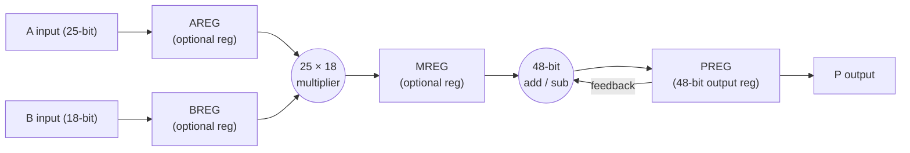
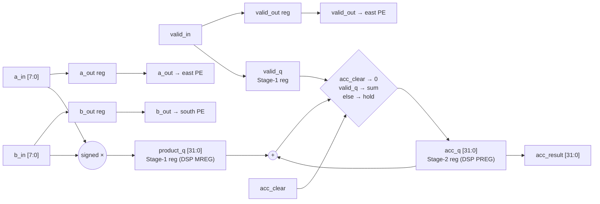
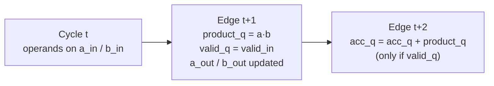

# Module 1 — `pe_int8`: The INT8 Multiply-Accumulate Processing Element

| Item | Value |
|---|---|
| RTL file | [src/pe_int8.sv](../src/pe_int8.sv) |
| Golden model | `pe_golden_int8()` in [golden/golden_model.py](../golden/golden_model.py#L39) |
| Testbench | [tb/test_pe_int8.py](../tb/test_pe_int8.py) |
| Used by | `systolic_array.sv` (64 copies in an 8×8 array) |
| Role in the project | Baseline compute cell. Every later PE (`pe_mixed`) and array is measured against it. |

---

## 1. What this module is and why I built it first

The processing element (PE) is the smallest building block of my accelerator. It
does one job: it multiplies two 8-bit numbers and adds the result to a running
total. This operation is called a **multiply-accumulate (MAC)**.

I built this module first because everything else in my design depends on it.
The systolic array is just many copies of this PE wired together, and the
mixed-precision and sparsity features are extensions of it. If the PE is slow or
large, the whole array is slow or large. That is why I spent the most effort
getting this single block right before scaling up.

---

## 2. Theory

### 2.1 Why neural networks need MAC operations

Most of the work in a neural network layer is a matrix multiplication. A fully
connected layer or a convolution (after reshaping) computes:

$$
C = A \times B
$$

where $A$ holds the input activations and $B$ holds the weights. Every single
output element is a **dot product** of one row of $A$ and one column of $B$:

$$
C[i][j] = \sum_{k=0}^{K-1} A[i][k] \cdot B[k][j]
$$

If I look closely, this sum is just one operation repeated $K$ times:

$$
\text{acc} \leftarrow \text{acc} + a \cdot b
$$

This is the MAC. For an $M \times K$ by $K \times N$ matrix multiplication I need
$M \cdot N \cdot K$ MACs. For real networks that is billions of MACs per image, so
the hardware that does the MAC must be small, fast and power-efficient. Making
this one operation efficient is the core of the whole accelerator.

### 2.2 Why INT8 instead of floating point

Training uses 32-bit floating point, but for inference it is well known that
weights and activations can be **quantized** to 8-bit integers with very little
loss in accuracy. I chose INT8 for the baseline because:

- An 8×8 integer multiplier is much smaller and faster than a 32-bit
  floating-point multiplier.
- Each operand takes 4× less memory and bandwidth than FP32.
- INT8 is the industry-standard inference format (Google TPU, NVIDIA Tensor
  Cores, ARM NPUs all support it), so my results can be compared with them.

### 2.3 Signed numbers: two's complement

My operands are **signed**, because weights and activations can be negative. I
use two's complement, the standard way hardware stores signed integers. An 8-bit
two's complement number ranges from **−128 to +127**. The top bit (bit 7) is the
sign bit, with weight $-2^7$:

$$
\text{value} = -b_7 \cdot 2^7 + \sum_{i=0}^{6} b_i \cdot 2^i
$$

Example: `8'b1111_1110` = −128 + 64 + 32 + 16 + 8 + 4 + 2 = **−2**.

This matters in the RTL. In SystemVerilog a `logic [7:0]` is **unsigned** by
default. If I multiply two of them directly, `8'hFE × 8'h02` gives 254 × 2 = 508
instead of −2 × 2 = −4. So I must tell the tool the operands are signed. I do
this with `$signed()` (see Section 5.4).

### 2.4 How wide must the product and the accumulator be?

**Product width.** The largest product magnitude comes from the two most
negative values:

$$
(-128) \times (-128) = +16384, \qquad (-128) \times 127 = -16256
$$

So every product fits in the range $[-16256, +16384]$, which needs **16 signed
bits**. In general an $n$-bit × $n$-bit signed multiply needs $2n$ bits.

**Accumulator width.** The accumulator adds up $K$ products. In the worst case
each one is $2^{14}$, so the sum can reach $K \cdot 2^{14}$. The bits I need are:

$$
\text{bits}_{acc} = 16 + \lceil \log_2 K \rceil
$$

For my 8×8 array, $K = 8$, so I only need 19 bits. I chose **32 bits** anyway.
With 32 bits I can safely add up to $2^{31} / 2^{14} = 131{,}072$ worst-case
products before any risk of overflow. This means:

- The same PE works for much deeper dot products (large $K$, or many tiles
  accumulated in place) without redesign.
- 32 bits is the standard INT8 accumulator width (TPU and others use INT32), so
  my results line up with standard quantized inference.
- On the FPGA the accumulator sits inside the DSP48's 48-bit adder, so the extra
  width costs nothing in area.

If the sum ever went past 32 bits, the accumulator would **wrap around** (two's
complement overflow) and would not saturate. I chose wrap-around because
saturation needs extra comparison logic on the critical path, and with 32 bits
overflow cannot happen for any realistic $K$. My golden model also wraps, so
hardware and reference always agree bit for bit.

### 2.5 Output-stationary dataflow (what the PE expects from its neighbours)

A PE does not work alone. It sits in a grid, and data moves through it. I use the
**output-stationary** dataflow:

- The **A** value (activation) enters from the **west** and is passed to the
  **east** neighbour one clock later.
- The **B** value (weight) enters from the **north** and is passed to the
  **south** neighbour one clock later.
- The **C** result (the accumulator) **stays inside** the PE until the whole dot
  product is finished.

So besides doing the MAC, my PE also has to **forward** its inputs to its
neighbours with exactly one clock of delay. That one-clock forwarding is a
contract with the array. If I changed it, the timing of the whole grid would
break. I explain the full array dataflow in the `systolic_array` document. For
the PE, all I need to know is: *forward A and B after exactly one cycle, and keep
C local.*

I chose output-stationary because each partial sum is added in place and never
travels. Partial sums are 32 bits wide while operands are only 8 bits, so not
moving the 32-bit values saves the most wiring and switching power.

### 2.6 Pipelining and maximum clock frequency

The maximum clock frequency of a synchronous circuit is set by its slowest
register-to-register path, the **critical path**:

$$
F_{max} = \frac{1}{T_{clk \to q} + T_{logic} + T_{setup}}
$$

A MAC done in a single cycle has a long path: *register → 8×8 multiplier → 32-bit
adder → register*. The multiplier and the adder are both slow, and here they sit
back to back in one cycle.

**Pipelining** breaks this long path by putting a register in the middle:

- Cycle 1: multiply, and store the product in a register (`product_q`).
- Cycle 2: add the stored product to the accumulator.

Now each cycle only has to cover *either* the multiply *or* the add, so the
clock can run much faster. The price is **one extra cycle of latency**: the
final result appears one clock later. For a dot product that takes $K$ cycles
anyway, one extra cycle is a very small cost.

### 2.7 The FPGA DSP48E1 block

My FPGA target is a Xilinx Kintex-7 (`xc7k70t`). It has dedicated hard
arithmetic blocks called **DSP48E1** slices. They are much faster and more
power-efficient than building a multiplier out of LUTs. A simplified view:



The important points for my design:

- My 8×8 multiply easily fits the 25×18 multiplier.
- My 32-bit accumulator fits the 48-bit ALU and the P register.
- The **PREG feedback path** lets one DSP do `P = P + A×B`. This is exactly a MAC,
  in one block, with no general fabric logic.
- The **MREG** register sits right after the multiplier. My pipeline register
  `product_q` maps onto it, so pipelining costs no extra flip-flops.
- DSP registers support **synchronous reset only**. If I used an asynchronous
  reset, Vivado could not pack my registers into the DSP. This is why my PE uses
  a synchronous reset.

So my goal for the RTL was: **write it so that Vivado maps each PE to exactly one
fully pipelined DSP48E1** (MREG = 1, PREG = 1). Section 7 shows how many attempts
this took.

---

## 3. Interface

### 3.1 Parameters

| Parameter | Default | Meaning |
|---|---|---|
| `DATA_WIDTH` | 8 | Width of each operand (A and B). Signed. |
| `ACC_WIDTH` | 32 | Width of the accumulator and the result. Signed. |

### 3.2 Ports

| Port | Dir | Width | Description |
|---|---|---|---|
| `clk` | in | 1 | Clock. All registers update on the rising edge. |
| `rst` | in | 1 | Synchronous, active-high reset. Clears every register. |
| `valid_in` | in | 1 | High when `a_in`/`b_in` carry a real operand pair to accumulate. |
| `acc_clear` | in | 1 | Synchronously zeroes the accumulator to start a new dot product (new tile). |
| `a_in` | in | 8 | Activation operand, arriving from the west. |
| `b_in` | in | 8 | Weight operand, arriving from the north. |
| `a_out` | out | 8 | `a_in` delayed by 1 cycle, sent to the east neighbour. |
| `b_out` | out | 8 | `b_in` delayed by 1 cycle, sent to the south neighbour. |
| `valid_out` | out | 1 | `valid_in` delayed by 1 cycle, travels east together with A. |
| `acc_result` | out | 32 | The running dot-product result C[i][j]. |

**Why the valid signal travels with A.** In the array, the edge of the grid
starts feeding data at staggered times. A PE must not add garbage before its real
data arrives or after it ends. So I attach a `valid` bit to the A stream. It
moves east with A, cycle by cycle, and each PE accumulates only when its valid
bit is high.

---

## 4. Microarchitecture

### 4.1 Block diagram



### 4.2 The three groups of registers

I think of the PE as three independent groups of registers that all update on
the same clock edge:

| Group | Registers | Purpose |
|---|---|---|
| Forwarding | `a_out`, `b_out`, `valid_out` | Move data to neighbours, 1-cycle delay. |
| Stage 1 (multiply) | `product_q`, `valid_q` | Hold the product and its valid bit for one cycle. |
| Stage 2 (accumulate) | `acc_q` | The running sum. Updated from Stage 1's outputs. |

The forwarding path and the MAC pipeline are **separate**. This is the key idea
of my design. I added a pipeline stage to the MAC, but I did **not** add any delay
to the forwarding path. So the array's timing (the "skew") is unchanged, and only
the final result appears one cycle later.

### 4.3 Pipeline view



---

## 5. RTL implementation walkthrough

### 5.1 Internal signals — [pe_int8.sv L39-L46](../src/pe_int8.sv#L39-L46)

```systemverilog
logic signed [ACC_WIDTH-1:0] product_q;
logic                        valid_q;
(* use_dsp = "yes" *) logic signed [ACC_WIDTH-1:0] acc_q;

assign acc_result = acc_q;
```

- `product_q` is the Stage-1 pipeline register. I declared it `signed` and
  `ACC_WIDTH` wide so that the product is **sign-extended** to 32 bits before the
  add. If I made it unsigned, a negative product like −4 would be added as a huge
  positive number.
- `valid_q` is the valid bit delayed by one cycle, so it stays lined up with
  `product_q`. Without it, the accumulator would use the valid bit of the *next*
  operand pair, one cycle too early.
- `acc_q` is the accumulator. The `(* use_dsp = "yes" *)` attribute tells Vivado
  to build the logic around this register in a DSP block. I put the attribute on
  this **internal register**, not on the whole module. This placement decides
  between one and two DSPs per PE (Section 7).
- The output `acc_result` is just a wire to `acc_q`. I kept the attribute on an
  internal signal rather than on the output port, so the port declaration stays
  clean.

### 5.2 Synchronous reset — [pe_int8.sv L48-L55](../src/pe_int8.sv#L48-L55)

```systemverilog
always_ff @(posedge clk) begin
    if (rst) begin
        a_out     <= '0;
        b_out     <= '0;
        valid_out <= 1'b0;
        product_q <= '0;
        valid_q   <= 1'b0;
        acc_q     <= '0;
    end else begin
```

The sensitivity list has only `posedge clk`, with no `posedge rst`. This makes
the reset **synchronous**. I did this on purpose: DSP48E1 internal registers only
support synchronous reset. With an asynchronous reset, Vivado would have to keep
`acc_q` and `product_q` in general flip-flops outside the DSP, and the fast
MREG/PREG path would be lost.

### 5.3 Systolic forwarding — [pe_int8.sv L57-L60](../src/pe_int8.sv#L57-L60)

```systemverilog
a_out     <= a_in;
b_out     <= b_in;
valid_out <= valid_in;
```

These are plain one-cycle delays. They have nothing to do with the MAC result;
they just pass data on to the neighbours. In the array, a chain of these
registers is what creates the diagonal "wavefront" of data.

### 5.4 Stage 1: multiply — [pe_int8.sv L62-L64](../src/pe_int8.sv#L62-L64)

```systemverilog
product_q <= $signed(a_in) * $signed(b_in);
valid_q   <= valid_in;
```

- `$signed()` makes the multiply a **signed** multiply. Both operands must be
  signed. In SystemVerilog, if even one operand is unsigned, the whole expression
  is treated as unsigned.
- The 16-bit signed product is sign-extended to 32 bits automatically, because
  the target `product_q` is a 32-bit signed variable.
- I multiply `a_in`/`b_in` (the inputs), **not** `a_out`/`b_out`. If I used the
  registered copies, the multiply would see each operand one cycle late.

### 5.5 Stage 2: accumulate — [pe_int8.sv L66-L70](../src/pe_int8.sv#L66-L70)

```systemverilog
if (acc_clear)
    acc_q <= '0;
else if (valid_q)
    acc_q <= acc_q + product_q;
```

- I use `valid_q`, the **delayed** valid, not `valid_in`. It belongs to the
  product that is in `product_q` right now.
- `acc_clear` has **priority** over accumulating. When a new tile starts, I want
  a clean zero, whatever else is happening.
- When neither is true, `acc_q` keeps its value. That "hold" is a clock-enable,
  which the DSP's P register supports directly (CEP pin).

**One subtle consequence of the clear priority.** If a valid product is still
sitting in `product_q` on the same clock edge where `acc_clear` is high, that
product is dropped. So the correct protocol is **clear, then stream**: assert
`acc_clear` before (or in the same cycle as) the first valid operand of the new
tile, never while the previous tile's last product is still in the pipeline.
Clearing in the same cycle as the first new operand is safe, because that
operand's product only reaches `acc_q` on the *next* edge.

### 5.6 Why this exact RTL style gives one DSP per PE

Vivado's DSP inference looks for a recognizable pattern:
*register → multiply → register → add-with-feedback → register.* My code matches
it exactly:

| My RTL | DSP48E1 resource |
|---|---|
| `$signed(a_in) * $signed(b_in)` | 25×18 multiplier |
| `product_q` | MREG |
| `acc_q + product_q`, fed back into `acc_q` | ALU in accumulate mode (P + M) |
| `acc_q` | PREG |
| `acc_clear` → `'0` | Synchronous reset of P (RSTP) |
| hold when `!valid_q` | P clock enable (CEP) |

Vivado also pulled the neighbouring forwarding registers (`a_out`, `b_out`)
into the DSP's AREG/BREG input registers (this is **register retiming**). That
is why the final flip-flop count is so low.

---

## 6. Timing behaviour — a worked example

Let me compute the dot product $3 \cdot 4 + (-2) \cdot 5 + 7 \cdot (-1) = 12 - 10 - 7 = -5$.

Inputs are applied before each rising edge. The table shows the register values
**after** that edge.

| Edge | `a_in` | `b_in` | `valid_in` | `acc_clear` | `product_q` | `valid_q` | `acc_q` | Comment |
|---|---|---|---|---|---|---|---|---|
| 1 | 0 | 0 | 0 | 1 | 0 | 0 | **0** | Clear the accumulator |
| 2 | 3 | 4 | 1 | 0 | 12 | 1 | 0 | First product captured |
| 3 | −2 | 5 | 1 | 0 | −10 | 1 | 12 | 12 added |
| 4 | 7 | −1 | 1 | 0 | −7 | 1 | 2 | −10 added |
| 5 | 0 | 0 | 0 | 0 | 0 | 0 | **−5** | −7 added → final result |
| 6 | 0 | 0 | 0 | 0 | 0 | 0 | −5 | Held (valid_q = 0) |

Things to notice:

- Each product reaches `acc_q` **one edge after** its operands were applied.
  That is the pipeline latency.
- The last operand pair went in at edge 4, but the final result is ready at
  edge 5. In total, a $K$-term dot product is ready **$K + 1$ cycles** after the
  first operand.
- `a_out`/`b_out` (not shown) simply equal the previous edge's `a_in`/`b_in`.
  They are **not** delayed by the pipeline.

---

## 7. Design decisions and trade-offs — how I got to the final PE

I did not get the optimal PE on the first try. I synthesized the full 8×8 array
(out-of-context, `xc7k70t-1`, 4.0 ns target = 250 MHz) after each change. This
history is the main justification for the final RTL style.

| Version | What I changed | LUTs | FFs | DSP48 | WNS (ns) | Fmax (MHz) |
|---|---|---|---|---|---|---|
| v1: fabric MAC | Plain single-cycle `acc <= acc + a*b` | ~9,600 | 3,008 | 0 | −1.410 | ~185 |
| v2: forced DSP, no pipeline | `use_dsp="yes"` on module, sync reset | 1 | 704 | 128 | −1.801 | ~172 |
| v3: pipelined | Added `product_q` register | 1 | 704 | 128 | +0.969 | ~330 |
| **v4: fused (final)** | Moved `use_dsp` to internal `acc_q` | **2** | **344** | **64** | **+2.024** | **~506** |

**v1 — fabric MAC (185 MHz).** Vivado built the 8×8 multipliers out of LUTs and
carry chains, using about 150 LUTs per PE and no DSPs. It failed 250 MHz because
the multiply and the add were in one long combinational path.

**v2 — forced DSP, no pipeline (172 MHz, worse!).** I forced the DSPs with
`use_dsp` on the module. LUTs dropped to almost zero, but timing got **worse**.
The DSPs were unpipelined (MREG = 0), and because the attribute was on the whole
module, Vivado used **two DSPs per PE**: one for `A×B` and a second for the
add. The signal had to cross from one DSP to the other through general routing in
the same cycle. **Lesson: just forcing DSPs does not fix timing. The critical
path itself must be broken.**

**v3 — pipelined (330 MHz).** Adding the `product_q` register split the multiply
and the add into separate cycles and turned on the DSP's MREG. Timing passed with
lots of margin. This was **the fix that actually mattered for speed**. But it
still used two DSPs per PE.

**v4 — fused single-DSP MAC (506 MHz, final).** I moved the `use_dsp` attribute
from the module onto the internal `acc_q` register. Now Vivado saw a single
`P = P + A×B` pattern and built **one DSP per PE**, with both MREG and PREG on.
The DSPs also absorbed the forwarding registers, so FFs fell from 704 to 344. The
result is about **2× my 250 MHz target**, with half the DSPs.

**Why one DSP per PE matters for scaling.** The `xc7k70t` has only 240 DSP48E1
slices. With two DSPs per PE, even a 11×11 array would not fit. With one DSP per
PE, the 8×8 array uses 64 (27 %), which leaves room for the mixed-precision and
sparsity logic I add later.

**Other decisions:**

| Decision | Alternative I rejected | Reason |
|---|---|---|
| Synchronous reset | Asynchronous reset | DSP48 registers only support sync reset, and async would block DSP packing. |
| 32-bit accumulator | 19-bit (exact minimum for K = 8) | Allows deep K and tiling; standard INT32; free inside the 48-bit DSP ALU. |
| Wrap-around | Saturation | Saturation adds compare logic on the critical path; overflow is impossible at 32 bits for realistic K. |
| Pipeline only the MAC | Pipeline the forwarding too | Keeps the array skew at 1 cycle/hop; only the result latency grows (+1 cycle). |
| `valid_q` alignment register | Use `valid_in` directly | Without it, the valid and the product would be one cycle apart, so wrong products would be added. |
| `use_dsp` on `acc_q` | `use_dsp` on the module | Module-level forces 2 DSPs/PE; register-level lets Vivado fuse to 1. |

---

## 8. Verification

### 8.1 Golden model

[`pe_golden_int8()`](../golden/golden_model.py#L39) is a pure-Python,
bit-accurate model of one MAC step:

```python
acc_out = to_signed(acc_in + to_signed(a, 8) * to_signed(b, 8), 32)
```

`to_signed()` reproduces two's-complement interpretation and wrap-around, so the
Python result matches the hardware bit for bit, even if overflow ever happened.

### 8.2 Cycle-accurate shadow model

A plain golden function does not know about the pipeline. So in the testbench I
wrote a `PEModel` class that copies the RTL's register behaviour: on each clock
it updates the accumulator using the **previous** cycle's product and valid,
with `acc_clear` taking priority. After every clock edge, the testbench compares
the RTL to the model for `acc_result`, `a_out`, `b_out` and `valid_out`. Any
mismatch stops the test straight away.

### 8.3 Tests

| Test | What it checks | Size |
|---|---|---|
| `test_pe_directed_corners` | Every combination of {0, 1, −1, 127, −128} for A and B, each accumulated 4 times. Covers sign handling and the largest product (−128 × −128). | 25 combinations |
| `test_pe_random_mac` | 100 random signed operand pairs accumulated back to back. | 100 MACs |
| `test_pe_valid_gating_and_clear` | Random `valid_in` (60 % high) and random `acc_clear` (5 %). Checks that invalid data is never added and that clear always wins. | 200 cycles |

The testbench is written in cocotb (Python). I run it with `make TEST=pe` in
`tb/`. The random seed comes from `TB_SEED`, so any failure can be replayed
exactly.

---

## 9. Implementation results

### 9.1 FPGA (Vivado, Kintex-7 `xc7k70tfbv676-1`, 8×8 array, out-of-context)

| Metric | Value |
|---|---|
| DSP48E1 | 64 (1 per PE), MREG = 1, PREG = 1 |
| LUTs | 2 |
| Flip-flops | 344 |
| WNS at 4.0 ns | +2.024 ns |
| Fmax (estimated) | ~506 MHz |
| Result latency | K + 1 cycles (+1 for the MAC pipeline) |

### 9.2 ASIC (Yosys + OpenSTA, FreePDK45, single PE)

| Metric | Value |
|---|---|
| Standard cells | 734 |
| Flip-flops (`DFFPOSX1`) | 65 |
| Cell area | 2,417.8 (library area units, µm²) |
| Critical-path arrival | 2.113 ns |
| Setup slack at 4.0 ns | +1.828 ns (MET) |

The ASIC netlist has **65** flip-flops, not the 82 I would count from the RTL
(8 + 8 + 1 + 32 + 1 + 32). Yosys found two kinds of duplicate registers and
merged them:

- `valid_out` and `valid_q` are both loaded from `valid_in` every cycle, so they
  are the same register (−1).
- The top 16 bits of `product_q` are only sign-extension copies of bit 15, so only
  16 product bits really need storing (−16).

8 + 8 + 1 + 16 + 32 = **65**. This matches the report.

ASIC power is not quoted here because it needs a SAIF activity file from
simulation. I report it in the implementation-results chapter.

---

## 10. Report-ready summary

> The processing element (PE) is the basic compute unit of the accelerator. It
> performs a signed INT8 multiply-accumulate, $acc \leftarrow acc + a \cdot b$,
> into a 32-bit two's-complement accumulator. It also forwards its activation
> operand east and its weight operand south with a one-cycle delay, to implement
> an output-stationary systolic dataflow. I implemented the MAC as a two-stage
> pipeline: the product is registered in the first stage and accumulated in the
> second. This split removes the multiplier-plus-adder critical path, at the cost
> of one extra cycle of result latency. Because the forwarding registers are kept
> separate from the MAC pipeline, the array's one-cycle-per-hop skew is
> unchanged. A synchronous reset and a register-level `use_dsp` attribute on the
> internal accumulator let Vivado map each PE onto a single, fully pipelined
> DSP48E1 slice (MREG = PREG = 1) in a fused `P = P + A×B` configuration. Across
> four design iterations on a Kintex-7 device, the 8×8 array improved from about
> 185 MHz with roughly 9,600 LUTs (fabric MAC) to about 506 MHz using 64 DSPs,
> 2 LUTs and 344 flip-flops. That is about twice the 250 MHz target. I verified
> the PE against a bit-accurate Python golden model, using a cycle-accurate
> shadow model across directed corner cases, random MAC sequences, and random
> valid and clear patterns.

---

## 11. References

1. H. T. Kung and C. E. Leiserson, "Systolic Arrays (for VLSI)," *Sparse Matrix Proceedings*, SIAM, 1978.
2. N. P. Jouppi et al., "In-Datacenter Performance Analysis of a Tensor Processing Unit," *Proc. ISCA*, 2017.
3. B. Jacob et al., "Quantization and Training of Neural Networks for Efficient Integer-Arithmetic-Only Inference," *Proc. CVPR*, 2018.
4. AMD/Xilinx, *7 Series DSP48E1 Slice User Guide*, UG479.
5. AMD/Xilinx, *Vivado Design Suite User Guide: Synthesis*, UG901 (`USE_DSP` attribute, DSP inference coding styles).

---

### Figures to export for the Word report

| Figure | Source | Suggested caption |
|---|---|---|
| Fig. 1.1 | Section 2.7 Mermaid block | Simplified DSP48E1 slice used for the fused MAC |
| Fig. 1.2 | Section 4.1 Mermaid block | Microarchitecture of the INT8 processing element |
| Fig. 1.3 | Section 4.3 Mermaid block | Two-stage MAC pipeline timing |
| Table 1.x | Section 6 table | Cycle-by-cycle accumulation example |
| Table 1.y | Section 7 table | PE design iterations and their FPGA results |
