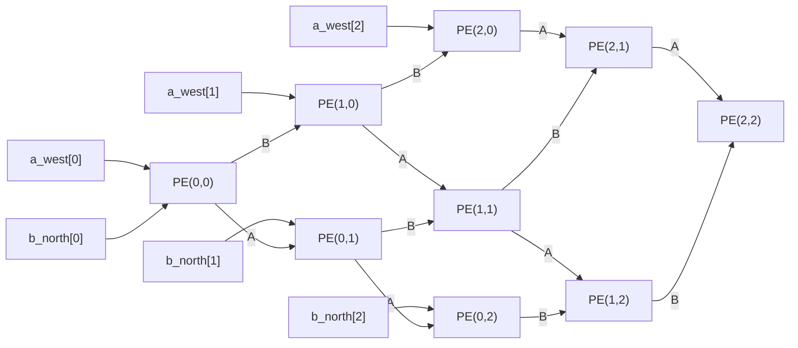
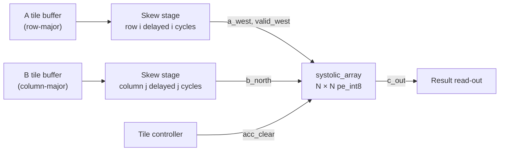

# Module 2 — `systolic_array`: The N×N Output-Stationary INT8 Systolic Array

| Item | Value |
|---|---|
| RTL file | [src/systolic_array.sv](../src/systolic_array.sv) |
| Building block | `pe_int8` (see [01_pe_int8.md](01_pe_int8.md)) |
| Golden model | `gemm_golden()` in [golden/golden_model.py](../golden/golden_model.py#L56) |
| Testbench | [tb/test_systolic_array.py](../tb/test_systolic_array.py) |
| Default size | N = 8 → 64 PEs |
| Role in the project | **Baseline accelerator.** The mixed-precision and sparse arrays are compared against it. |

---

## 1. What this module is and why I need it

One PE computes one dot product. A matrix multiplication $C = A \times B$ with
$N \times N$ outputs needs $N^2$ dot products. If I compute them one after
another on a single PE, it takes $N^2 \cdot K$ cycles. That is far too slow.

The systolic array solves this. I place $N \times N$ PEs in a grid and let every
PE work on **its own output element at the same time**. PE$(i,j)$ is responsible
for $C[i][j]$. With 64 PEs, I do 64 MACs every clock cycle instead of one.

The difficulty is not the arithmetic, which the PE already does. The difficulty
is **getting the right operands to the right PE at the right time**, without
giving every PE its own wide connection to memory. This module solves that
problem with the systolic dataflow.

---

## 2. Theory

### 2.1 What "systolic" means

The word comes from the heart: a *systole* is the contraction that pumps blood
in rhythmic pulses. In a systolic array, data is pumped through a regular grid of
simple cells, one hop per clock. Each cell:

1. receives data from its neighbours,
2. does a small computation, and
3. passes the data on to the next neighbour.

The concept was introduced by H. T. Kung and C. E. Leiserson in 1978. It became
famous again when Google built the TPU around a 256×256 systolic array.

The key benefit is **data reuse through neighbour-to-neighbour links**:

- Each value $A[i][k]$ is read from memory **once**, at the west edge, and then
  used by all $N$ PEs in row $i$ as it travels east.
- Each value $B[k][j]$ is read **once**, at the north edge, and used by all $N$
  PEs in column $j$ as it travels south.

So the array performs $N^2$ MACs per cycle while reading only $2N$ values per
cycle from memory. For $N = 8$, that is 64 MACs for 16 values: a **4× reduction
in memory bandwidth** compared with feeding each PE separately. The ratio grows
with $N$, which is why large arrays are so efficient.

Also, every connection is **short and local** (PE to its direct neighbour). There
are no long wires and no global buses for the operands, so the clock can run fast
even as the array grows.

### 2.2 Dataflow choices: which data stays still?

In a systolic array, one of the three matrices stays inside the PEs while the
other two move. There are three classic options:

| Dataflow | What stays in the PE | What moves | Used by |
|---|---|---|---|
| Weight-stationary (WS) | Weights $B$ | $A$ moves, partial sums move | Google TPU v1 |
| Input-stationary (IS) | Activations $A$ | $B$ moves, partial sums move | Some CNN accelerators |
| **Output-stationary (OS)** | **Results $C$** | **$A$ and $B$ move** | ShiDianNao, many FPGA designs |

I chose **output-stationary** for these reasons:

1. **The 32-bit partial sums never move.** Only the 8-bit operands travel. Moving
   8-bit values instead of 32-bit values means 4× fewer wires switching between
   PEs, which saves routing and dynamic power.
2. **The accumulator stays inside the DSP.** In my PE the accumulator is the DSP's
   P register with internal feedback. In WS or IS designs, the partial sum has to
   leave the PE every cycle to go to the next PE, which would break that fused
   DSP structure.
3. **K is unlimited.** The PE just keeps accumulating, so the depth of the dot
   product does not depend on the array size. A WS array must split large K into
   chunks and add the pieces together afterwards.
4. **It suits my later features.** Mixed precision (two INT4 MACs per cycle) and
   sparsity (skipping zero weights) both change *how many* products are added
   per cycle. With OS, that is a purely local change inside each PE.

The cost of OS is that the results are spread across all PEs, and reading them
out takes either a very wide output bus or a separate drain phase (Section 7.4).

### 2.3 How the matrix multiplication maps onto the grid

$$
C[i][j] = \sum_{k=0}^{K-1} A[i][k] \cdot B[k][j]
$$

- **Row $i$ of A** enters the west edge of **row $i$** of the grid, one $k$ per
  cycle, and flows east.
- **Column $j$ of B** enters the north edge of **column $j$** of the grid, one
  $k$ per cycle, and flows south.
- PE$(i,j)$ is crossed by row $i$ of A and column $j$ of B, so it sees exactly the
  two vectors it needs for $C[i][j]$.

### 2.4 Why the inputs must be skewed

There is a timing problem. $A[i][k]$ needs $j$ cycles to travel from the west edge
to column $j$, and $B[k][j]$ needs $i$ cycles to travel from the north edge to row
$i$. If I injected all rows and all columns at the same time, the matching pair
$A[i][k]$ and $B[k][j]$ would arrive at PE$(i,j)$ at **different** cycles, and the
PE would multiply the wrong numbers.

The fix is to **skew** (delay) the inputs at the edges:

- Row $i$ of A is injected $i$ cycles late. So $A[i][k]$ enters at cycle $i + k$.
- Column $j$ of B is injected $j$ cycles late. So $B[k][j]$ enters at cycle $j + k$.

Now let me check the arrival times at PE$(i,j)$:

$$
t_A = \underbrace{(i + k)}_{\text{inject}} + \underbrace{j}_{\text{hops east}}
\qquad
t_B = \underbrace{(j + k)}_{\text{inject}} + \underbrace{i}_{\text{hops south}}
$$

$$
t_A = t_B = i + j + k
$$

Both operands arrive at **the same cycle**. This is the central timing equation
of my array.

### 2.5 The wavefront picture

Because the arrival time is $i + j + k$, all PEs with the same $i + j$ (the same
anti-diagonal) work on the same $k$ at the same time. The computation sweeps
across the grid as a **diagonal wavefront**, from the top-left corner to the
bottom-right corner.

```
  k = 0 wavefront at successive cycles (4×4 example)

  cycle 0        cycle 1        cycle 2        cycle 3
  X . . .        x X . .        x x X .        x x x X
  . . . .        X . . .        x X . .        x x X .
  . . . .        . . . .        X . . .        x X . .
  . . . .        . . . .        . . . .        X . . .

  X = PE that receives its k=0 operands this cycle
  x = PE already working on later k values
```

### 2.6 Latency and throughput

**Latency of one tile.** I define cycle 0 as the cycle when the first operand,
$A[0][0]$ and $B[0][0]$, is on the edge inputs.

- PE$(i,j)$ receives its last pair ($k = K-1$) in cycle $i + j + K - 1$.
- The PE pipeline (from Module 1) adds the product one cycle later, so $C[i][j]$
  is final and readable from cycle $i + j + K + 1$.
- The last PE, $(N-1, N-1)$, is final from cycle:

$$
T_{tile} = 2(N-1) + K + 1 = 2N + K - 1
$$

For $N = K = 8$: **$T_{tile} = 23$ cycles**. That is 22 cycles for the dataflow,
plus 1 for the PE pipeline.

**Feeding time.** The edges are busy for $N + K - 1 = 15$ cycles (the last row
starts $N-1$ cycles late and then needs $K$ cycles).

**Peak throughput.** Every PE does one MAC per cycle:

$$
\text{Peak} = N^2 \times f_{clk} = 64 \times 250\,\text{MHz} = 16\ \text{GMAC/s} = 32\ \text{GOPS}
$$

(One MAC is counted as 2 operations, a multiply and an add.) At the measured
Fmax of about 506 MHz, the peak would be about 64.8 GOPS.

**Utilization for a single tile.** One $8\times8\times8$ tile has
$N^2 K = 512$ useful MACs, but the array is occupied for 23 cycles × 64 PEs =
1,472 PE-cycles. So a single isolated tile uses about **35 %** of peak. The rest
is the fill time (wavefront entering) and drain time (wavefront leaving). This
efficiency improves with larger $K$, because fill and drain are a fixed cost:

$$
\text{Utilization} = \frac{N^2 K}{N^2 (2N + K - 1)} = \frac{K}{2N + K - 1}
$$

For $K = 64$: $64/79 \approx 81\%$. For $K = 512$: about 97 %.

---

## 3. Interface

### 3.1 Parameters

| Parameter | Default | Meaning |
|---|---|---|
| `N` | 8 | Array dimension. The array has N×N PEs and produces an N×N output tile. |
| `DATA_WIDTH` | 8 | Operand width, passed to every PE. |
| `ACC_WIDTH` | 32 | Accumulator width, passed to every PE. |

K (the dot-product depth) is **not** a parameter. It is simply how many cycles I
keep streaming data. The array works for any K.

### 3.2 Ports

| Port | Dir | Width (N = 8) | Description |
|---|---|---|---|
| `clk` | in | 1 | Clock, shared by all PEs. |
| `rst` | in | 1 | Synchronous reset, broadcast to all PEs. |
| `acc_clear` | in | 1 | Zeroes all 64 accumulators at once (start of a new tile). |
| `a_west` | in | N×8 = 64 | One 8-bit A operand per row. Row $i$ = `a_west[i*8 +: 8]`. |
| `valid_west` | in | N = 8 | One valid bit per row, travels east with A. |
| `b_north` | in | N×8 = 64 | One 8-bit B operand per column. Column $j$ = `b_north[j*8 +: 8]`. |
| `c_out` | out | N×N×32 = 2048 | All results. $C[i][j]$ = `c_out[(i*N + j)*32 +: 32]`. |
| `valid_east` | out | N = 8 | Valid bit that leaves the east edge of each row. |

### 3.3 Why I flattened the ports into wide vectors

I could have used SystemVerilog unpacked arrays like `input logic [7:0] a_west [N]`.
I used flat packed vectors instead because:

- Every tool I use handles them the same way: Vivado OOC synthesis, Yosys,
  Questa/Verilator for cocotb, and gate-level netlists.
- cocotb reads and writes a flat vector as one integer, which makes packing and
  unpacking in Python simple.
- The post-synthesis Verilog netlist has the same port list as the RTL, so the same
  testbench can drive both.

The indexing rule is always the same: **element $x$ lives at `[x*WIDTH +: WIDTH]`**,
with row-major order for C.

---

## 4. Microarchitecture

### 4.1 Physical grid (4×4 shown, my design is 8×8)

```
              b_north[0]   b_north[1]   b_north[2]   b_north[3]
                  │            │            │            │
                  ▼            ▼            ▼            ▼
 a_west[0] ──► PE(0,0) ───► PE(0,1) ───► PE(0,2) ───► PE(0,3) ──► valid_east[0]
                  │            │            │            │
                  ▼            ▼            ▼            ▼
 a_west[1] ──► PE(1,0) ───► PE(1,1) ───► PE(1,2) ───► PE(1,3) ──► valid_east[1]
                  │            │            │            │
                  ▼            ▼            ▼            ▼
 a_west[2] ──► PE(2,0) ───► PE(2,1) ───► PE(2,2) ───► PE(2,3) ──► valid_east[2]
                  │            │            │            │
                  ▼            ▼            ▼            ▼
 a_west[3] ──► PE(3,0) ───► PE(3,1) ───► PE(3,2) ───► PE(3,3) ──► valid_east[3]

   ─► horizontal links carry  A (8 bit) + valid (1 bit), 1 register per hop
   │  vertical   links carry  B (8 bit),                 1 register per hop
   Every PE(i,j) keeps C[i][j] locally → c_out[(i*N+j)*32 +: 32]
   acc_clear, rst, clk go to all PEs (broadcast)
```

### 4.2 Dataflow graph (for the report figure)

In this graph, nodes in the same vertical column receive their operands in the
same cycle. So the graph also shows the wavefront from Section 2.5 (3×3 shown).



### 4.3 Where the skew is created

My array module does **not** contain the skew registers. It expects the inputs to
already be skewed (row $i$ late by $i$ cycles, column $j$ late by $j$ cycles). In
my verification environment the testbench creates the skew. In a complete system,
a small block of triangular delay registers in front of the array would do it
(Section 7.3).



---

## 5. RTL implementation walkthrough

### 5.1 Mesh wires — [systolic_array.sv L49-L56](../src/systolic_array.sv#L49-L56)

```systemverilog
logic [DATA_WIDTH-1:0] a_h [N][N+1];   // horizontal A links
logic [DATA_WIDTH-1:0] b_v [N+1][N];   // vertical   B links
logic                  v_h [N][N+1];   // horizontal valid links
```

I modelled the links *between* PEs as 2-D arrays of wires:

- `a_h[i][j]` is the A wire **entering** PE$(i,j)$ from the west. PE$(i,j)$ drives
  `a_h[i][j+1]`, the wire entering its east neighbour.
- `b_v[i][j]` is the B wire **entering** PE$(i,j)$ from the north. PE$(i,j)$
  drives `b_v[i+1][j]`.

**Why N+1 instead of N.** A row of N PEs has N+1 "gaps": one at the west edge,
N−1 between PEs, and one at the east edge. With N+1 entries, every PE follows
exactly the same rule (in = `[j]`, out = `[j+1]`), and I do not need a special
case for the last PE. The extra column `a_h[i][N]` and row `b_v[N][j]` simply
have no reader. Synthesis removes the registers that drive them, because nothing
uses their outputs. The only exception is the valid bit, which I bring out as
`valid_east`.

### 5.2 Edge connections — [systolic_array.sv L59-L70](../src/systolic_array.sv#L59-L70)

```systemverilog
for (i = 0; i < N; i++) begin : g_row
    assign a_h[i][0]     = a_west[i*DATA_WIDTH +: DATA_WIDTH];
    assign v_h[i][0]     = valid_west[i];
    assign valid_east[i] = v_h[i][N];

    for (j = 0; j < N; j++) begin : g_col
        if (i == 0) begin : g_north
            assign b_v[0][j] = b_north[j*DATA_WIDTH +: DATA_WIDTH];
        end
```

- The west input of each row is the column-0 entry of `a_h`.
- The north input of each column is the row-0 entry of `b_v`. I connect it only
  once, inside the `i == 0` branch, so that each wire has exactly one driver.
- `valid_east` exposes the valid that has travelled through all N PEs of a row.
  The array does not need it for computation, but it is useful as a "this row
  has finished feeding" observation signal in simulation.
- `+:` is the indexed part-select: `x[base +: W]` means W bits starting at `base`.
  It works with a loop variable, while `x[hi:lo]` would need constant bounds.

### 5.3 PE instantiation — [systolic_array.sv L71-L85](../src/systolic_array.sv#L71-L85)

```systemverilog
pe_int8 #(.DATA_WIDTH(DATA_WIDTH), .ACC_WIDTH(ACC_WIDTH)) u_pe (
    .clk        (clk),
    .rst        (rst),
    .valid_in   (v_h[i][j]),
    .acc_clear  (acc_clear),
    .a_in       (a_h[i][j]),
    .b_in       (b_v[i][j]),
    .a_out      (a_h[i][j+1]),
    .b_out      (b_v[i+1][j]),
    .valid_out  (v_h[i][j+1]),
    .acc_result (c_out[(i*N + j)*ACC_WIDTH +: ACC_WIDTH])
);
```

This one block, inside two nested `generate` loops, builds the whole grid. The
pattern `in = [i][j]`, `A out = [i][j+1]`, `B out = [i+1][j]` is the systolic
array: each PE talks only to its direct neighbours.

The named generate blocks (`g_row`, `g_col`) give every PE a predictable
hierarchical name: `g_row[2].g_col[5].u_pe` is PE(2,5). I use these names when I
look at waveforms or debug a single PE.

### 5.4 What the array does *not* contain

The array module has **no logic of its own**: no registers, no adders, no FSM.
It is pure wiring between PEs. All the registers live inside the PEs. I kept it
this way deliberately:

- The array timing is fully defined by the PE (1-cycle forwarding, +1-cycle
  MAC pipeline).
- To create the mixed-precision array later, I only swap the PE type and add one
  `mode` wire. The mesh stays the same.

---

## 6. Timing behaviour — a worked 2×2 example

Let me use a small array so that every cycle fits in one table. $N = 2$, $K = 2$:

$$
A = \begin{bmatrix} 1 & 2 \\ 3 & 4 \end{bmatrix},\quad
B = \begin{bmatrix} 5 & 6 \\ 7 & 8 \end{bmatrix},\quad
C = A B = \begin{bmatrix} 19 & 22 \\ 43 & 50 \end{bmatrix}
$$

### 6.1 Skewed edge inputs

| Cycle | `a_west[0]` (row 0) | `a_west[1]` (row 1) | `b_north[0]` (col 0) | `b_north[1]` (col 1) |
|---|---|---|---|---|
| 0 | A[0][0] = 1 | — | B[0][0] = 5 | — |
| 1 | A[0][1] = 2 | A[1][0] = 3 | B[1][0] = 7 | B[0][1] = 6 |
| 2 | — | A[1][1] = 4 | — | B[1][1] = 8 |

Row 1 and column 1 each start one cycle late. That is the skew.

### 6.2 What each PE sees (operands meet at cycle $i + j + k$)

| Cycle | PE(0,0) | PE(0,1) | PE(1,0) | PE(1,1) |
|---|---|---|---|---|
| 0 | 1×5 (k=0) | — | — | — |
| 1 | 2×7 (k=1) | 1×6 (k=0) | 3×5 (k=0) | — |
| 2 | — | 2×8 (k=1) | 4×7 (k=1) | 3×6 (k=0) |
| 3 | — | — | — | 4×8 (k=1) |

Look at cycle 2. PE(1,1) gets A = 3, which entered PE(1,0) at cycle 1 and moved
east, and B = 6, which entered PE(0,1) at cycle 1 and moved south. They are a
correct matching pair, $A[1][0]$ and $B[0][1]$. The skew works.

### 6.3 When each result is final (cycle $i + j + K + 1$)

| PE | Products | Result | Final from cycle |
|---|---|---|---|
| PE(0,0) | 5 + 14 | **19** | 3 |
| PE(0,1) | 6 + 16 | **22** | 4 |
| PE(1,0) | 15 + 28 | **43** | 4 |
| PE(1,1) | 18 + 32 | **50** | 5 = $2N + K - 1$ ✓ |

---

## 7. Design decisions and trade-offs

### 7.1 Summary table

| Decision | Alternative I rejected | Reason |
|---|---|---|
| Output-stationary | Weight-stationary (TPU style) | 32-bit sums never move; keeps the fused DSP accumulator; K unlimited; mixed precision and sparsity stay local to the PE. |
| Skew outside the array | Built-in skew registers | Keeps the array a pure, reusable mesh; skew is tested by the testbench. A real system adds a small skew stage (7.3). |
| Valid travels with A only | Separate valid on B | With correct skew, A and B always arrive together, so one valid per row is enough and saves N×N registers. |
| Global `acc_clear` | Clear that travels with the wavefront | Simplest; 64 loads is a small fanout. Cost: tiles cannot overlap (7.2). |
| Flat port vectors | Unpacked port arrays | Portable across Vivado, Yosys, cocotb and gate-level netlists. |
| `N+1` link arrays | Special-case the last PE | Same rule for every PE; unused edge registers are trimmed by synthesis. |
| Parameterized N | Fixed 8×8 | Same RTL scales; the testbench reads `TB_N` so I can test other sizes. |

### 7.2 Limitation: tiles cannot overlap

My `acc_clear` reaches all 64 PEs in the same cycle. Because of the wavefront,
PE(0,0) finishes its tile about $2N$ cycles before PE(N−1,N−1). Ideally PE(0,0)
could start the next tile right away. With a single global clear, that would
wipe PE(N−1,N−1)'s unfinished result. So I must wait for the whole array to
drain before clearing. That is why single-tile utilization is only $K/(2N+K-1)$.

The standard fix is to let the clear (or a "first-k" flag) **travel through the
array together with the data**, so every PE resets at the moment its own new tile
arrives. I note this as future work. It does not affect the comparisons in this
dissertation, because the baseline, mixed and sparse arrays all use the same
protocol.

### 7.3 Cost of a hardware skew stage

To build the skew in hardware, row $i$ needs $i$ delay registers of 8 bits, and
column $j$ needs $j$:

$$
\text{Skew registers} = 2 \times \sum_{i=0}^{N-1} i \times 8 = 8\,N(N-1)\ \text{bits}
$$

For $N = 8$ that is 448 flip-flops, about the same as the whole array's FF count
today. It is a real cost, but a predictable one. I report it separately rather
than mixing it into the array numbers.

### 7.4 Result read-out and why I synthesize out-of-context

`c_out` is $8 \times 8 \times 32 = 2048$ bits wide. With the input buses, the
array has about 2,200 ports, but the `xc7k70t-fbv676` package has only 300 user
I/O pins. When I first ran the full flow, placement failed:

```
ERROR: [Place 30-415] IO Placement failed due to overutilization (2195 > 300)
```

Synthesis itself was fine. The array was simply never meant to connect to
package pins directly. In a real accelerator it sits inside a larger chip and
connects to on-chip buffers. So I run Vivado in **out-of-context (OOC)** mode,
which leaves the ports as internal nets and measures the array as a block. This is
the standard way to characterize an IP block.

For a real system, the results would be read out serially. The usual method is to
shift the C values out row by row through the same links (N cycles), or to write
them into a BRAM through an addressed port.

### 7.5 Scalability

| N | PEs | DSP48E1 needed | Fits xc7k70t (240 DSP)? |
|---|---|---|---|
| 4 | 16 | 16 | Yes |
| 8 | 64 | 64 | Yes (27 %) |
| 12 | 144 | 144 | Yes (60 %) |
| 16 | 256 | 256 | No |

Thanks to the one-DSP-per-PE result from Module 1, the array grows linearly in
DSPs. All links are neighbour-to-neighbour, so the critical path stays inside one
PE and does not get longer as N grows. Only the broadcast signals (`acc_clear`,
`rst`) get a larger fanout, and those can be pipelined or replicated if needed.

---

## 8. Verification

### 8.1 Golden model

[`gemm_golden(A, B)`](../golden/golden_model.py#L56) computes $C = AB$ with
three plain Python loops. It wraps to 32-bit two's complement after **every**
addition, the same way the hardware accumulator does. It has no idea about skew
or timing. It is the pure mathematical answer, which is exactly what I want for a
reference.

### 8.2 Testbench structure

The testbench is in [tb/test_systolic_array.py](../tb/test_systolic_array.py),
and I run it with `make TEST=array`.

- `clear_accumulators()` pulses `acc_clear` for one cycle (clear-then-stream).
- `stream_matrices()` implements the skew contract. For each cycle $t$ it puts
  $A[i][t-i]$ on row $i$ and $B[t-j][j]$ on column $j$, whenever that index is
  inside $0 \ldots K-1$, and it drives zero with `valid = 0` everywhere else. It
  then **drains** for $2N + K + 4$ extra cycles, which is more than the
  $2N + K - 1$ the math requires, so the last PE has certainly finished.
- `check_result()` unpacks all 64 results from `c_out` and compares each one with
  the golden matrix. It reports the first 5 mismatches with their (i, j)
  position, so a skew bug shows up as a recognisable pattern (for example, a
  whole wrong row or diagonal).

### 8.3 Tests

| Test | What it checks | Why it matters |
|---|---|---|
| `test_gemm_identity` | $A \times I = A$ | If the skew is wrong by one cycle, A's values land in the wrong columns. This shows it immediately. |
| `test_gemm_corners` | All +127, all −128, all zeros, a checkerboard of +127/−128 | Largest positive sums (all −128 gives +131,072 per output), sign handling across all PEs. |
| `test_gemm_random` | 50 random 8×8 matrix pairs (`TB_MATRICES`) | Broad functional coverage, 3,200 checked outputs. |
| `test_back_to_back_tiles` | 5 tiles in a row, with no reset in between | Proves that `acc_clear` fully isolates one tile from the next. |

The array size (`TB_N`), the seed (`TB_SEED`) and the number of random matrices
(`TB_MATRICES`) all come from environment variables. So I can rerun the same
tests on, for example, a 4×4 array without editing the testbench.

---

## 9. Implementation results

### 9.1 FPGA (Vivado, Kintex-7 `xc7k70tfbv676-1`, N = 8, OOC, 4.0 ns constraint)

From [synth/fpga/reports/](../synth/fpga/reports) (`*_baseline_uniform50.rpt`):

| Metric | Value |
|---|---|
| DSP48E1 | 64 / 240 (26.7 %) |
| Slice LUTs | 2 |
| Slice registers (FF) | 344 |
| WNS (setup) | +2.024 ns |
| WHS (hold) | +0.146 ns |
| Fmax (estimated) | ≈ 506 MHz |
| Tile latency (N = K = 8) | 23 cycles |
| Peak throughput @ 250 MHz | 16 GMAC/s = 32 GOPS |
| Total on-chip power | 0.219 W (0.139 W dynamic, 0.080 W static) |
| — of which DSPs | 0.123 W |

**About the power numbers.** These numbers use a uniform 50 % toggle rate, which
is a vectorless placeholder and not real activity. Use them only to compare my
configurations with each other, never as an absolute claim. Even with that
caveat, they already show that **almost all of the dynamic power (≈ 88 %) is in
the DSP multipliers**. That is the motivation for the sparsity and clock-gating
work in the later modules: the way to save power is to stop the multipliers from
switching when the work is useless.

**Why only 344 FFs for 64 PEs.** Module 1 explains this: the forwarding registers
and the accumulator are absorbed into the DSP's internal A/B/M/P registers.

### 9.2 ASIC

I synthesize the ASIC flow (Yosys + FreePDK45 / Sky130) at the **PE level** only.
The array is 64 copies of the PE plus wires, so array area ≈ 64 × PE area plus
routing. I report the PE-level numbers in Module 1.

---

## 10. Report-ready summary

> The baseline accelerator is an N×N (N = 8) output-stationary systolic array
> built from 64 `pe_int8` instances. Rows of matrix A enter at the west edge and
> flow east, and columns of matrix B enter at the north edge and flow south, one
> register hop per cycle. Each PE(i,j) accumulates the result C[i][j] in place.
> Each operand is fetched from memory once and reused by N PEs through
> neighbour-to-neighbour links, so the array performs 64 MACs per cycle while
> reading only 16 operands. To make matching operands meet, I skew the edge
> inputs: row i and column j are delayed by i and j cycles. As a result, A[i][k]
> and B[k][j] arrive at PE(i,j) together in cycle i + j + k, and the computation
> sweeps across the array as a diagonal wavefront. Including the one-cycle PE
> pipeline, an N×N×K tile completes in 2N + K − 1 cycles, which is 23 cycles for
> N = K = 8. I chose the output-stationary dataflow so that the 32-bit partial
> sums never move between PEs. This keeps each accumulator inside the DSP48E1's
> P register and makes the later mixed-precision and sparsity extensions purely
> local to the PE. The array module itself contains no logic, only the generated
> mesh wiring. On a Kintex-7 (out-of-context), it uses 64 DSP48E1 slices,
> 2 LUTs and 344 flip-flops, and it closes timing at about 506 MHz. I verified it
> against a bit-accurate Python GEMM reference using identity, extreme-value,
> 50 random and back-to-back tile tests, with zero mismatches.

---

## 11. References

1. H. T. Kung and C. E. Leiserson, "Systolic Arrays (for VLSI)," *Sparse Matrix Proceedings*, SIAM, 1978.
2. H. T. Kung, "Why Systolic Architectures?," *IEEE Computer*, vol. 15, no. 1, 1982.
3. N. P. Jouppi et al., "In-Datacenter Performance Analysis of a Tensor Processing Unit," *Proc. ISCA*, 2017.
4. Y.-H. Chen, J. Emer and V. Sze, "Eyeriss: A Spatial Architecture for Energy-Efficient Dataflow for Convolutional Neural Networks," *Proc. ISCA*, 2016 (dataflow taxonomy: WS / OS / RS).
5. Z. Du et al., "ShiDianNao: Shifting Vision Processing Closer to the Sensor," *Proc. ISCA*, 2015 (output-stationary).
6. AMD/Xilinx, *Vivado Design Suite User Guide: Hierarchical Design*, UG905 (out-of-context synthesis).

---

### Figures to export for the Word report

| Figure | Source | Suggested caption |
|---|---|---|
| Fig. 2.1 | Section 4.1 grid (redraw in draw.io, export SVG) | Physical organisation of the N×N output-stationary systolic array |
| Fig. 2.2 | Section 2.5 wavefront diagram (redraw as 4 small grids) | Diagonal wavefront: PE(i,j) receives operand k at cycle i + j + k |
| Fig. 2.3 | Section 4.2 Mermaid block | Dataflow graph of a 3×3 array; nodes in the same column are active in the same cycle |
| Fig. 2.4 | Section 4.3 Mermaid block | Array in system context: skew stages, tile controller and read-out |
| Table 2.x | Section 2.2 table | Comparison of systolic dataflows |
| Table 2.y | Section 6.2 table | Cycle-by-cycle operand arrival in a 2×2 example |

**Note on grid figures:** Mermaid places nodes automatically, so it cannot draw a
neat square grid. For Fig. 2.1 and Fig. 2.2 I recommend draw.io (diagrams.net,
free, also available as a VS Code extension). Export as SVG and insert into Word.
Use Mermaid for the flow and block diagrams, where automatic layout works well.
