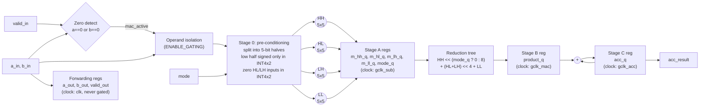
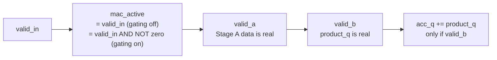

# Module 3 — `pe_mixed`: The Precision-Adaptive (INT8 / INT4×2) Processing Element

| Item | Value |
|---|---|
| RTL file | [src/pe_mixed.sv](../src/pe_mixed.sv) |
| Replaces | `pe_int8` (see [01_pe_int8.md](01_pe_int8.md)) |
| Uses | `icg_cell` (only when `ENABLE_GATING = 1`; see Module 7) |
| Golden model | `pe_golden()`, `pe_golden_int4x2()`, `pack_int4x2()` in [golden/golden_model.py](../golden/golden_model.py#L88-L171) |
| Testbench | [tb/test_pe_mixed.py](../tb/test_pe_mixed.py) |
| Used by | `systolic_array_mixed.sv`, `systolic_array_sparse.sv` |
| Role in the project | **Contribution 1.** One PE that runs either 1 INT8 MAC or 2 INT4 MACs per cycle, reusing the same multiplier hardware. It also carries the zero-skip gating hooks for Contribution 3. |

---

## 1. What this module is and why I built it

The baseline PE always computes at 8-bit precision. But not every layer of a
neural network needs 8 bits. Research on quantization shows that many layers
(often the large middle layers of a CNN or transformer) can run at **4-bit**
precision with almost no loss of accuracy, while sensitive layers (usually the
first and last) need 8 bits.

If the hardware only supports INT8, a 4-bit layer gets no benefit: the PE still
does one 8×8 multiply per cycle, and half of every operand is wasted. My goal for
this module was:

> **One PE that, at run time, can do either one INT8 MAC per cycle or two INT4
> MACs per cycle, using the same multiplier hardware and the same accumulator.**

So a 4-bit layer runs about **2× faster** on the same silicon, and I don't need a
separate INT4 engine. This is called a **fracturable** (or precision-scalable)
multiplier.

---

## 2. Theory

### 2.1 Mixed-precision quantization in one paragraph

Quantization maps real-valued weights and activations onto a small set of
integers. With INT8 there are 256 levels. With INT4 there are only 16 levels
(−8 … +7). Fewer bits means smaller multipliers, half the memory traffic, and
(if the hardware supports it) double the throughput. The cost is lower numerical
resolution, which some layers tolerate and others do not. So modern accelerators
support **several precisions** and let the compiler choose per layer. My PE
supports the two most common integer formats: INT8 and INT4.

### 2.2 The key idea: an 8-bit multiply is made of four 4-bit multiplies

I split each 8-bit operand into a **high half** and a **low half** of 4 bits each:

$$
a = 2^4 \cdot a_{hi} + a_{lo}, \qquad b = 2^4 \cdot b_{hi} + b_{lo}
$$

Multiplying these out (the same way you multiply two 2-digit numbers by hand):

$$
a \cdot b = 2^8 (a_{hi} b_{hi}) + 2^4 (a_{hi} b_{lo} + a_{lo} b_{hi}) + a_{lo} b_{lo}
$$

So one 8×8 product = **four 4×4 sub-products** (I call them HH, HL, LH, LL),
shifted and added. Now look at what two independent INT4 MACs need. If each byte
carries two separate 4-bit numbers (two "lanes"):

$$
\text{INT4×2 result} = a_{hi} b_{hi} + a_{lo} b_{lo}
$$

This is just the **HH** and **LL** sub-products, **without the shift**, and
without the two cross terms. So:

| Sub-product | INT8 mode | INT4×2 mode |
|---|---|---|
| HH = $a_{hi} b_{hi}$ | used, shifted left by 8 | used, no shift (lane 1) |
| HL = $a_{hi} b_{lo}$ | used, shifted left by 4 | **not used** |
| LH = $a_{lo} b_{hi}$ | used, shifted left by 4 | **not used** |
| LL = $a_{lo} b_{lo}$ | used, no shift | used, no shift (lane 0) |

**Both modes use the same four small multipliers and the same adder tree.** The
only differences are:

1. whether the low halves are treated as **signed** or **unsigned**, and
2. how far the HH term is **shifted** (8 or 0).

That is the whole trick of my design. INT4×2 mode comes almost for free, because
the 4×4 multipliers it needs are already inside the 8×8 multiply.

### 2.3 The signedness detail (the part that is easy to get wrong)

In **INT8 mode**, the operand is one signed 8-bit number. When I split it:

- the **high** nibble carries the sign, so it is **signed** (−8 … +7);
- the **low** nibble is just the lower 4 bits of the value, so it is
  **unsigned** (0 … 15).

Example: $-2$ = `1111_1110`. High nibble `1111` = −1 (signed). Low nibble `1110`
= 14 (unsigned). Check: $16 \times (-1) + 14 = -2$ ✓. If I treated the low nibble
as signed (−2), I would get $-16 - 2 = -18$, which is wrong.

In **INT4×2 mode**, each nibble is an independent signed INT4 number, so **both**
halves are **signed**.

To handle both cases with one multiplier, I extend every half to **5 bits** before
multiplying:

| Half | INT8 mode | INT4×2 mode |
|---|---|---|
| high | `{sign, hi[3:0]}` → signed −8…7 | `{sign, hi[3:0]}` → signed −8…7 |
| low | `{0, lo[3:0]}` → 0…15 | `{sign, lo[3:0]}` → signed −8…7 |

A 5-bit signed number can hold both 0…15 and −8…7, so the **same 5×5 signed
multiplier** is correct in both modes. The only thing the mode changes is the one
extra bit I put on top of the low nibble: a copy of the sign bit, or zero.

### 2.4 Sizing the sub-products and the sum

A 5×5 signed multiply needs at most 10 bits. The real worst cases are much
smaller: $15 \times 15 = 225$, $(-8)(-8) = 64$, $(-8)(15) = -120$, all well inside a
10-bit signed range. The full INT8 product needs 16 bits; I reduce in an 18-bit
sum (`SUM = 2·8 + 2`) for headroom while adding the shifted terms. The result is
then sign-extended into the same 32-bit accumulator as before.

### 2.5 How INT4×2 doubles throughput

In INT4×2 mode, one byte carries **two consecutive k-steps** of the dot product:
the low lane holds $k = 2m$ and the high lane holds $k = 2m+1$. So a dot product
of depth $K$ is streamed in **$K/2$ cycles**:

$$
C[i][j] = \sum_{m=0}^{K/2 - 1} \Big( A_{hi}[i][m] B_{hi}[m][j] + A_{lo}[i][m] B_{lo}[m][j] \Big)
$$

Each PE does **2 MACs per cycle** in this mode, compared with 1 in INT8 mode. At
array level, the fixed fill and drain cycles do not shrink, so the measured
array speed-up is less than 2× for short K (I explain this in Module 4).

### 2.6 Operand isolation — saving power on unused hardware

In INT4×2 mode the HL and LH multipliers produce nothing useful. If their inputs
kept changing, they would still switch internally and burn **dynamic power**
($P_{dyn} = \alpha C V^2 f$, where $\alpha$ is the switching activity). So I force
their inputs to **zero** in INT4×2 mode. A multiplier whose inputs do not change
does not switch, so its $\alpha$ drops to almost zero. This technique is called
**operand isolation**.

### 2.7 Zero-skipping (the hook for Contribution 3)

The same idea extends to the whole PE. If either operand byte is **zero**, the
product is zero, and adding zero changes nothing. So in that cycle I can:

1. **isolate** all four multipliers (force their inputs to zero), and
2. **stop the clock** to the MAC pipeline registers (clock gating).

The result is **bit-identical** to doing the useless MAC, because adding 0 or not
adding at all gives the same accumulator. Only the power changes. This is enabled
by the parameter `ENABLE_GATING`. With 2:4 sparse weights, at least half of the
weights are zero, so this saves a lot of switching. I explain the clock-gating
cell itself in Module 7 (`icg_cell`). Here I explain how the PE uses it.

---

## 3. Interface

### 3.1 Parameters

| Parameter | Default | Meaning |
|---|---|---|
| `DATA_WIDTH` | 8 | Operand width. Must be **even** (it is split into two halves). A compile-time `$error` catches odd values. |
| `ACC_WIDTH` | 32 | Accumulator width. |
| `ENABLE_GATING` | 0 | 0 = plain mixed-precision PE. 1 = add zero-operand detection, operand isolation and clock gating of the MAC pipeline. |

### 3.2 Ports

The ports are the same as `pe_int8`, plus one: `mode`.

| Port | Dir | Width | Description |
|---|---|---|---|
| `clk` | in | 1 | Clock. |
| `rst` | in | 1 | Synchronous, active-high reset. |
| **`mode`** | in | 1 | **0 = INT8, 1 = INT4×2.** Changed only between tiles. |
| `valid_in` | in | 1 | Operand pair is real. |
| `acc_clear` | in | 1 | Zero the accumulator (start of tile). |
| `a_in` | in | 8 | INT8: one signed byte. INT4×2: `{lane1[3:0], lane0[3:0]}`. |
| `b_in` | in | 8 | Same packing as `a_in`. |
| `a_out`, `b_out`, `valid_out` | out | 8, 8, 1 | 1-cycle forwarding, **never gated**. |
| `acc_result` | out | 32 | Running result. |

Because the port list is a superset of `pe_int8`, the array only needs one extra
wire (`mode`) to switch to this PE.

---

## 4. Microarchitecture

### 4.1 Block diagram



### 4.2 Pipeline stages

| Stage | Logic (combinational, before the register) | Register(s) | Clock |
|---|---|---|---|
| 0 → A | zero detect, isolation, split + sign-extend, four 5×5 multiplies | `m_hh_q`, `m_hl_q`, `m_lh_q`, `m_ll_q`, `mode_q` | `gclk_sub` |
| A → B | mode-dependent shift of HH, cross-term shift, 3-input add | `product_q` | `gclk_mac` |
| B → C | 32-bit accumulate (with clear) | `acc_q` | `gclk_acc` |
| Forwarding | none (plain delay) | `a_out`, `b_out`, `valid_out` | `clk` |
| Control | none | `valid_a`, `valid_b` | `clk` |

So the MAC is now a **3-stage** pipeline, against 2 stages in `pe_int8`. The
forwarding path is still exactly 1 cycle, so the **array skew is unchanged**.
Only the result appears one cycle later (Section 6).

### 4.3 The valid chain

Each pipeline stage needs to know whether its data is real:



`valid_a` and `valid_b` run on the **ungated** clock. This is important. If they
ran on a gated clock and the clock stopped, they could get stuck at 1, and a stale
product would be added again and again. On the free-running clock they always
fall back to 0 when there is no new data.

---

## 5. RTL implementation walkthrough

### 5.1 Local parameters and the width check — [pe_mixed.sv L95-L112](../src/pe_mixed.sv#L95-L112)

```systemverilog
localparam int HALF = DATA_WIDTH / 2;      // 4
localparam int EXT  = HALF + 1;            // 5 - room for the sign bit
localparam int PROD = 2 * EXT;             // 10 - one sub-product
localparam int SUM  = 2 * DATA_WIDTH + 2;  // 18

if (DATA_WIDTH % 2 != 0) begin : g_bad_width
    $error("pe_mixed: DATA_WIDTH must be even, got %0d", DATA_WIDTH);
end
```

I derived every internal width from `DATA_WIDTH`, so the design is not hard-coded
to 8 bits. The `$error` inside a `generate if` is an **elaboration-time** check.
If someone sets an odd width, compilation stops with a clear message instead of
silently building a broken multiplier.

### 5.2 Zero detection and operand isolation — [pe_mixed.sv L121-L131](../src/pe_mixed.sv#L121-L131)

```systemverilog
assign zero_operand = (a_in == '0) || (b_in == '0);
assign mac_active   = ENABLE_GATING ? (valid_in && !zero_operand) : valid_in;

assign a_iso = (ENABLE_GATING && !mac_active) ? '0 : a_in;
assign b_iso = (ENABLE_GATING && !mac_active) ? '0 : b_in;
```

- I detect zeros on the **whole byte**, not per nibble. This works in both modes:
  if a byte is zero, all four sub-products are zero. It is also very shallow logic
  (an 8-input NOR), so it never becomes the critical path.
- `mac_active` is the "this cycle really needs to MAC" signal. With gating off it
  is just `valid_in`. With gating on, zero cycles also count as inactive.
- `a_iso`/`b_iso` force the multiplier inputs to zero whenever the cycle is
  inactive. That covers idle cycles, drain cycles **and** zero operands, so none
  of them toggles the datapath.
- Because `ENABLE_GATING` is a **parameter**, the mux disappears completely
  when it is 0. Synthesis sees `a_iso = a_in`.

### 5.3 Pre-conditioning: split, sign-extend, isolate the cross terms — [pe_mixed.sv L138-L153](../src/pe_mixed.sv#L138-L153)

```systemverilog
assign a_hi = $signed({a_iso[DATA_WIDTH-1], a_iso[DATA_WIDTH-1 -: HALF]});
assign a_lo = int4_mode ? $signed({a_iso[HALF-1], a_iso[HALF-1:0]})
                        : $signed({1'b0,         a_iso[HALF-1:0]});

assign hl_a = int4_mode ? '0 : a_hi;
assign hl_b = int4_mode ? '0 : b_lo;
```

- `a_hi`: I repeat bit 7 (the sign) on top of the high nibble, so it is always a
  signed 5-bit value. `[DATA_WIDTH-1 -: HALF]` means "4 bits counting down from bit
  7", which is `[7:4]`.
- `a_lo`: here the mode matters. In INT4×2 mode I copy bit 3 (the lane-0 sign) on
  top. In INT8 mode I put a `0` on top, so the low nibble is read as 0…15.
- `hl_*`, `lh_*`: in INT4×2 mode the cross-term multipliers get zero inputs
  (operand isolation, Section 2.6).

**Why I resolve the mode here and not after the multipliers.** The other way
would be to compute all products and then use a mux to choose which ones to
add. That puts a mux on the critical path, after the multipliers. By applying the
mode **before** the multipliers (the extra top bit and the isolation), the
multiplier and adder tree are identical in both modes, and the mode logic sits on
a short, non-critical path.

### 5.4 The four shared sub-multipliers — [pe_mixed.sv L161-L166](../src/pe_mixed.sv#L161-L166)

```systemverilog
(* use_dsp = "no" *) logic signed [PROD-1:0] m_hh, m_hl, m_lh, m_ll;

assign m_hh = a_hi * b_hi;   // used in BOTH modes
assign m_hl = hl_a * hl_b;   // INT8 only
assign m_lh = lh_a * lh_b;   // INT8 only
assign m_ll = a_lo * b_lo;   // used in BOTH modes
```

I deliberately set `use_dsp = "no"`. If I let Vivado use DSPs, it would merge the
four small multipliers back into one DSP48 multiply. The fracturable structure,
which is the thing I want to study, would then disappear. I discuss this trade-off
in Section 7.

### 5.5 Stage A registers — [pe_mixed.sv L265-L280](../src/pe_mixed.sv#L265-L280)

```systemverilog
always_ff @(posedge gclk_sub) begin
    ...
    m_hh_q <= m_hh;  m_hl_q <= m_hl;  m_lh_q <= m_lh;  m_ll_q <= m_ll;
    mode_q <= int4_mode;
end
```

I register the four raw sub-products **before** reducing them. I also register
the mode (`mode_q`) together with them. This is what makes mid-stream mode
changes safe: the shift in Stage B always uses the mode that belongs to **this**
data, not the mode that is on the input pin now.

### 5.6 Shared reduction tree — [pe_mixed.sv L187-L189](../src/pe_mixed.sv#L187-L189)

```systemverilog
assign hh_term    = mode_q ? SUM'(m_hh_q) : (SUM'(m_hh_q) <<< (2 * HALF));
assign cross_term = SUM'(m_hl_q + m_lh_q) <<< HALF;   // zero in INT4x2 mode
assign product_c  = hh_term + cross_term + SUM'(m_ll_q);
```

This is the equation from Section 2.2, written directly:

- `hh_term`: shift by 8 in INT8 mode, or by 0 in INT4×2 mode. This is the **only**
  mode-dependent operation after the multipliers. It is a 2:1 choice on one term,
  not a mux across the whole tree.
- `cross_term`: in INT4×2 mode, HL and LH are already zero (isolated), so this
  term is automatically zero. No mux needed.
- `SUM'(...)` is a **size cast** to 18 bits. Because the values are signed, the
  cast sign-extends them. `<<<` is the arithmetic shift (for left shifts it gives
  the same result as `<<`, but it documents that the value is signed).

### 5.7 Stages B and C — [pe_mixed.sv L282-L298](../src/pe_mixed.sv#L282-L298)

```systemverilog
always_ff @(posedge gclk_mac)
    product_q <= rst ? '0 : ACC_WIDTH'(product_c);

always_ff @(posedge gclk_acc)
    if (rst)            acc_q <= '0;
    else if (acc_clear) acc_q <= '0;
    else if (valid_b)   acc_q <= acc_q + product_q;
```

These are the same as in `pe_int8`, one stage later: register the product, then
accumulate it when it is valid, with `acc_clear` taking priority.

### 5.8 Clock gating hookup — [pe_mixed.sv L210-L246](../src/pe_mixed.sv#L210-L246)

```systemverilog
if (ENABLE_GATING) begin : g_icg
    icg_cell u_icg_sub (.clk(clk), .enable(mac_active | rst), .test_en(1'b0), .gclk(gclk_sub));
    icg_cell u_icg_mac (.clk(clk), .enable(valid_a    | rst), .test_en(1'b0), .gclk(gclk_mac));
    icg_cell u_icg_acc (.clk(clk), .enable(acc_active | rst), .test_en(1'b0), .gclk(gclk_acc));
end else begin : g_no_icg
    assign gclk_sub = clk;  assign gclk_mac = clk;  assign gclk_acc = clk;
end
```

I use **one gated clock per pipeline stage**, and each one is enabled only when
that stage has real work:

| Gated clock | Registers | Enabled when |
|---|---|---|
| `gclk_sub` | Stage A (`m_*_q`, `mode_q`) | `mac_active`: this cycle has a valid, non-zero pair |
| `gclk_mac` | Stage B (`product_q`) | `valid_a`: Stage A captured real data last cycle |
| `gclk_acc` | Stage C (`acc_q`) | `valid_b \|\| acc_clear`: something to add or clear |

Three details I had to get right:

1. **`| rst` in every enable.** My reset is synchronous, which means it only acts
   on a clock edge. If the gated clock were stopped during reset, those registers
   would never be cleared. ORing `rst` into each enable keeps the clock running
   while reset is high.
2. **The forwarding registers are never gated.** If I stopped `a_out`/`b_out` in
   one PE, every PE east and south of it would get wrong data. Only the PE's
   **private** MAC registers are gated.
3. **One clock domain.** All gated clocks come from `clk` inside the same PE and
   only drive registers in that PE. There is no clock-domain crossing, so I need
   no synchronizers.

With `ENABLE_GATING = 0`, the gated clocks are just wires to `clk`, and no ICG
cell is built.

---

## 6. Timing behaviour — worked examples

### 6.1 Arithmetic check, INT8 mode

$a = -2$ (`0xFE`), $b = 100$ (`0x64`).

| | high | low (INT8: unsigned) |
|---|---|---|
| a = 0xFE | −1 | 14 |
| b = 0x64 | 6 | 4 |

HH = −6, HL = (−1)(4) = −4, LH = (14)(6) = 84, LL = (14)(4) = 56.

$$
256(-6) + 16(-4 + 84) + 56 = -1536 + 1280 + 56 = -200 = (-2)(100) \checkmark
$$

### 6.2 Arithmetic check, INT4×2 mode

$a$ = `0x3E` → lanes (hi = 3, lo = −2). $b$ = `0xA5` → lanes (hi = −6, lo = 5).

HH = 3 × (−6) = −18, LL = (−2) × 5 = −10, HL = LH = 0 (isolated).

$$
\text{result} = -18 + (-10) = -28 \quad \text{(two MACs in one cycle)} \checkmark
$$

Notice that the **same byte** `0x3E` means 62 in INT8 mode but (3, −2) in INT4×2
mode. The `mode` bit decides how the bits are interpreted.

### 6.3 Pipeline timing (gating off)

The operands are applied before edge $t$.

| Edge | Happens | `pe_int8` equivalent |
|---|---|---|
| $t$ | `m_*_q` = sub-products, `valid_a` = 1, `a_out`/`b_out` updated | `product_q`, `valid_q` |
| $t+1$ | `product_q` = reduced product, `valid_b` = 1 | `acc_q` updated |
| $t+2$ | `acc_q` = acc + product | — |

So `pe_mixed` has **one more cycle** of result latency than `pe_int8`. At array
level, the tile latency becomes $2N + K_{cycles}$ instead of $2N + K - 1$. The
forwarding (`a_out` at edge $t$) is identical in both PEs.

### 6.4 Gating example (`ENABLE_GATING = 1`)

The stream is (a, b) = (5, 3), (0, 7), (4, 2), all with `valid_in` = 1.

| Edge | Input | `mac_active` | `gclk_sub` ticks? | `valid_a` | `gclk_mac` ticks? | `valid_b` | `gclk_acc` ticks? | `acc_q` |
|---|---|---|---|---|---|---|---|---|
| 1 | (5,3) | 1 | yes | 1 | no | 0 | no | 0 |
| 2 | (0,7) | **0** | **no** | 0 | yes | 1 | no | 0 |
| 3 | (4,2) | 1 | yes | 1 | **no** | 0 | yes | 15 |
| 4 | — | 0 | no | 0 | yes | 1 | **no** | 15 |
| 5 | — | 0 | no | 0 | no | 0 | yes | 23 |

The zero pair (0, 7) causes **one skipped clock in each of the three stages**, one
stage per cycle as it would have moved through the pipeline. The final result is
5·3 + 4·2 = 23, the same as without gating.

---

## 7. Design decisions and trade-offs

### 7.1 Why I added the third pipeline stage

My first version had only 2 stages, like `pe_int8`: pre-conditioning, the four
multiplies **and** the reduction tree all happened in one cycle before
`product_q`. Because of `use_dsp = "no"`, all of that logic went into LUTs and
CARRY4 chains. At 250 MHz on the Kintex-7 it **missed timing by about
2.7–3.4 ns on more than 800 endpoints**.

Adding Stage A (registering the four raw sub-products) splits the path into
"multiply" and "reduce", and timing closed. The price was one more cycle of
latency and about 40 more flip-flops per PE. The forwarding path did not change,
so the array skew is still 1 cycle per hop.

### 7.2 Summary of decisions

| Decision | Alternative I rejected | Reason |
|---|---|---|
| 4 shared 5×5 sub-multipliers | Separate INT8 multiplier + 2 INT4 multipliers | Sharing means INT4×2 needs almost no extra multiplier area. |
| Mode applied **before** the multipliers | Mux the partial products after multiplying | Keeps the mode select off the critical path; tree is the same in both modes. |
| 5-bit sign-extended halves | Separate signed and unsigned multipliers | One signed 5×5 multiplier is correct for 0…15 and −8…7. |
| Isolate HL/LH in INT4×2 | Let them compute garbage | Cuts switching power on the idle half of the tree. |
| `mode_q` pipelined with the data | Use the live `mode` pin in Stage B | Makes mid-stream mode changes safe for in-flight products. |
| `mode` is per tile (with `acc_clear`) | Per-operand mode | A tile has one precision; mixing precisions within one sum makes no sense. |
| `use_dsp = "no"` | Let Vivado use DSP48 | A DSP would absorb the structure I am studying. ASIC is the fair area comparison. |
| Zero detection per byte | Per nibble (per lane) | Shallow logic, same in both modes; per-lane is a possible future refinement. |
| Gated clock per stage | One gated clock for the whole MAC | Each stage sleeps exactly when it has no work. |
| `valid_a`/`valid_b` on ungated clock | On the gated clock | Guarantees a stale product is never added twice. |

### 7.3 Honest limitation: the FPGA area comparison is not like-for-like

On the FPGA, the baseline uses **64 DSP48 slices and almost no LUTs**, while the
mixed array uses **0 DSPs and about 9,500 LUTs**. These are different resource
types, so I cannot compute a meaningful "% overhead" from them. That is why I use
the **ASIC flow as the area reference** for this contribution (Section 9.2).

Why not use DSPs for the mixed PE? A DSP48E1 has one 25×18 multiplier. It cannot
natively do two independent signed 4×4 products, each with its own operands, and
keep them separate. There are known packing tricks (for example AMD WP486 packs
two INT8 products that **share** one operand into one DSP), but they need a shared
operand, and my two lanes have different A **and** B values. So on this FPGA
family, a fabric implementation is the honest way to show the fracturable
structure.

---

## 8. Verification

### 8.1 Golden model

- `pe_golden(mode, a, b, acc)` dispatches to `pe_golden_int8()` (from Module 1)
  or to `pe_golden_int4x2()`.
- `pe_golden_int4x2()` unpacks both bytes with `unpack_int4x2()` (two signed
  nibbles) and returns `acc + a_hi·b_hi + a_lo·b_lo`, wrapped to 32 bits.
- `pack_int4x2(hi, lo)` builds the packed byte for the testbench, and it asserts
  that both lanes are in −8…7.

The golden model does **not** use the sub-product decomposition. It computes the
answer directly. So the testbench checks my decomposition maths against plain
multiplication.

### 8.2 Cycle-accurate shadow model

`PEMixedModel` in the testbench copies the 3-stage pipeline. It stores the
`(a, b, mode)` of each in-flight product. This lets it catch any bug where a mode
change leaks into a product that is already in the pipeline.

### 8.3 Tests

| Test | What it checks | Size |
|---|---|---|
| `test_int8_corners` | {0, ±1, 127, −128} in every pair, accumulated 4× | 25 combinations |
| `test_int8_exhaustive` | **Every** possible INT8 operand pair | 65,536 pairs |
| `test_int8_random_accumulate` | Long random accumulation | 500 MACs |
| `test_int4x2_corners` | Lane values {0, ±1, 7, −8} in all four lanes | 625 combinations |
| `test_int4x2_exhaustive` | **Every** byte pair = every (a_hi, a_lo, b_hi, b_lo) | 65,536 pairs |
| `test_int4x2_lane_independence` | One lane zero; checks that result = other lane only (no bleed between lanes) | 200 cases |
| `test_mode_transition_with_clear` | 40 tiles alternating INT8 / INT4×2, with expected sums computed independently | 40 tiles |
| `test_mode_change_does_not_corrupt_inflight` | Random mode, valid and clear every cycle | 300 cycles |

The two exhaustive tests mean that the arithmetic is **proven correct for every
possible input** in both modes, not just sampled. The exhaustive tests can be
skipped for quick runs with `TB_EXHAUSTIVE=0`.

The same tests run with gating enabled using `make TEST=pe_mixed GATING=1`.
Because gating is designed to be bit-identical, the same expected values must
pass unchanged. There is also a gate-level target (`TEST=pe_mixed_gl`) that runs
the same tests on the Yosys netlist.

---

## 9. Implementation results

### 9.1 FPGA (8×8 `systolic_array_mixed`, Kintex-7 `xc7k70t-1`, OOC, 4.0 ns)

| Metric | Baseline (`pe_int8`) | Mixed (`pe_mixed`) |
|---|---|---|
| LUTs | 2 | 9,549 |
| Flip-flops | 344 | 6,716 |
| DSP48E1 | 64 | 0 |
| CARRY4 | — | 2,048 |
| WNS | +2.024 ns | +0.064 ns |
| Fmax (≈ 1 / (T − WNS)) | ≈ 506 MHz | ≈ 254 MHz |
| Dynamic power (uniform 50 %) | 0.139 W | 0.520 W |

The mixed array meets the 250 MHz target. As explained in 7.3, the area columns
compare DSPs against LUTs and are not a like-for-like overhead.

### 9.2 ASIC (Yosys, FreePDK45, single PE)

| Metric | `pe_int8` | `pe_mixed` (gating off) | `pe_mixed` (gating on) |
|---|---|---|---|
| Cells | 734 | 1,312 | 1,427 (+ 3 latches) |
| Flip-flops | 65 | 107 | 108 |
| Cell area | 2,417.8 | 4,438.6 | 4,807.5 (+ latch area) |
| ABC recipe | default | `strash; map` (abcfix) | `strash; map` (abcfix) |

**How to read this honestly.**

- The gating logic costs about **+8.3 %** area over the non-gated mixed PE
  (4,807.5 vs 4,438.6). That number does not yet include the 3 ICG latches,
  because the FreePDK45 library has no plain latch cell to map them to (Module 7).
- The raw `pe_mixed` vs `pe_int8` ratio is 1.84×, but it is **not a fair
  comparison yet**, for two reasons:
  1. `pe_mixed` was mapped with the stripped-down `strash; map` ABC recipe. I
     needed this recipe to work around a Yosys "wire has no driver" problem on
     the larger netlist. It does much less logic optimization than the default
     recipe used for `pe_int8`.
  2. `pe_mixed` has an extra pipeline stage (about +42 flip-flops). That stage was
     added for **FPGA fabric timing**, which the ASIC does not need.
- To get the real precision-mode overhead, I need to synthesize `pe_int8` with
  the **same** abcfix recipe, and ideally compare against a 2-stage `pe_mixed`
  variant. This is open work.

---

## 10. Report-ready summary

> The precision-adaptive processing element extends the baseline PE with a
> run-time `mode` input that selects either one signed INT8 MAC or two packed
> signed INT4 MACs per cycle. It rests on a simple decomposition: splitting each
> 8-bit operand into 4-bit halves turns an INT8 product into four 4×4
> sub-products, $2^8 HH + 2^4 (HL + LH) + LL$, while two INT4 MACs need only
> $HH + LL$. I therefore implemented four shared 5×5 signed sub-multipliers and
> one shared reduction tree. The mode only changes the sign extension of the low
> halves (unsigned in INT8, signed in INT4×2) and the shift applied to the HH
> term. I resolve the mode in a pre-conditioning stage, never as a mux on the
> partial products, so it stays off the critical path. In INT4×2 mode, I force
> the inputs of the unused cross-term multipliers to zero to suppress their
> switching activity. To close timing at 250 MHz in FPGA fabric, I pipelined the
> MAC into three stages (sub-product, reduced product, accumulate). The mode is
> carried alongside the data, so mode changes never corrupt in-flight products,
> and the one-cycle forwarding path keeps the systolic skew unchanged. An
> optional `ENABLE_GATING` parameter adds byte-level zero detection, operand
> isolation and a per-stage clock gate. The results remain bit-identical to the
> ungated PE. I verified the PE exhaustively over all 65,536 operand pairs in
> both modes, and with lane-isolation, mode-transition and in-flight mode-change
> tests.

---

## 11. References

1. B. Jacob et al., "Quantization and Training of Neural Networks for Efficient Integer-Arithmetic-Only Inference," *Proc. CVPR*, 2018.
2. H. Sharma et al., "Bit Fusion: Bit-Level Dynamically Composable Architecture for Accelerating Deep Neural Networks," *Proc. ISCA*, 2018 (fracturable / bit-composable multipliers).
3. K. Wang et al., "HAQ: Hardware-Aware Automated Quantization with Mixed Precision," *Proc. CVPR*, 2019 (per-layer precision selection).
4. B. Moons, R. Uytterhoeven, W. Dehaene and M. Verhelst, "Envision: A 0.26-to-10 TOPS/W Subword-Parallel Dynamic-Voltage-Accuracy-Frequency-Scalable CNN Processor," *Proc. ISSCC*, 2017 (subword-parallel MACs).
5. AMD/Xilinx, *Deep Learning with INT8 Optimization on Xilinx Devices*, WP486.
6. M. Münch et al., "Automating RT-Level Operand Isolation to Minimize Power Consumption in Datapaths," *Proc. DATE*, 2000.

---

### Figures to export for the Word report

| Figure | Source | Suggested caption |
|---|---|---|
| Fig. 3.1 | Section 2.2 table (redraw as a 2×2 grid of HH/HL/LH/LL boxes with shift labels) | Decomposition of an INT8 product into four 4×4 sub-products |
| Fig. 3.2 | Section 4.1 Mermaid block | Microarchitecture of the precision-adaptive PE |
| Fig. 3.3 | Section 4.3 Mermaid block | Valid chain through the three-stage MAC pipeline |
| Table 3.x | Section 2.3 table | Sign extension of operand halves per mode |
| Table 3.y | Section 6.4 table | Cycle-by-cycle clock gating on a zero operand |
| Table 3.z | Section 9.2 table | ASIC area of baseline and precision-adaptive PEs |
