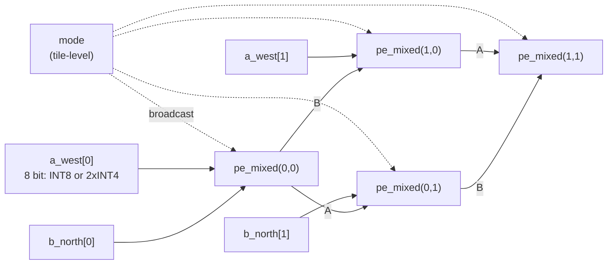
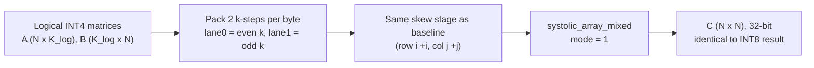

# Module 4 — `systolic_array_mixed`: The Precision-Adaptive Systolic Array

| Item | Value |
|---|---|
| RTL file | [src/systolic_array_mixed.sv](../src/systolic_array_mixed.sv) |
| Building block | `pe_mixed` with `ENABLE_GATING = 0` (see [03_pe_mixed.md](03_pe_mixed.md)) |
| Mesh / skew | Same as `systolic_array` (see [02_systolic_array.md](02_systolic_array.md)) |
| Golden model | `gemm_golden()`, `gemm_golden_int4x2()`, `pack_int4x2()` in [golden/golden_model.py](../golden/golden_model.py#L141-L171) |
| Testbench | [tb/test_array_mixed.py](../tb/test_array_mixed.py) |
| Synthesis config | `mixed` in [synth/fpga/synth_sweep.tcl](../synth/fpga/synth_sweep.tcl) |
| Role in the project | Brings Contribution 1 (INT8 / INT4×2) to array level and measures the real throughput gain. |

---

## 1. What this module is and why I kept it separate

This module is the 8×8 systolic array from Module 2, with each `pe_int8`
replaced by a `pe_mixed` and one extra input, `mode`, wired to every PE. The mesh,
the port packing and the skew rules are exactly the same.

I could have added a parameter to `systolic_array.sv` to choose the PE type.
Instead I kept this as a **separate top-level module**, for one reason: the
baseline INT8 array must stay **untouched**. All my claims (area overhead,
throughput gain, power saving) are measured *relative to the baseline*. If I
edited the baseline file to add mixed precision, I could never be sure that the
"baseline" numbers were still the original design. With separate files, the
`baseline` and `mixed` synthesis configs are fully independent, and I can rerun
either one at any time.

---

## 2. Theory

### 2.1 What changes when the PEs become precision-adaptive

At array level, nothing changes in **how data moves**. A still flows east, B
still flows south, C still stays in place, and the skew is still $i$ cycles per
row and $j$ cycles per column. That is because `pe_mixed` kept the exact 1-cycle
forwarding contract of `pe_int8` (Module 3, Section 4.2).

What changes is **what one byte means**:

| Mode | One byte on a link carries | MACs per PE per cycle |
|---|---|---|
| INT8 (`mode = 0`) | one k-step: $A[i][k]$ or $B[k][j]$ | 1 |
| INT4×2 (`mode = 1`) | two k-steps: lanes $(k = 2m+1,\ k = 2m)$ | 2 |

So in INT4×2 mode, the **same wires**, the **same registers** and the **same
skew** move **twice as much useful data** per cycle.

### 2.2 How matrices are packed for INT4×2

For a logical dot product of depth $K_{log}$, I pack two consecutive k-steps
into one byte. The low lane holds the even k, and the high lane holds the odd k:

$$
A_{packed}[i][m] = \{\,A[i][2m+1],\ A[i][2m]\,\}, \qquad
B_{packed}[m][j] = \{\,B[2m+1][j],\ B[2m][j]\,\}
$$

The packed matrices have depth $K_{pk} = K_{log}/2$, and the array streams them
exactly like INT8 matrices of depth $K_{pk}$. Each PE then computes:

$$
C[i][j] = \sum_{m=0}^{K_{pk}-1} \Big( A[i][2m+1]\,B[2m+1][j] + A[i][2m]\,B[2m][j] \Big)
= \sum_{k=0}^{K_{log}-1} A[i][k]\,B[k][j]
$$

This is exactly the normal matrix product. **A and B must use the same lane
convention.** The low lane of A must hold the same k as the low lane of B,
otherwise the PE multiplies $A[i][2m]$ by $B[2m+1][j]$ and the result is wrong.
This is a contract between the array and whatever packs the data (the
testbench here, a DMA or memory layout in a real system).

### 2.3 Why the array speed-up is less than 2× for small K

Each PE does exactly 2× the work per cycle in INT4×2 mode. But the array also
has **fixed costs** that do not depend on the precision: the wavefront has to
enter the grid (fill) and leave it (drain). Only the K part of the time is
halved.

**Streaming cycles.** The edge inputs are busy for $N + K - 1$ cycles, where $K$
is the number of **bytes** streamed per row:

$$
T_{stream}^{INT8} = N + K_{log} - 1, \qquad
T_{stream}^{INT4\times2} = N + \tfrac{K_{log}}{2} - 1
$$

**Total tile latency** (until the last PE is final; `pe_mixed` has a 3-stage MAC,
which is one cycle more than `pe_int8`):

$$
T_{tile} = 2N + K
$$

**Speed-up** for the same logical problem:

$$
S_{stream} = \frac{N + K_{log} - 1}{N + K_{log}/2 - 1}
\qquad
S_{tile} = \frac{2N + K_{log}}{2N + K_{log}/2}
$$

Both approach **2.0** as $K_{log}$ grows, because the fixed $N$ terms become small
compared with $K$:

| Logical depth $K_{log}$ | $T^{INT8}_{stream}$ | $T^{INT4×2}_{stream}$ | $S_{stream}$ | $S_{tile}$ |
|---|---|---|---|---|
| 16 (my testbench) | 23 | 15 | **1.53×** | 1.33× |
| 64 | 71 | 39 | 1.82× | 1.67× |
| 128 | 135 | 71 | 1.90× | 1.80× |
| 576 (3×3×64 conv) | 583 | 295 | 1.98× | 1.95× |
| 4096 | 4103 | 2055 | 2.00× | 1.99× |

So the **1.53×** I measured in simulation is not a hardware problem. It is the
expected value for the very short dot product ($K_{log} = 16$) used in my
throughput test. Solving $S_{stream} \ge 1.8$ gives
$K_{log} \ge 8(N-1) = 56$. Real network layers are far deeper than that (a
3×3 convolution with 64 input channels already has $K = 576$), so in practice
the array delivers close to the full **2×**.

### 2.4 Effective peak throughput

| Mode | MACs / cycle (64 PEs) | At 250 MHz | GOPS (2 ops / MAC) |
|---|---|---|---|
| INT8 | 64 | 16 GMAC/s | 32 |
| INT4×2 | 128 | 32 GMAC/s | 64 |

### 2.5 Mode is a tile-level setting

The `mode` signal goes to all 64 PEs **at the same time** (broadcast). It is not
carried through the mesh with the data. Inside each PE, the mode is used in two
places:

- in Stage 0 (deciding whether the low nibble is signed, and isolating the cross
  terms), using the **live** `mode` pin, and
- in Stage B (the HH shift), using the registered `mode_q`.

So a byte is interpreted according to the `mode` value **at the moment that byte
passes through Stage 0 of a PE**. Because of the wavefront, the last PE,
PE(N−1, N−1), sees the final byte of a tile about $2N$ cycles after PE(0,0) does.
If I changed `mode` in between, the end of the old tile would be processed in
the wrong precision in the far PEs.

The rule is therefore: **change `mode` only when the array has fully drained,
and pulse `acc_clear` at the same time.** This is the same boundary that the
global `acc_clear` already requires (Module 2, Section 7.2), so it costs nothing
extra. One precision per tile is also the natural software model, because a
compiler picks the precision **per layer**.

---

## 3. Interface

Identical to `systolic_array` (Module 2, Section 3), plus one port:

| Port | Dir | Width | Description |
|---|---|---|---|
| **`mode`** | in | 1 | 0 = INT8, 1 = INT4×2. Broadcast to all PEs. Change only at a tile boundary. |
| `clk`, `rst`, `acc_clear` | in | 1 each | As in the baseline. |
| `a_west`, `b_north` | in | N×8 | INT8: one value per byte. INT4×2: two packed lanes per byte. |
| `valid_west` | in | N | Valid per row (per **byte**, so one valid covers both lanes). |
| `c_out` | out | N×N×32 | Results, same packing as the baseline. |
| `valid_east` | out | N | As in the baseline. |

Because the port list is the baseline plus `mode`, the same testbench helper
functions (`stream_matrices`, `check_result`) work for both arrays.

---

## 4. Microarchitecture



(2×2 corner shown. The real array is 8×8, with the same mesh as Module 2's
Fig. 2.1, plus the `mode` broadcast.)

The array module itself still contains **no logic**: no registers, no muxes. It
only wires 64 `pe_mixed` instances together and fans `mode` out to them.



---

## 5. RTL implementation walkthrough

The file is a near-copy of `systolic_array.sv`. Only three things differ.

### 5.1 The new `mode` port — [systolic_array_mixed.sv L40](../src/systolic_array_mixed.sv#L40)

```systemverilog
input  logic                       mode,        // 0 = INT8, 1 = INT4x2
```

### 5.2 PE type and mode connection — [systolic_array_mixed.sv L71-L86](../src/systolic_array_mixed.sv#L71-L86)

```systemverilog
pe_mixed #(
    .DATA_WIDTH (DATA_WIDTH),
    .ACC_WIDTH  (ACC_WIDTH)
) u_pe (
    .clk        (clk),
    .rst        (rst),
    .mode       (mode),          // same wire to every PE
    .valid_in   (v_h[i][j]),
    ...
);
```

- Every PE gets the **same** `mode` wire. With 64 loads, this fanout is small,
  and since `mode` only changes between tiles, it is effectively a static signal
  for timing. It is never on a critical path.
- I do **not** pass `ENABLE_GATING`, so it takes its default value of 0. This
  module is the "mixed precision only" design point. The gated version is built
  in `systolic_array_sparse` (Module 8). That keeps each synthesis config
  focused on **one** change from the previous one.

### 5.3 Everything else is unchanged

The link arrays (`a_h`, `b_v`, `v_h`), the edge assignments, the `generate`
loops, the named blocks (`g_row[i].g_col[j].u_pe`) and the `c_out` packing are
line-for-line the same as in the baseline. This is intentional. Any difference
in results between `baseline` and `mixed` must come from the PE, not from the
array wiring.

---

## 6. Timing behaviour — the throughput experiment

The testbench `test_throughput_int4x2_vs_int8` runs the **same logical problem**
twice. $N = 8$, $K_{log} = 16$, and all values are in the INT4 range −8…7, so
that both modes are exact.

| | INT8 run | INT4×2 run |
|---|---|---|
| A fed as | 8 × 16 bytes, one value each | 8 × 8 bytes, two lanes each |
| B fed as | 16 × 8 bytes | 8 × 8 bytes |
| Bytes streamed per row ($K$) | 16 | 8 |
| Stream cycles ($N + K - 1$) | **23** | **15** |
| Result C | $C_{exp}$ | **identical** $C_{exp}$ |
| Speed-up | — | 23 / 15 = **1.53×** |

Both runs are checked against the same `gemm_golden()` result. This proves two
things together: the packing is correct (INT4×2 gives exactly the INT8 answer),
and the stream is shorter.

---

## 7. Design decisions and trade-offs

| Decision | Alternative I rejected | Reason |
|---|---|---|
| Separate top-level file | Parameter on `systolic_array.sv` | Baseline stays untouched, so every comparison is against the original design. |
| Broadcast `mode` | Pipeline `mode` through the mesh with the data | One precision per tile (per layer) is the real usage; the global `acc_clear` already forces a drain at tile boundaries. Pipelining would add N×N extra registers. |
| One `valid` per byte | One valid per lane | Both lanes of a byte always belong to the same row, cycle and tile. Odd $K_{log}$ is handled by padding the last high lane with 0. |
| Lane 0 = even k | Lane 0 = odd k | Arbitrary, but it must be the same for A and B; documented and fixed in `pack_int4x2()`. |
| `ENABLE_GATING = 0` here | Turn gating on here | Isolates the effect of mixed precision alone; gating is measured separately. |

### 7.1 Limitation: speed-up for short K

As Section 2.3 shows, the speed-up is limited by fill and drain for short dot
products. Two improvements would raise it towards 2× even for short K. Neither
is needed for my measurements:

1. **Overlapping tiles** (a clear that travels with the wavefront, Module 2,
   Section 7.2). The fill of the next tile then hides the drain of the current
   one, so only the $K$ term remains.
2. **Choosing large K tiles** in the software tiling, which is what real compilers
   do.

### 7.2 Limitation: odd logical depth

If $K_{log}$ is odd, the last byte has only one real lane. The fix is simple:
pad the missing lane with zero in **either** A or B. The product is then zero and
the result is unchanged. My testbench always uses an even $K_{log}$.

---

## 8. Verification

| Test | What it checks |
|---|---|
| `test_int8_identity` | $A \times I = A$ in INT8 mode, the skew sanity check. |
| `test_int8_random` | 50 random INT8 matrix pairs vs `gemm_golden()`. **INT8 mode must reproduce the baseline exactly.** |
| `test_int4x2_corners` | Whole matrices of (−8, −8), (7, 7), (−8, 7) and (0, 0) lanes vs `gemm_golden_int4x2()`. |
| `test_int4x2_random` | 50 random packed matrix pairs vs `gemm_golden_int4x2()`. |
| `test_alternating_mode_tiles` | 10 back-to-back tiles alternating INT8 / INT4×2, with `acc_clear` at each change. No tile may affect the next. |
| `test_throughput_int4x2_vs_int8` | Same logical problem in both modes: identical C, and the cycle ratio is reported (must be > 1.5×). |

**Two independent golden paths.** `gemm_golden_int4x2()` works directly on
**packed** bytes (unpack, multiply lanes, add). The throughput test instead
compares against plain `gemm_golden()` on the **unpacked** INT4 values. If the
lane convention were wrong anywhere (in the RTL, or in my packing helper), the
second check would catch it even if the first one did not.

Run with: `cd tb && make TEST=array_mixed` (`TB_N`, `TB_SEED`, `TB_MATRICES`
are supported, as for the baseline).

---

## 9. Implementation results

### 9.1 FPGA (Kintex-7 `xc7k70tfbv676-1`, N = 8, OOC, 4.0 ns, uniform 50 % toggle)

| Metric | Baseline (`systolic_array`) | Mixed (`systolic_array_mixed`) |
|---|---|---|
| LUTs | 2 | 9,549 (23.3 %) |
| Flip-flops | 344 | 6,716 (8.2 %) |
| DSP48E1 | 64 | 0 |
| CARRY4 | — | 2,048 |
| WNS | +2.024 ns | +0.064 ns |
| Fmax | ≈ 506 MHz | ≈ 254 MHz |
| Total / dynamic power | 0.219 W / 0.139 W | 0.601 W / 0.520 W |
| Peak throughput @ 250 MHz | 32 GOPS (INT8) | 32 GOPS (INT8) / **64 GOPS (INT4×2)** |
| Tile latency (N = 8, K bytes) | $2N + K - 1$ | $2N + K$ |

### 9.2 How to read these numbers

- **Timing:** the mixed array meets the 250 MHz target with a small margin. The
  baseline is faster because its MAC is a hardened DSP48, while the mixed MAC is
  built from LUTs and carry chains (`use_dsp = "no"`, see Module 3, Section 7.3).
- **Area:** DSPs and LUTs are different resources, so I do not compute an FPGA
  "% overhead" from this table. The area claim comes from the ASIC flow, at PE
  level (Module 3, Section 9.2), and that comparison still needs the
  same-recipe rerun noted there.
- **Power:** the higher dynamic power of the mixed array is mostly the cost of
  fabric multipliers against DSP multipliers. It is not the cost of precision
  adaptivity itself. These numbers use a vectorless 50 % toggle placeholder,
  so they are only for comparing configurations, not for absolute claims.
- **Energy per MAC in INT4×2 mode:** at the same clock and similar switching,
  INT4×2 does twice the MACs for about the same power. So the energy per MAC
  roughly halves. I will confirm this with SAIF-annotated power in the
  results chapter.

---

## 10. Report-ready summary

> The precision-adaptive array instantiates 64 `pe_mixed` processing elements
> in the same 8×8 output-stationary mesh as the baseline. The skew contract, the
> port packing and the result layout are identical, and a single broadcast
> `mode` input selects INT8 or INT4×2 operation for the whole tile. I kept it as
> a separate top-level module so that the baseline remains unchanged as the
> reference design. In INT4×2 mode, each byte on every systolic link carries two
> consecutive k-steps (lane 0 holds the even index and lane 1 the odd index), so
> the same wires, registers and skew deliver twice the useful operands per cycle,
> and the array's peak rate doubles from 64 to 128 MACs per cycle. Because the
> wavefront fill and drain do not shrink with precision, the array-level speed-up
> for a logical depth $K$ is $(N+K-1)/(N+K/2-1)$. This gives the 1.53× I
> measured for the short $K = 16$ test, 1.9× at $K = 128$, and 1.98× for a typical
> $K = 576$ convolution layer. I verified both modes against independent golden
> models. A throughput test shows that the INT4×2 stream produces a result
> matrix bit-identical to the INT8 stream of the same logical problem. On a
> Kintex-7 the mixed array closes timing at about 254 MHz, using fabric
> multipliers rather than DSP48 slices.

---

## 11. References

1. N. P. Jouppi et al., "In-Datacenter Performance Analysis of a Tensor Processing Unit," *Proc. ISCA*, 2017.
2. H. Sharma et al., "Bit Fusion: Bit-Level Dynamically Composable Architecture for Accelerating Deep Neural Networks," *Proc. ISCA*, 2018.
3. K. Wang et al., "HAQ: Hardware-Aware Automated Quantization with Mixed Precision," *Proc. CVPR*, 2019.
4. NVIDIA, *NVIDIA A100 Tensor Core GPU Architecture* white paper, 2020 (INT8 / INT4 Tensor Core throughput scaling).

---

### Figures to export for the Word report

| Figure | Source | Suggested caption |
|---|---|---|
| Fig. 4.1 | Section 4, second Mermaid block | Data preparation for INT4×2 operation: packing, skew, array |
| Fig. 4.2 | Section 2.3 table (plot $S_{stream}$ and $S_{tile}$ against $K_{log}$, log x-axis, in Excel or Python) | Array-level INT4×2 speed-up as a function of dot-product depth |
| Table 4.x | Section 2.2 equations (draw lane layout of one byte) | Packing of two k-steps into one byte |
| Table 4.y | Section 6 table | Throughput experiment: same problem in INT8 and INT4×2 |
| Table 4.z | Section 9.1 table | FPGA implementation of baseline and mixed arrays |

**Tip for Fig. 4.2:** a line chart of speed-up against $K$ is the clearest way to
show examiners why 1.53× is expected and not a shortfall. Make it as a native
Excel chart pasted into Word, or as a Python/matplotlib SVG. Both stay sharp in
the PDF.
