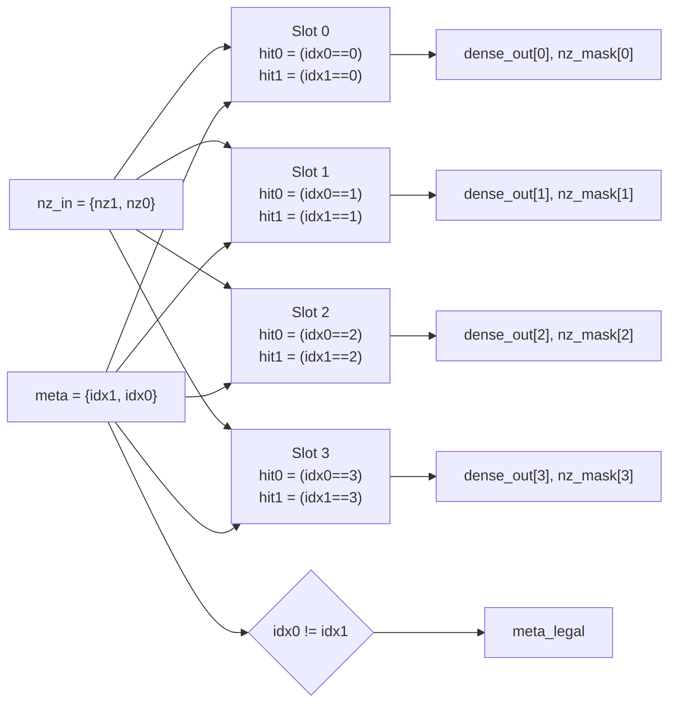
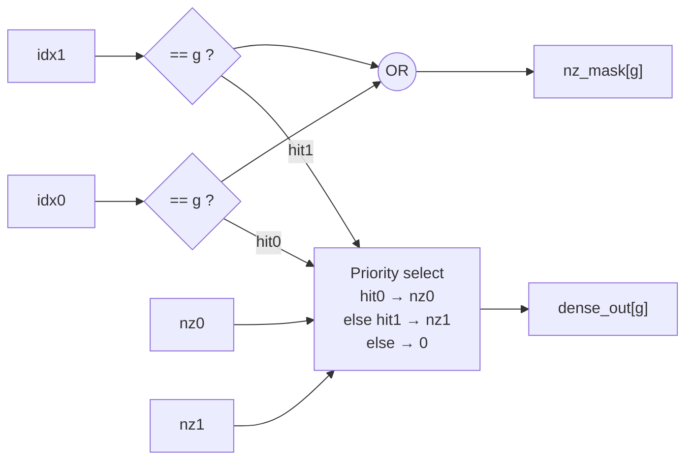

# Module 5 — `sparsity_decoder`: The 2:4 Structured-Sparsity Metadata Decoder

| Item | Value |
|---|---|
| RTL file | [src/sparsity_decoder.sv](../src/sparsity_decoder.sv) |
| Type | Purely combinational (no clock, no registers) |
| Golden model | `prune_group_2of4()`, `pack_meta_2of4()`, `pack_nz_pair()`, `expand_group_2of4()`, `prune_matrix_2of4()` in [golden/golden_model.py](../golden/golden_model.py#L173-L278) |
| Testbench | [tb/test_sparsity_decoder.py](../tb/test_sparsity_decoder.py) |
| Used by | `sparse_feeder` (one per array column, Module 6) |
| Role in the project | **Contribution 2 front-end.** Turns compressed 2:4 weights back into a dense group of four, with **explicit zeros** that the PEs then use to skip work and gate their clocks. |

---

## 1. What this module is and why I need it

Neural network weights contain many values that are zero or very close to
zero. If I could avoid storing and multiplying those values, I would save memory,
bandwidth and power. The problem is that **random** (unstructured) zeros are very
hard for hardware to exploit. Their positions are unpredictable, so the hardware
needs complex indexing logic that often costs more than it saves.

**2:4 structured sparsity** solves this by putting a simple rule on the zeros. I
use it the same way NVIDIA's Ampere GPUs do. The weights are stored in a
**compressed** form: only the non-zero values plus a small position tag.

This module is the **decoder**. It takes one compressed group (two values and
their two positions) and rebuilds the original group of four weights, putting
each value back in its slot and a **real zero** in the two empty slots. Those
zeros are what the rest of my design uses to save power.

---

## 2. Theory

### 2.1 Pruning and sparsity

**Pruning** means setting some weights of a trained network to zero. The
**sparsity** of a matrix is the fraction of its elements that are zero. For
example, 50 % sparsity means half the weights are zero.

There are two broad kinds:

| Kind | Rule | Advantage | Problem for hardware |
|---|---|---|---|
| Unstructured | Any weight can be zero | Highest accuracy for a given sparsity | Zero positions are random, which needs complex index logic and gives irregular memory access |
| Structured | Zeros follow a fixed pattern | Simple, regular hardware | Less freedom, so slightly more accuracy loss (usually recovered by fine-tuning) |

### 2.2 The 2:4 rule

**2:4 structured sparsity** is a fine-grained structured pattern:

> In every group of **4 consecutive weights** along the dot-product (K)
> dimension, **at most 2 are non-zero**.

This gives exactly **50 % sparsity**, and it is very regular: every group has the
same size and the same number of survivors. That regularity is what makes it
easy for hardware. The decoder logic is the same for every group, and the
compressed data has a fixed size.

Example. One column of B, with K = 8, so two groups:

```
                      group 0              group 1
position         :  [  0,   1,   2,   3 |   0,   1,   2,   3 ]
original weights :  [ 12,  -3,  45,   7 | -60,   2,   0,  33 ]
pruned (dense)   :  [ 12,   0,  45,   0 | -60,   0,   0,  33 ]
```

In each group I keep the two values with the largest magnitude:

- Group 0 = {12, −3, 45, 7}. The largest magnitudes are **45** (position 2) and
  **12** (position 0). −3 and 7 are set to zero.
- Group 1 = {−60, 2, 0, 33}. The largest magnitudes are **−60** (position 0) and
  **33** (position 3). 2 and 0 are set to zero.

### 2.3 How a group is stored (compressed format)

For each group I store only:

- the **two surviving values** `nz0`, `nz1`, 8 bits each, and
- their **positions** `idx0`, `idx1`, 2 bits each (a position is 0…3).

| Field | Group 0 | Group 1 |
|---|---|---|
| `nz0`, `idx0` | 12, 0 | −60, 0 |
| `nz1`, `idx1` | 45, 2 | 33, 3 |
| `meta` = `{idx1, idx0}` | `4'b10_00` = 0x8 | `4'b11_00` = 0xC |

The 4-bit position word is called the **metadata**.

### 2.4 How much storage does it really save?

| Format (INT8) | Bits per group of 4 | Relative |
|---|---|---|
| Dense | 4 × 8 = 32 | 100 % |
| 2:4 compressed | 2 × 8 + 4 (metadata) = 20 | **62.5 %** |

So the weight **values** are halved (50 %), but the metadata adds 1 bit per
weight. The **net** saving in weight memory and bandwidth is **37.5 %** at INT8.
(At FP16 the same format saves 43.75 %, because the metadata is a smaller share
of the total. This is the number usually quoted for GPUs.)

**Is 4 bits of metadata the minimum?** There are $\binom{4}{2} = 6$ ways to choose
2 positions out of 4, so in theory $\lceil \log_2 6 \rceil = 3$ bits would be
enough. I use the simple 2 + 2 bit format (one index per survivor), as NVIDIA
does, because decoding it needs only two tiny comparators per slot. A 3-bit code
would need a lookup table and would save only 1 bit per group.

### 2.5 What the decoder must do

The decoder is the **inverse** of compression:

$$
\text{dense}[g] =
\begin{cases}
nz_0 & \text{if } g = idx_0 \\
nz_1 & \text{if } g = idx_1 \\
0 & \text{otherwise}
\end{cases}
\qquad g \in \{0,1,2,3\}
$$

This operation is called a **scatter**: two inputs are written to two chosen
places among four outputs.

### 2.6 Two ways to exploit sparsity in hardware — and which one I chose

Once the weights are 2:4 sparse, there are two different ways an accelerator can
benefit:

| Approach | What the hardware does | Gain |
|---|---|---|
| **A. Skip for speed** (NVIDIA Sparse Tensor Core) | Uses the metadata to **select** the 2 matching activations out of 4, and only does 2 MACs per group | **2× throughput** + bandwidth |
| **B. Expand and gate for power** (my design) | Expands back to 4 values with explicit zeros, and the PE **detects** the zeros and gates its clock | Bandwidth + **dynamic power**; same throughput |

I chose **B**. The reason is my **output-stationary systolic** dataflow. In
approach A, each PE would need to receive all 4 activations of a group and pick
2 of them using that column's metadata. But in a systolic array, the activations
for a row flow **through** all columns, and each column has **different**
metadata. So every PE would need a 4-wide activation input and its own
selection mux, which breaks the simple 1-byte-per-hop mesh. Approach B keeps the
mesh exactly as it is. The sparsity is handled **at the edge** of the array
(this decoder) and **inside each PE** (the zero detection from Module 3).

The trade-off, which I state openly: **2:4 sparsity in my design does not make
the array faster.** It reduces the weight bandwidth into the array by 37.5 % and
lets about half of all MAC cycles be clock-gated. That is a **power and
bandwidth** contribution, not a throughput one. Approach A for systolic arrays is
a possible extension (Section 7.3).

### 2.7 Why explicit zeros are the key

The decoder outputs real zero bytes in the pruned slots. When such a zero reaches
a PE, the PE's `zero_operand` detector (Module 3, Section 5.2) sees `b_in == 0`.
The PE then:

1. forces its multiplier inputs to zero (operand isolation), and
2. stops the clock to its MAC pipeline registers (clock gating).

So the **2:4 structure guarantees that at least 50 % of the weight bytes entering
the array are zero**. Every one of those zeros becomes a skipped, gated MAC in all
8 PEs of that column, as the zero travels south. The decoder creates the zeros,
and the PEs turn them into power savings.

---

## 3. Interface

### 3.1 Parameter

| Parameter | Default | Meaning |
|---|---|---|
| `DATA_WIDTH` | 8 | Width of one weight value. |

### 3.2 Ports (no clock, no reset: the module is combinational)

| Port | Dir | Width | Description |
|---|---|---|---|
| `nz_in` | in | 2×8 = 16 | The two survivors, packed as `{nz1, nz0}`. |
| `meta` | in | 4 | Positions, packed as `{idx1[1:0], idx0[1:0]}`. |
| `dense_out` | out | 4×8 = 32 | The rebuilt group. Slot $g$ = `dense_out[g*8 +: 8]`. |
| `nz_mask` | out | 4 | Bit $g$ = 1 if slot $g$ holds a survivor. |
| `meta_legal` | out | 1 | 0 if `idx0 == idx1` (illegal metadata). |

---

## 4. Microarchitecture

### 4.1 Structure

The decoder is four identical **slot circuits**, one per output position:



### 4.2 One slot in detail



### 4.3 Hardware cost

Each output bit of a slot depends on exactly **6 inputs**: `idx0` (2 bits),
`idx1` (2 bits), one bit of `nz0` and the same bit of `nz1`. A 7-series LUT6 can
implement **any** function of 6 inputs, so each output bit fits in a single LUT
with **one logic level**:

| Output | Count | Inputs each | Est. LUTs |
|---|---|---|---|
| `dense_out` bits | 32 | 6 | 32 |
| `nz_mask` bits | 4 | 4 | 4 |
| `meta_legal` | 1 | 4 | 1 |
| **Total** | | | **≈ 37 LUT6, 1 level** |

This is my analytical estimate for a standalone decoder. Inside `sparse_feeder`,
Vivado merges the decoder with the slot-select mux, so the final per-column count
is reported there (Module 6). Either way, the decoder is tiny compared with even
one PE.

---

## 5. RTL implementation walkthrough

### 5.1 Unpacking the inputs — [sparsity_decoder.sv L48-L54](../src/sparsity_decoder.sv#L48-L54)

```systemverilog
assign nz0  = nz_in[0 +: DATA_WIDTH];
assign nz1  = nz_in[DATA_WIDTH +: DATA_WIDTH];
assign idx0 = meta[1:0];
assign idx1 = meta[3:2];
```

I give names to the fields of the packed buses. The packing order (`nz0` and
`idx0` in the low bits) matches `pack_nz_pair()` and `pack_meta_2of4()` in the
golden model exactly. If the two ever disagreed, every test would fail at once,
so this convention is locked.

### 5.2 Legality check — [sparsity_decoder.sv L56](../src/sparsity_decoder.sv#L56)

```systemverilog
assign meta_legal = (idx0 != idx1);
```

A legal 2:4 group has two **different** positions. Of the 16 possible metadata
values, 12 are legal and 4 are illegal (`0x0`, `0x5`, `0xA`, `0xF`, where both
indices are equal). Illegal metadata can only come from a bug in the compression
software or from corrupted memory. I don't want the hardware to hide that, so I
expose it as a signal that the testbench (and, in a real system, an error
register) can check.

### 5.3 The four slots — [sparsity_decoder.sv L61-L74](../src/sparsity_decoder.sv#L61-L74)

```systemverilog
for (g = 0; g < 4; g++) begin : g_slot
    logic hit0, hit1;
    assign hit0 = (idx0 == 2'(g));
    assign hit1 = (idx1 == 2'(g));

    assign dense_out[g*DATA_WIDTH +: DATA_WIDTH] =
               hit0 ? nz0 :
               hit1 ? nz1 : '0;

    assign nz_mask[g] = hit0 | hit1;
end
```

- `2'(g)` casts the loop number to 2 bits, so the comparison has matching widths
  (no lint warnings, no silent extension).
- `hit0` / `hit1` answer: "is survivor 0 / survivor 1 meant for this slot?"
- The nested `? :` is a **priority** select. If `hit0` is true, `nz0` wins.
  This only matters for **illegal** metadata (both hits true in the same slot).
  For legal metadata at most one hit is true in each slot, so the priority has no
  effect.
- `'0` drives the **explicit zero** for pruned slots. This is the most important
  line of the module: it produces the zeros that the PEs gate on.
- `nz_mask` reports which slots got a real survivor. Note that a survivor can
  itself be the value 0 (if a group had fewer than 2 non-zeros). In that case
  `nz_mask` is 1 but `dense_out` is 0, and the PE will still gate on it, which is
  correct.

### 5.4 Why there are no registers

The module uses only `assign` statements: no `always_ff`, and no clock port. I
designed it this way deliberately:

- A register here would add one cycle of delay **only to the B path**, which
  would break the $i + j + k$ skew contract of the array, unless every user
  compensated for it.
- A pure function is easier to verify (no timing, just inputs → outputs) and
  easier to reuse.

When the full path later turned out to be too slow for 250 MHz on the FPGA, I
added the pipeline register in the **feeder** that wraps this decoder (Module 6),
not here. The decoder stays a pure combinational function.

---

## 6. Worked example (all slots)

Group 1 from Section 2.3: `nz0 = −60` (0xC4), `nz1 = 33` (0x21), `meta = 0xC`, so
`idx0 = 0` and `idx1 = 3`.

| Slot g | hit0 (idx0 == g) | hit1 (idx1 == g) | `dense_out[g]` | `nz_mask[g]` |
|---|---|---|---|---|
| 0 | **1** | 0 | **−60** | 1 |
| 1 | 0 | 0 | 0 | 0 |
| 2 | 0 | 0 | 0 | 0 |
| 3 | 0 | **1** | **33** | 1 |

`meta_legal` = (0 ≠ 3) = 1. The output is [−60, 0, 0, 33], which is the original
pruned group ✓.

**Illegal example:** `meta = 0x5` (`idx0 = idx1 = 1`), `nz0 = 55`, `nz1 = −77`.
Slot 1 has both hits, so the priority gives 55. Output [0, 55, 0, 0],
`nz_mask` = `0010`, `meta_legal` = **0**. `nz1` is dropped, and the flag reports
the problem.

---

## 7. Design decisions and trade-offs

### 7.1 Summary

| Decision | Alternative I rejected | Reason |
|---|---|---|
| 2:4 structured sparsity | Unstructured sparsity | Fixed group size gives a fixed-size, tiny decoder; industry-standard (NVIDIA Ampere and later). |
| 2 + 2 bit metadata | 3-bit combinational code (6 patterns) | Decoding is two comparators per slot instead of a lookup table; saves only 1 bit per group. |
| Expand + explicit zeros (power) | Skip the zeros (speed, NVIDIA style) | Keeps the 1-byte-per-hop systolic mesh unchanged; each column's metadata can differ. |
| Purely combinational | Registered decoder | Doesn't disturb the skew; pipelining is done one level up in the feeder. |
| `nz0` priority on collision + `meta_legal` flag | Undefined behaviour, or OR both values | Deterministic, matches the golden model bit for bit, and the error is visible. |
| Sparsity along K (per column of B) | Along N | The group of 4 must be 4 consecutive k-steps of one dot product, which is the stream one column receives. |

### 7.2 Pruning policy (software side, in the golden model)

`prune_group_2of4()` keeps the **two largest magnitudes** in each group (ties go
to the lower index) and returns them with `idx0 < idx1`, so the metadata is
canonical and reproducible. This is the standard magnitude-pruning heuristic.
In a real deployment, the network is fine-tuned after pruning to recover
accuracy (NVIDIA's ASP flow does exactly this). Training is outside the scope of
my hardware work. I only need correctly-formed 2:4 data to test the hardware.

The decoder itself does **not** require `idx0 < idx1`. Any of the 12 legal
orderings decodes correctly, and my testbench checks all of them.

### 7.3 Possible extension: skipping for speed

To also get a 2× speed-up, each PE would have to receive a whole group of
**four** activations per step (a 32-bit A link instead of 8-bit). The metadata
would travel south with the compressed weights, and each PE would use a small
4-to-2 select mux to pick the two activations that match its two surviving
weights. That quadruples the A wiring and adds a mux to every PE. I note it as
future work, because my goal was to add sparsity **without** changing the
systolic mesh.

---

## 8. Verification

The testbench is combinational: it applies inputs, waits 1 ns for them to
settle, and compares the outputs with `expand_group_2of4()`. That golden function
reproduces the RTL behaviour exactly, **including** the collision rule.

| Test | What it checks | Size |
|---|---|---|
| `test_metadata_exhaustive` | **All 16** metadata encodings (12 legal + 4 illegal) × 7 representative values {0, ±1, 127, −128, 42, −99} for both survivors. Checks `dense_out`, `nz_mask` and `meta_legal`. | 784 vectors |
| `test_legal_2of4_placement` | For all 12 legal index pairs, with **non-zero** random survivors (so a dropped value can't hide as a zero): each survivor is in the right slot, and both pruned slots are exactly 0. | 240 vectors |
| `test_illegal_metadata_flagged` | All 4 colliding encodings: `meta_legal = 0`, `nz0` wins, exactly one non-zero output. | 4 vectors |
| `test_sparsity_rate_is_exactly_two_of_four` | The 2:4 contract itself: legal metadata always gives exactly 2 survivors and 2 zeros. | 500 random groups |

The metadata input space is only 4 bits, so I could test it **exhaustively**.
Every possible metadata value is proven correct, not just sampled.

Run with: `cd tb && make TEST=decoder`.

In synthesis I also checked that the decoder infers **no flip-flops and no
latches**. A latch would appear if any slot were missing an `else` branch, and
the `'0` default prevents that.

---

## 9. Implementation results

The decoder is never synthesized on its own. It is instantiated inside
`sparse_feeder` (one per column, so 8 in total), which is part of the
`sparse_nogate` and `full` synthesis configs. I report its area together with the
feeder and the sparse array in Modules 6 and 8. My analytical estimate is
**about 37 LUT6 per decoder, with one logic level** (Section 4.3).

---

## 10. Report-ready summary

> The sparsity decoder implements the front end of 2:4 structured sparsity. In
> every group of four consecutive weights along the contraction dimension, at
> most two are non-zero. Each group is stored as two 8-bit survivors plus a 4-bit
> metadata word holding their 2-bit positions. This reduces INT8 weight storage
> and bandwidth from 32 to 20 bits per group, a net saving of 37.5 %. The decoder
> is a purely combinational scatter. For each of the four output slots, two 2-bit
> comparators decide whether the slot receives the first survivor, the second
> survivor, or an explicit zero. Each output bit depends on only six inputs, so
> it maps to a single LUT6 level on the FPGA. Metadata with colliding indices is
> handled deterministically (the first survivor wins) and flagged on a
> `meta_legal` output. Rather than skipping zero weights for throughput, as GPU
> sparse tensor cores do, my design re-expands them. The explicit zeros keep the
> one-byte-per-hop systolic mesh unchanged, and they drive the per-PE zero
> detection and clock gating that turn the guaranteed 50 % weight sparsity into
> dynamic power savings. I verified the decoder exhaustively over all 16
> metadata encodings, with additional placement, illegal-input and density
> tests.

---

## 11. References

1. A. Mishra et al., "Accelerating Sparse Deep Neural Networks," arXiv:2104.08378, 2021 (NVIDIA 2:4 structured sparsity and the ASP pruning flow).
2. NVIDIA, *NVIDIA A100 Tensor Core GPU Architecture* white paper, 2020 (Sparse Tensor Cores, metadata format).
3. S. Han, H. Mao and W. J. Dally, "Deep Compression: Compressing Deep Neural Networks with Pruning, Trained Quantization and Huffman Coding," *Proc. ICLR*, 2016.
4. A. Zhou et al., "Learning N:M Fine-grained Structured Sparse Neural Networks From Scratch," *Proc. ICLR*, 2021.
5. Y.-H. Chen, T. Krishna, J. Emer and V. Sze, "Eyeriss: An Energy-Efficient Reconfigurable Accelerator for Deep Convolutional Neural Networks," *IEEE JSSC*, 2017 (zero-skipping / clock-gating on zero operands).

---

### Figures to export for the Word report

| Figure | Source | Suggested caption |
|---|---|---|
| Fig. 5.1 | Section 2.2–2.3 example (draw as boxes: original → pruned → compressed + metadata) | 2:4 structured pruning and compressed storage of one weight column |
| Fig. 5.2 | Section 4.1 Mermaid block | Structure of the combinational 2:4 sparsity decoder |
| Fig. 5.3 | Section 4.2 Mermaid block | Logic of one output slot |
| Table 5.x | Section 2.6 table | Skip-for-speed vs expand-and-gate approaches to 2:4 sparsity |
| Table 5.y | Section 2.4 table | Storage cost of dense and 2:4 compressed INT8 weights |
