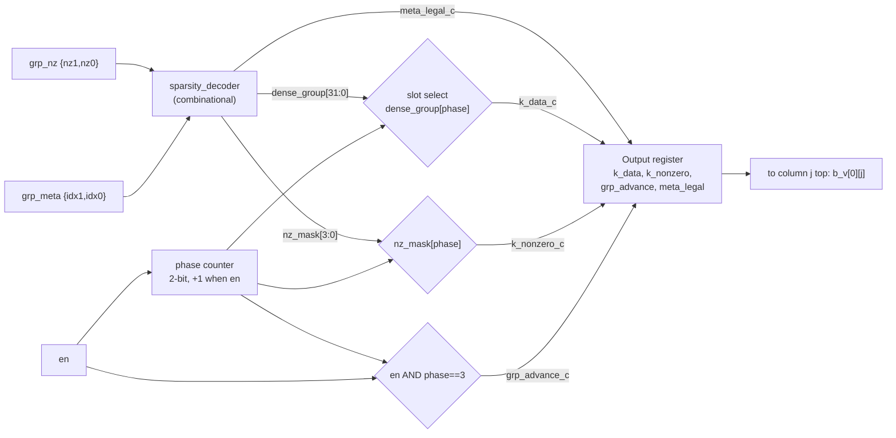

# Module 6 — `sparse_feeder`: The North-Edge 2:4 Weight Expander

| Item | Value |
|---|---|
| RTL file | [src/sparse_feeder.sv](../src/sparse_feeder.sv) |
| Contains | one `sparsity_decoder` (see [05_sparsity_decoder.md](05_sparsity_decoder.md)) |
| Used by | `systolic_array_sparse` (one feeder per column, so 8 in total) |
| Golden model | `prune_matrix_2of4()` in [golden/golden_model.py](../golden/golden_model.py#L255) |
| Testbench | Tested inside the array: [tb/test_array_sparse.py](../tb/test_array_sparse.py) (`stream_sparse()`) |
| Role in the project | Turns a **compressed group** (2 values + metadata, once every 4 cycles) into a **dense stream** (one weight per cycle) at the top of each array column. |

---

## 1. What this module is and why I need it

The decoder from Module 5 rebuilds a whole group of **four** weights at once. But
an array column does not want four weights at once. It wants **one weight per
cycle**, because each PE does one MAC per cycle and the B values move south one
hop per cycle.

So I need a small block between the compressed weight source and the top of each
column that:

1. holds one compressed group,
2. decodes it into four dense weights,
3. sends them out **one per cycle**, in order, over four cycles, and
4. tells the source when to present the **next** group.

That is the **feeder**. It is the "parallel to serial" step of my sparsity path.
It sits **outside** the systolic mesh, at the north edge, so the mesh itself
stays exactly as it was.

---

## 2. Theory

### 2.1 Rate matching: compressed in, dense out

| Side | What moves | How often |
|---|---|---|
| Input (from memory) | 1 group = 2 × 8-bit values + 4-bit metadata = 20 bits | once every 4 cycles |
| Output (into the column) | 1 dense 8-bit weight | every cycle |

Over 4 cycles, the column receives 4 × 8 = 32 bits of dense weights, but only 20
bits had to come from memory. So the **average weight bandwidth per column** drops
from 8 bits/cycle to **5 bits/cycle** (−37.5 %). This is where the memory-side
benefit of 2:4 sparsity is actually realized.

### 2.2 Walking a group: the phase counter

To send the four slots in order, the feeder needs to know **which slot** it is on.
I use a **2-bit counter**, `phase`, that counts 0 → 1 → 2 → 3 → 0 … Each cycle,
the feeder outputs `dense_group[phase]`. When `phase` is 3, the group is finished,
and the feeder raises `grp_advance` to ask for the next group. A 2-bit counter
wraps from 3 back to 0 by itself, so no extra logic is needed for that.

The k-step being sent is therefore:

$$
k = 4 \cdot (\text{group number}) + \text{phase}
$$

### 2.3 Why each column needs its own feeder and its own enable

Because of the systolic skew (Module 2), **column $j$ starts $j$ cycles later**
than column 0. So at any given cycle, different columns are at **different
k-steps**, and so at different phases and different groups. A single shared
counter could not serve them all. Each column therefore gets:

- its own feeder (its own `phase` counter), and
- its own enable bit `feed_en[j]`, which the driver turns on when that column's
  stream should start.

The enable also lets a column **pause** without losing its place: `phase` only
advances when `en = 1`.

### 2.4 Pipelining at a boundary, and the "matched delay" rule

In a systolic array, A and B must meet at PE$(i,j)$ in the **same cycle**. If I
add a register to the **B path only** (here, at the feeder output), every weight
arrives one cycle late, while the activations do not. The pairs no longer line
up.

The general rule is: **any extra delay on one input path must be matched by the
same delay on the other input path.** In my design, the feeder has one output
register, so the activations must also be injected one cycle later. I explain
in Section 6 exactly how the driver does this.

---

## 3. Interface

### 3.1 Parameter

| Parameter | Default | Meaning |
|---|---|---|
| `DATA_WIDTH` | 8 | Weight width. |

### 3.2 Ports

| Port | Dir | Width | Description |
|---|---|---|---|
| `clk`, `rst` | in | 1 | Clock, synchronous reset (resets `phase` to 0). |
| `en` | in | 1 | Advance one k-step this cycle. Low = hold (column not started, or paused). |
| `grp_nz` | in | 16 | Current group's survivors `{nz1, nz0}`. **Must stay stable for the 4 enabled cycles of the group.** |
| `grp_meta` | in | 4 | Current group's metadata `{idx1, idx0}`. Same stability rule. |
| `k_data` | out | 8 | Dense weight for this k-step (registered). Goes to `b_v[0][j]`, the top of column $j$. |
| `k_nonzero` | out | 1 | 1 if this k-step is a survivor (registered). |
| `grp_advance` | out | 1 | Strobe: the group has been fully consumed (registered). |
| `meta_legal` | out | 1 | 0 if the current group's metadata is illegal (registered). |

---

## 4. Microarchitecture



The feeder has only **two pieces of state**:

| Register | Bits | Purpose |
|---|---|---|
| `phase` | 2 | Which slot of the group to send next. |
| Output register | 8 + 1 + 1 + 1 = 11 | Breaks the long combinational path to the PE (Section 7.1). |

---

## 5. RTL implementation walkthrough

### 5.1 The decoder instance — [sparse_feeder.sv L82-L90](../src/sparse_feeder.sv#L82-L90)

```systemverilog
sparsity_decoder #(.DATA_WIDTH(DATA_WIDTH)) u_dec (
    .nz_in      (grp_nz),
    .meta       (grp_meta),
    .dense_out  (dense_group),
    .nz_mask    (nz_mask),
    .meta_legal (meta_legal_c)
);
```

The decoder is used exactly as designed and tested in Module 5. It continuously
decodes whatever group is on the inputs. Because the group is stable for four
cycles, `dense_group` is also stable for those four cycles, and the feeder just
picks a different slot each cycle.

### 5.2 Phase counter — [sparse_feeder.sv L92-L97](../src/sparse_feeder.sv#L92-L97)

```systemverilog
always_ff @(posedge clk) begin
    if (rst)
        phase <= 2'd0;
    else if (en)
        phase <= phase + 2'd1;
end
```

- `phase + 2'd1` on a 2-bit register wraps 3 → 0 automatically.
- `phase` only moves when `en` is high, so a column that has not started yet (or is
  paused) keeps its place.
- `phase` is reset by `rst` only, not by `acc_clear`. Between tiles it simply
  continues. This works because the dot-product depth $K$ must be a **multiple of
  4** (a 2:4 requirement anyway), so after each tile `phase` is back at 0. The
  `test_back_to_back_sparse_tiles` test checks this.

### 5.3 Slot selection — [sparse_feeder.sv L99-L105](../src/sparse_feeder.sv#L99-L105)

```systemverilog
assign k_data_c      = dense_group[phase*DATA_WIDTH +: DATA_WIDTH];
assign k_nonzero_c   = nz_mask[phase];
assign grp_advance_c = en && (phase == 2'd3);
```

- `dense_group[phase*8 +: 8]` is a 4:1 mux, selecting one byte out of four by
  `phase`.
- `grp_advance_c` is high in the cycle that consumes the **last** slot of the
  group.

### 5.4 Output register — [sparse_feeder.sv L107-L120](../src/sparse_feeder.sv#L107-L120)

```systemverilog
always_ff @(posedge clk) begin
    if (rst) begin
        k_data <= '0;  k_nonzero <= 1'b0;  grp_advance <= 1'b0;  meta_legal <= 1'b0;
    end else begin
        k_data      <= k_data_c;
        k_nonzero   <= k_nonzero_c;
        grp_advance <= grp_advance_c;
        meta_legal  <= meta_legal_c;
    end
end
```

All four outputs are registered **together**, so they always refer to the same
k-step. Note that the output register has **no enable**. When `en` is low, it
still loads the current slot of whatever group is on the inputs. That value then
enters the column with `valid = 0` for that row, so the PE ignores it.

### 5.5 How the array uses it

In `systolic_array_sparse`, `k_data` of feeder $j$ drives `b_v[0][j]`, the B
input of PE(0, $j$). `k_nonzero` is **not used** by the array (the PE detects
zeros on its own, from the byte value), so synthesis removes that register. It is
kept as a port for debugging and for possible future use.

---

## 6. Timing behaviour

### 6.1 Feeding one column

Two groups from Module 5: G0 = [12, 0, 45, 0] (meta 0x8) and G1 = [−60, 0, 0, 33]
(meta 0xC). `en = 1` from cycle 0 to 7. `k_data_c` is the combinational value
during the cycle; `k_data` is the registered output **visible** during the cycle.

| Cycle | Group on inputs | `phase` | `k_data_c` | `k_data` (visible) | `grp_advance` (visible) |
|---|---|---|---|---|---|
| 0 | G0 | 0 | 12 | 0 (reset) | 0 |
| 1 | G0 | 1 | 0 | **12** (k=0) | 0 |
| 2 | G0 | 2 | 45 | **0** (k=1) | 0 |
| 3 | G0 | 3 | 0 | **45** (k=2) | 0 |
| 4 | G1 | 0 | −60 | **0** (k=3) | **1** |
| 5 | G1 | 1 | 0 | **−60** (k=4) | 0 |
| 6 | G1 | 2 | 0 | **0** (k=5) | 0 |
| 7 | G1 | 3 | 33 | **0** (k=6) | 0 |
| 8 | — (en=0) | 0 | — | **33** (k=7) | **1** |

So **weight k-step $k$ is visible at the top of the column in cycle $k + 1$**: one
cycle after it was selected, because of the output register. Exactly half of the
dense weights the column receives (k = 1, 3, 5, 6) are zeros. Each of those
becomes a gated MAC in all 8 PEs of the column.

### 6.2 Keeping A and B aligned across the array

With the feeder for column $j$ enabled from cycle $j$:

$$
\text{B}[k][j] \text{ reaches PE}(0,j) \text{ at cycle } j + k + 1
\quad\Rightarrow\quad
\text{reaches PE}(i,j) \text{ at cycle } i + j + k + 1
$$

So the activations must also arrive one cycle later than in the dense array. The
driver injects $A[i][k]$ at cycle $i + k + \mathbf{1}$ instead of $i + k$:

$$
\text{A}[i][k] \text{ reaches PE}(i,j) \text{ at cycle } (i + k + 1) + j = i + j + k + 1 \ \checkmark
$$

Both arrive together, and the skew contract still holds, shifted by one cycle
everywhere. The full sparse tile therefore takes **one cycle longer** than the
mixed array: $2N + K + 1$.

There are two ways to match the delay:

| Option | Driver change | Why I chose / rejected it |
|---|---|---|
| **Delay A by 1** (chosen, in `stream_sparse()`) | Inject $A[i][k]$ at $i + k + 1$, `feed_en[j]` from cycle $j$ | Simple and causal. Weights for column 0 start at cycle 0 as before. |
| Start B 1 earlier | `feed_en[j]` from cycle $j - 1$ | For column 0 this means cycle −1, i.e. driving data before the stream starts. That is awkward for the driver. |

### 6.3 Two different "is there a one-cycle offset?" questions

During development I mixed these two questions up, so I want to state them
clearly:

1. **Reading the feeder's own outputs** (for example, `meta_legal` in the
   testbench): **no compensation needed.** The output register's input comes
   straight from **this** cycle's `grp_meta`. So "drive the inputs, wait for the
   clock edge, read the output" gives the result for the inputs just driven,
   exactly as with a wire.
2. **Pairing feeder outputs with activations in the mesh**: **compensation needed.**
   The weights pass through one register and the activations pass through none,
   so the activations must be delayed by one cycle (6.2).

---

## 7. Design decisions and trade-offs

### 7.1 Why the output register exists

Without the register, there was one long combinational path from the feeder into
the first PE:

```
phase register → 4:1 slot mux → decoder scatter → PE b_in
   → zero detect / operand isolation → pre-conditioning → 5×5 multiply → m_*_q
```

On the Kintex-7 at 250 MHz, this path **missed timing by about 0.5 ns on more
than 115 endpoints** (the PE(0, j) row). Registering the feeder outputs cuts the
path in two. The cost is 11 flip-flops per column and one cycle of latency, which
the driver absorbs by delaying A (6.2).

I put the register **in the feeder**, not in the decoder, so that the decoder
stays a pure combinational function, which is easy to verify exhaustively
(Module 5), and so that all four feeder outputs stay aligned.

### 7.2 Summary of decisions

| Decision | Alternative I rejected | Reason |
|---|---|---|
| One feeder per column | One shared feeder | Columns are skewed, so each is at a different k-step at any time. |
| Feeder at the array boundary | Decode inside every PE | Decode once per column instead of once per PE (8× less logic); mesh unchanged. |
| 2-bit wrapping phase counter | Explicit modulo-4 logic | Free wrap-around in a 2-bit register. |
| Hold group for 4 enabled cycles | Source pushes one slot per cycle | Source fetches only once per group, which is the bandwidth saving. |
| Registered outputs | Purely combinational feeder | Needed for 250 MHz; latency handled by the driver. |
| `phase` not reset by `acc_clear` | Reset on every tile | Not needed when K is a multiple of 4; keeps the clear fanout smaller. |
| Delay A to compensate | Advance B (`feed_en` at $j-1$) | Causal and simpler for the driver. |

### 7.3 Limitations I found while documenting

1. **`grp_advance` is now one cycle "late" as a request.** Before the output
   register was added, `grp_advance` was high **during** the last cycle of a group,
   so a registered source could load the next group at that clock edge, just in
   time. Now it becomes visible **one cycle after** the last slot, which is the
   cycle the next group is already needed (cycle 4 in the table above). My
   testbench does not use `grp_advance`; it computes the group index directly
   from the cycle count, so all tests pass. But a real memory source driven by
   `grp_advance` would be one cycle late. The fix is either to expose the
   unregistered `grp_advance_c` as the request, or to let the source prefetch.
   I record this as a known interface issue.
2. **The source must hold the group stable for 4 enabled cycles.** This is a
   protocol rule, not checked in hardware. An assertion in the testbench (or a
   small input register in the feeder) would make it robust.
3. **2:4 on packed INT4×2 bytes.** In INT4×2 mode the feeder works on bytes,
   so a pruned byte removes **both** lanes (2 logical k-steps). The sparsity
   pattern is then "2:4 on lane pairs" (4:8 at lane level). The hardware handles
   this correctly. But my test pruning ranks packed bytes by their **signed byte
   value**, which is not a meaningful magnitude for two packed lanes. For real
   INT4 networks, the pruner should rank each byte by $|hi| + |lo|$. This only
   affects how the test data is chosen, not the correctness check.

---

## 8. Verification

The feeder is not tested on its own. I test it **inside** the full sparse array
(Module 8), because its job (pairing weights with activations at the correct
cycle) can only be judged there. Its correctness shows in these checks:

| Check (in [tb/test_array_sparse.py](../tb/test_array_sparse.py)) | What it proves about the feeder |
|---|---|
| `test_sparse_int8_random`, `test_sparse_int4x2_random` | Every expanded weight reaches the right PE at the right cycle: C matches `gemm_golden(A, B_pruned)` exactly. |
| `test_back_to_back_sparse_tiles` | `phase` re-aligns to 0 after each tile (6 tiles in a row). |
| `test_zero_weight_group_gates_cleanly` | All-zero groups give clean zeros, with no stale data. |
| Live `meta_legal` check in `stream_sparse()` | Every **active** column carries legal metadata on every cycle. Inactive columns legitimately show `meta = 0` (illegal) and are masked out. |

The decoder inside the feeder was already proven exhaustively in Module 5, so
these tests focus on the **sequencing**: the phase, the enable, and the latency
alignment.

---

## 9. Implementation results

The feeder's cost shows up as the difference between the `mixed` and
`sparse_nogate` FPGA configurations (same PEs, gating off; the only addition is
the 8 feeders):

| Metric | `mixed` | `sparse_nogate` | Δ (8 feeders) | Per feeder |
|---|---|---|---|---|
| LUTs | 9,549 | 9,910 | +361 | ≈ 45 |
| Flip-flops | 6,716 | 6,812 | +96 | 12 |
| WNS @ 4.0 ns | +0.064 ns | +0.120 ns | — | — |

- **12 FFs per feeder** = 2 (`phase`) + 8 (`k_data`) + 1 (`grp_advance`) + 1
  (`meta_legal`). The unused `k_nonzero` register was removed by synthesis. This
  matches the RTL exactly.
- **≈ 45 LUTs per feeder** = the decoder (≈ 37 LUT6, Module 5) + the 4:1 phase
  mux + the counter. Together the 8 feeders add **3.8 %** LUTs to the mixed array.
- **Timing slightly improved** (+0.064 → +0.120 ns), thanks to the output
  register: the critical path is no longer anywhere near the feeder.

---

## 10. Report-ready summary

> The sparse feeder is the boundary block that connects a compressed 2:4 weight
> source to one column of the systolic array. Each column has its own feeder,
> because the systolic skew places every column at a different k-step. The feeder
> holds one compressed group (two 8-bit survivors and 4 bits of metadata) for four
> enabled cycles. It decodes the group with the combinational `sparsity_decoder`,
> and it uses a 2-bit wrapping phase counter to emit one dense weight per cycle,
> with explicit zeros in the pruned slots. A strobe asks the source for the next
> group. This reduces the average weight bandwidth per column from 8 to 5 bits per
> cycle, while the mesh still receives an unmodified dense stream. To close timing
> at 250 MHz, I registered the feeder outputs. This adds one cycle to the weight
> path, which the driver compensates by injecting activations one cycle later, so
> that A[i][k] and B[k][j] still meet at PE(i,j), now in cycle i + j + k + 1. On a
> Kintex-7, each feeder costs about 45 LUTs and 12 flip-flops; all eight together
> add 3.8 % LUTs to the precision-adaptive array, with no loss of timing margin.

---

## 11. References

1. A. Mishra et al., "Accelerating Sparse Deep Neural Networks," arXiv:2104.08378, 2021.
2. NVIDIA, *NVIDIA A100 Tensor Core GPU Architecture* white paper, 2020.
3. H. T. Kung, "Why Systolic Architectures?," *IEEE Computer*, vol. 15, no. 1, 1982 (boundary I/O and matched delays in systolic arrays).

---

### Figures to export for the Word report

| Figure | Source | Suggested caption |
|---|---|---|
| Fig. 6.1 | Section 4 Mermaid block | Microarchitecture of the per-column sparse feeder |
| Fig. 6.2 | Section 6.1 table (redraw as a WaveDrom/timing diagram: clk, phase, k_data_c, k_data, grp_advance) | Expanding two compressed groups into a dense weight stream |
| Fig. 6.3 | Section 7.1 path (redraw as a chain of boxes with the register cut marked) | Critical path before and after the feeder output register |
| Table 6.x | Section 6.2 table | Options for compensating the feeder register latency |
| Table 6.y | Section 9 table | FPGA cost of the eight sparse feeders |

**Tip for Fig. 6.2:** timing diagrams look best drawn with **WaveDrom**
(wavedrom.com, free, exports SVG). Mermaid has no timing-diagram type. A WaveDrom
source for this figure is short. Ask me and I will write it.

