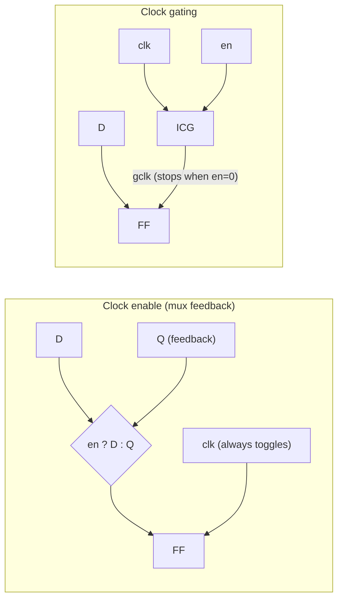
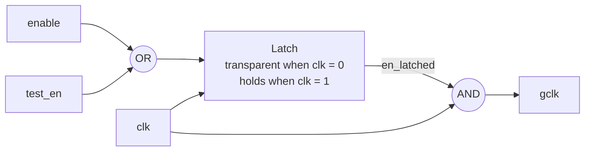
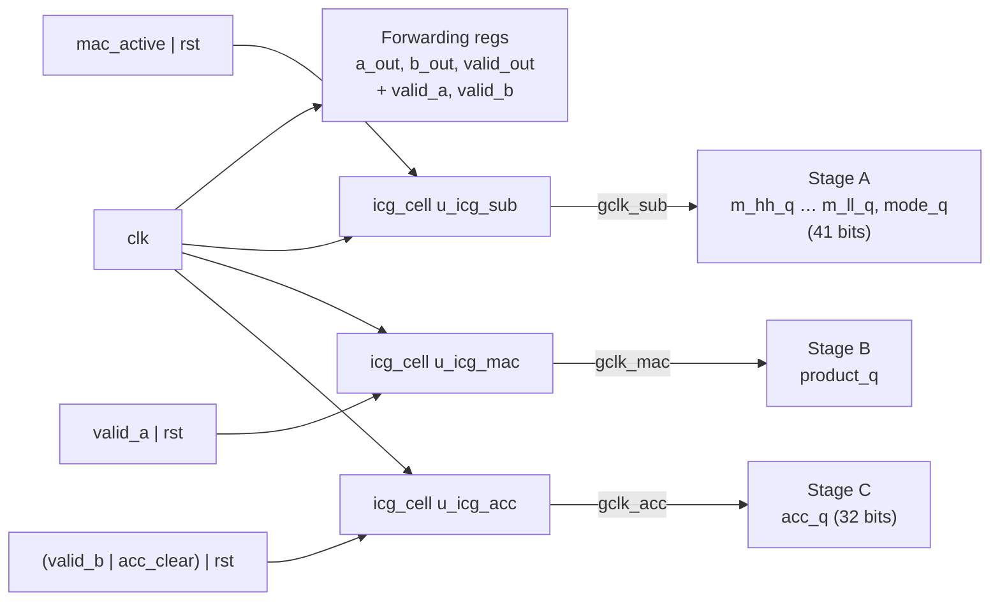

# Module 7 — `icg_cell`: The Integrated Clock-Gating Cell

| Item | Value |
|---|---|
| RTL file | [src/icg_cell.sv](../src/icg_cell.sv) |
| Type | One wrapper, **four** implementations selected by compile-time macros |
| Used by | `pe_mixed` (3 instances per PE when `ENABLE_GATING = 1`; see [03_pe_mixed.md](03_pe_mixed.md)) |
| Instances in the full 8×8 array | 3 × 64 = **192** |
| Tested by | `tb/test_pe_mixed.py` and `tb/test_array_sparse.py` with `GATING=1` |
| Role in the project | **Contribution 3.** The cell that actually stops the clock to a PE's MAC registers when there is no useful work. |

---

## 1. What this module is and why I need it

In Module 3, the PE decides **when** a pipeline stage has no useful work (an idle
cycle, or a zero operand). This module is the piece of hardware that **acts** on
that decision: it takes the main clock and an enable signal, and produces a
**gated clock** that only ticks when the enable is high.

It looks like a tiny module, but it is the part of my design where the
difference between FPGA and ASIC matters most. A clock gate is a standard,
safe cell on an ASIC, but on an FPGA it is a scarce and risky resource. So I
wrote **one wrapper with several implementations**, and I choose one at compile
time depending on the target. This section explains why each one exists and how
honestly each one can be reported.

---

## 2. Theory

### 2.1 Where dynamic power goes

The dynamic power of CMOS logic is:

$$
P_{dyn} = \alpha \cdot C \cdot V_{DD}^2 \cdot f
$$

- $\alpha$ = activity factor (how often a node switches per cycle)
- $C$ = capacitance being charged and discharged
- $V_{DD}$ = supply voltage
- $f$ = clock frequency

For normal data signals, $\alpha$ is usually well below 1. The **clock** is
different. It switches **twice every cycle**, always, whether anything useful is
happening or not. And the clock drives the clock pin of **every flip-flop**,
through a large tree of buffers. So the clock network has the highest activity
and a large capacitance. In typical digital designs, the clock tree plus the
flip-flop clock pins account for roughly **30–50 % of total dynamic power**.

This leads to the key observation: **a flip-flop whose value does not change
still burns power, just because its clock keeps toggling.**

### 2.2 Clock enable vs. clock gating

There are two ways to make a register "hold" its value:



| | Clock enable | Clock gating |
|---|---|---|
| How | A mux feeds Q back to D when `en = 0` | The clock itself is stopped when `en = 0` |
| FF clock pin toggles when holding? | **Yes** | **No** |
| Clock-tree branch toggles? | **Yes** | **No** (everything after the gate is quiet) |
| Extra logic | One mux per bit | One ICG cell per **group** of FFs |
| Saves | Downstream data toggling | Data toggling **plus** clock power |

A clock enable only stops the **data** from changing. Clock gating also stops the
**clock** for a whole group of registers, so it saves more. It is also usually
**smaller**, since one ICG cell replaces a mux on every bit. For example, my
Stage-A registers are 40 bits wide, so one ICG replaces 40 muxes.

### 2.3 Why a plain AND gate is dangerous

The simplest idea is `gclk = clk & enable`. The problem is **glitches**. If
`enable` changes while `clk` is high, the output becomes a **shortened clock
pulse** (or a pulse that starts in the middle of a cycle). A flip-flop can see
that as an extra, unexpected clock edge, or can fail to capture correctly because
the pulse is too short. That corrupts data, and it is very hard to debug.

```
            ┌───┐   ┌───┐   ┌───┐
clk      ───┘   └───┘   └───┘   └───
                  ┌─────────┐
enable   ─────────┘ ↑       └─────────     (changes while clk is HIGH)
                  ┌┐      ┌┐
clk & en ─────────┘└──────┘└──────────     two broken, short pulses ✗
```

### 2.4 The latch-based ICG

The standard fix is to put a **latch** in front of the AND gate. The latch is
**transparent while `clk` is low** and **holds while `clk` is high**:



- While `clk` is **low**, the AND output is 0 no matter what, so `enable` is free
  to change. The latch just follows it.
- When `clk` **rises**, the latch closes and freezes `en_latched`.
- While `clk` is **high**, `en_latched` **cannot change**, so the AND output is
  either a complete, clean high pulse or nothing at all.

```
            ┌───┐   ┌───┐   ┌───┐
clk      ───┘   └───┘   └───┘   └───
                  ┌─────────┐
enable   ─────────┘         └─────────
                      ┌───────┐
en_latched ───────────┘       └───────   (only changes while clk is LOW)
                        ┌───┐
gclk     ───────────────┘   └─────────   one full, clean pulse ✓
```

**Timing of the enable.** The enable is launched by a flip-flop at a rising
edge. It must be stable before the **next** rising edge, when the latch closes.
So the enable logic has (almost) a full clock period. It is a normal setup check
from the launching flip-flop to the ICG latch, which static timing analysis
handles automatically.

This structure (latch + AND, plus an OR for test) is exactly what every standard
cell library offers as a single **ICG cell** (often named `CLKGATE`, `ICG`,
`CLKGATETST`, …).

### 2.5 The test enable

For manufacturing test (scan), every flip-flop must be clocked during scan shift,
so that test patterns can be shifted through all of them. A gated clock that
happens to be off would break the scan chain. So ICG cells have a second input,
**`test_en`** (also called `SE` or `TE`), that forces the clock **on**. I tie it to
0 in functional mode, because scan insertion is outside the scope of my work. But
I keep the pin, so the design is ready for DFT.

### 2.6 When is clock gating worth it?

An ICG costs a latch, an AND gate, and the enable logic. It pays off when:

1. the gated register group is **wide**, so the clock pins saved are many, and
2. the enable is **often 0**, so there are many idle cycles.

In my PE, both are true. The three gated groups are 40, about 32 and 32 bits
wide. And with 2:4 sparse weights, **at least 50 %** of all MAC cycles have a zero
weight, plus every idle, fill and drain cycle of the wavefront.

### 2.7 The FPGA problem

On an FPGA, clocks travel on **dedicated global clock networks** driven by special
buffers. The Kintex-7 `xc7k70t` has only **32 global clock buffers (BUFG)**. My
full array needs **192** independently gated clocks (3 per PE × 64 PEs). That is
impossible on global clocks. Building the gate from a LUT and a latch in normal
fabric would route the clock through ordinary routing. That causes large skew and
hold violations, and it is strongly discouraged by the vendor.

So on the FPGA, **true per-PE clock gating cannot be implemented properly.** The
honest approach is to measure the FPGA version **without** real gating, and to
measure the true ICG benefit on the **ASIC** flow, where ICG cells are normal
library cells and clock-tree synthesis handles them. This is why my wrapper has
several implementations.

---

## 3. Interface

| Port | Dir | Width | Description |
|---|---|---|---|
| `clk` | in | 1 | Free-running source clock. |
| `enable` | in | 1 | 1 = let the next clock pulse through. Must be stable before the rising edge. |
| `test_en` | in | 1 | 1 = force the clock on (scan). Tied to 0 in this design. |
| `gclk` | out | 1 | Gated clock. Drives only registers in the same PE. |

The module has no parameters. The implementation is chosen with macros:

| Macro | Implementation | Use |
|---|---|---|
| *(none)* — default | Latch + AND | **ASIC** (Yosys) and RTL simulation |
| `ICG_NO_GATING` | `gclk = clk` | **FPGA** synthesis sweep (always used in `synth_sweep.tcl`) |
| `ICG_USE_BUFGCE` | Xilinx `BUFGCE` primitive | FPGA, **single-PE** experiments only |
| `ICG_STDCELL` | Named library ICG cell (`ICG_CELL_NAME`) | ASIC, when you want to force a specific cell |

---

## 4. Microarchitecture: how the PE uses three ICGs



- **One ICG per pipeline stage**, so each stage sleeps exactly in the cycles when
  it has nothing to do (Module 3, Section 6.4 has a cycle-by-cycle example).
- The **forwarding and valid registers stay on `clk`**. Gating them would stall
  the systolic mesh.
- All three gated clocks are derived **inside** the PE from the same `clk`, and
  each drives only that PE's registers. So there is **one clock domain**, with no
  clock-domain crossings and no synchronizers.

---

## 5. RTL implementation walkthrough

### 5.1 Default: latch-based ICG — [icg_cell.sv L83-L92](../src/icg_cell.sv#L83-L92)

```systemverilog
logic en_latched;

always_latch begin
    if (!clk)
        en_latched = enable | test_en;
end

assign gclk = clk & en_latched;
```

- `always_latch` tells both the simulator and the synthesis tool that a latch is
  **intended**. A latch inferred by accident in `always_comb` would produce a lint
  error, but here it is the purpose of the code.
- `if (!clk)` makes the latch transparent while the clock is **low**: this is a
  negative-level latch.
- `enable | test_en` is the test override from Section 2.5.
- `clk & en_latched` is the AND gate. Because `en_latched` cannot change while
  `clk` is high, `gclk` cannot glitch.

**Simulation note.** `gclk` is computed from `clk` by a continuous assignment, so
its rising edge happens in the **same simulation time step** as `clk`'s, before
any non-blocking (`<=`) updates of that step. Registers on `gclk` therefore sample
the **old** values of signals produced by `clk` registers, exactly like real
hardware with a balanced clock tree. RTL simulation is race-free.

### 5.2 FPGA sweep: passthrough — [icg_cell.sv L60-L65](../src/icg_cell.sv#L60-L65)

```systemverilog
`ifdef ICG_NO_GATING
    assign gclk = clk;
    wire _unused = &{1'b0, enable, test_en};
```

The clock is passed straight through. The `_unused` line only silences
"unused input" lint warnings. With this option, the PE's **operand isolation**
(inputs forced to zero when inactive, Module 3, Section 5.2) and the
accumulator's `valid_b` hold condition still work. So the FPGA "full design"
measures **operand isolation + clock enable**, not true clock gating (Section 7.2).

### 5.3 FPGA single-PE: BUFGCE — [icg_cell.sv L67-L72](../src/icg_cell.sv#L67-L72)

```systemverilog
BUFGCE u_bufgce (.I(clk), .CE(enable | test_en), .O(gclk));
```

`BUFGCE` is a global clock buffer with a glitch-free clock enable, which is
Xilinx's hardened ICG. It is correct and safe, but there are only 32 of them, so
I can only use it for experiments on one PE (3 gated clocks), never for the
8×8 array (192).

### 5.4 ASIC with a named cell — [icg_cell.sv L74-L81](../src/icg_cell.sv#L74-L81)

```systemverilog
`ICG_CELL_NAME u_icg (.CK(clk), .E(enable), .SE(test_en), .GCK(gclk));
```

This instantiates the library's real ICG cell by name, instead of letting the
tool build one from a latch and an AND gate. Cell and pin names differ between
libraries, so the name is a macro (default `CLKGATETST_X1`, the Nangate
FreePDK45 name). Before using this option, I must check the actual cell name in
the Liberty file I synthesize with.

### 5.5 How the macro is chosen per flow

| Flow | Script | Macro | Result |
|---|---|---|---|
| FPGA sweep (Vivado) | [synth/fpga/synth_sweep.tcl](../synth/fpga/synth_sweep.tcl) | `-verilog_define ICG_NO_GATING` (always) | Passthrough |
| ASIC (Yosys, FreePDK45) | [synth/asic/synth_pe_mixed_abcfix.tcl](../synth/asic/synth_pe_mixed_abcfix.tcl) | none | Inferred latch + AND |
| RTL simulation (cocotb) | [tb/Makefile](../tb/Makefile) | none | Inferred latch + AND (real gating behaviour) |

The RTL simulation uses the **real** latch-based ICG. So when the
`GATING=1` tests pass, they prove that gating is functionally transparent with
genuinely stopped clocks.

---

## 6. Timing behaviour

### 6.1 One ICG, cycle by cycle

| Clock phase | `enable` | Latch | `en_latched` | `gclk` |
|---|---|---|---|---|
| cycle 1, low | 0 → 1 (settles) | transparent | follows → 1 | 0 (clk low) |
| cycle 2, **rising** | 1 | **closes** | 1 (frozen) | **↑ pulse** |
| cycle 2, high | 1 → 0 (new value from FFs) | holding | still 1 | 1 (full pulse) |
| cycle 2, low | 0 | transparent | follows → 0 | 0 |
| cycle 3, rising | 0 | closes | 0 | **no pulse** |

### 6.2 Inside the PE (zero operand)

This repeats Module 3, Section 6.4, from the ICG point of view. A zero operand
pair produces **one missing pulse** on `gclk_sub`, one cycle later **one missing
pulse** on `gclk_mac`, and one cycle after that **one missing pulse** on
`gclk_acc`. The bubble of "no work" travels down the pipeline, and each stage
sleeps exactly once for it.

---

## 7. Design decisions and trade-offs

### 7.1 Summary

| Decision | Alternative I rejected | Reason |
|---|---|---|
| Latch-based ICG | Plain AND gate | AND glitches if enable changes while clk is high. |
| Latch-based ICG | Negative-edge flip-flop + AND | Also glitch-free, but gives the enable only half a cycle of timing budget. |
| One wrapper, macro-selected | Separate RTL per target | Same PE RTL for every flow; the FPGA/ASIC difference is visible in one place. |
| `ICG_NO_GATING` for the FPGA sweep | Fabric latch gates, or BUFGCE | 192 gated clocks don't fit 32 BUFGs; fabric clock gating is unsafe (skew, hold). |
| Keep `test_en` pin, tied 0 | Remove it | Standard ICG interface; the design is ready for scan insertion. |
| `rst` ORed into every enable (in the PE) | Asynchronous reset | Synchronous reset needs clock edges; keeps the DSP-friendly sync-reset style. |
| Gate per pipeline stage | Gate the whole MAC with one ICG | Each stage sleeps exactly when it is idle. |

### 7.2 What the FPGA "full" number really measures

With `ICG_NO_GATING`, the FPGA `full` configuration contains:

- **operand isolation:** multiplier inputs forced to 0 on idle and zero cycles,
  so the multiplier and reduction tree do not toggle, and
- **hold logic:** `acc_q` only loads when `valid_b | acc_clear`, which Vivado
  implements as a flip-flop **clock enable (CE)**.

It does **not** stop any clock. So in my report I describe the FPGA result as
**"operand isolation + clock enable"**, and the true clock-gating result comes
only from the ASIC flow. This is stated in the RTL header and in
`synth_sweep.tcl`, so the distinction cannot be lost.

### 7.3 Known issues I found while documenting

1. **Unmapped latch in the ASIC netlist.** In the gated FreePDK45 run, the 3 ICG
   latches remain as Yosys's generic `$_DLATCH_N_` cells (negative-level latch).
   The library (`gscl45nm`) does contain a cell called `LATCH`, which the ABC log
   shows being skipped as a sequential cell, but Yosys did not map the
   negative-level latch onto it. So the latch **area and power are currently
   missing** from the ASIC numbers. Possible fixes: map `$_DLATCH_N_` to
   `LATCH` + an inverter on the clock with a small techmap file, or use the
   `ICG_STDCELL` path with the library's real clock-gate cell (if it has one).
2. **Default `ICG_CELL_NAME` doesn't match my ASIC library.** `CLKGATETST_X1` is
   a Nangate FreePDK45 cell name. My Yosys runs use the OSU `gscl45nm` library
   (cell names like `AND2X1`, `DFFPOSX1`), so `ICG_STDCELL` would fail there unless
   I pass the right cell name.
3. **ICG count in comments.** `synth_sweep.tcl` describes the FPGA problem as
   "2 per PE × 64 = 128" gated clock nets. The RTL actually has **3** ICGs per PE
   (`u_icg_sub`, `u_icg_mac`, `u_icg_acc`), so **192**. The conclusion (it does not
   fit on an FPGA) is the same, but the number in the comment should be fixed.
4. **Hold timing on ASIC.** The gated clocks arrive slightly later than `clk`
   (latch and AND delay). Data launched by `clk` registers and captured by `gclk`
   registers could see hold violations if clock-tree synthesis does not balance
   them. A full place-and-route flow would handle this automatically. My
   Yosys + OpenSTA flow has no CTS, so I note it as a limitation of the ASIC
   power estimate.

---

## 8. Verification

| Check | How | Status |
|---|---|---|
| Functional transparency (PE) | `make TEST=pe_mixed GATING=1`: all 8 PE tests, including **exhaustive** 65,536-pair sweeps in both modes, with the real latch ICG in simulation | Same expected values as `GATING=0` |
| Functional transparency (array) | `make TEST=array_sparse GATING=1`: random INT8/INT4×2 sparse GEMMs, all-zero weights, back-to-back tiles | Same expected values as `GATING=0` |
| No stale accumulation | `test_zero_weight_group_gates_cleanly`: an all-zero weight matrix (every MAC gated) must give exactly 0 | Covered |
| Gate-level | `make TEST=pe_mixed_gl GL_NETLIST=... GL_LIB_V=...` runs the same PE tests on the Yosys netlist | Infrastructure ready; run pending |

The main principle of my verification is **the same tests and the same expected
values, with gating on and off**. Gating must never change a result; it only
changes how often clocks tick. Any difference is a bug.

---

## 9. Implementation results

### 9.1 FPGA (8×8, Kintex-7, OOC, uniform 50 % toggle) — operand isolation + CE, **not** ICG

| Metric | `sparse_nogate` | `full` (`ENABLE_GATING=1`, `ICG_NO_GATING`) | Δ |
|---|---|---|---|
| LUTs | 9,910 | 11,311 | +1,401 (≈ 22 per PE) |
| Flip-flops | 6,812 | 6,932 | +120 |
| Clock period | 4.00 ns | 4.05 ns | relaxed by 0.05 ns |
| WNS | +0.120 ns | +0.040 ns | |
| Dynamic power | 0.575 W | 0.546 W | **−5.0 %** |
| — Clocks | 0.106 W | 0.098 W | −7.5 % |
| — Signals | 0.223 W | 0.224 W | ≈ 0 |

How I read this:

- The +1,401 LUTs are the zero detectors and isolation muxes (about 22 LUTs per
  PE).
- The 5 % dynamic power drop is **not** a sparsity measurement yet. The power
  uses a vectorless 50 % toggle rate, which knows nothing about my real data, and
  part of the drop (about 1.2 %) comes simply from the slightly lower clock
  frequency (4.05 ns against 4.00 ns). The real sparsity-dependent saving needs
  SAIF activity from `test_power_stimulus` at 0/25/50/75 % sparsity. That is
  planned for the results chapter.

### 9.2 ASIC (FreePDK45, single `pe_mixed`) — true ICG

| Metric | Gating off | Gating on | Δ |
|---|---|---|---|
| Cells | 1,312 | 1,427 + 3 latches | +115 cells + 3 latches |
| Flip-flops | 107 | 108 | +1 |
| Area | 4,438.6 | 4,807.5 + latch area | **+8.3 %** (latches excluded) |

The **power** result for true clock gating comes from OpenSTA with SAIF activity
from the gate-level simulation. That run is still pending, together with the
latch mapping fix (7.3, item 1).

---

## 10. Report-ready summary

> Clock gating stops the clock to a group of registers when they have no useful
> work. This removes both the data toggling and the flip-flop clock-pin and
> clock-tree power, which a simple clock-enable cannot remove. I implemented it
> with an `icg_cell` wrapper whose default form is the standard latch-based
> integrated clock gate. A negative-level latch samples the enable while the
> clock is low and freezes it while the clock is high, and its output is ANDed
> with the clock, so the gated clock can never glitch. A test-enable input is
> provided for scan and tied low in functional mode. Each precision-adaptive PE
> uses three such cells, one per MAC pipeline stage. Each is enabled only when
> its stage holds valid, non-zero work, while the systolic forwarding registers
> stay on the free-running clock. A Kintex-7 has only 32 global clock buffers
> and cannot host the 192 independent gated clocks of the 8×8 array, so the
> FPGA flow compiles the wrapper as a passthrough. The FPGA result is therefore
> reported strictly as operand isolation plus clock enable, and I evaluate the
> true clock-gating benefit in the FreePDK45 ASIC flow, where gating adds about
> 8.3 % cell area to the PE. Functional transparency was verified by running the
> complete PE and array regressions, including exhaustive operand sweeps, with
> real latch-based gating enabled. They gave results identical to the ungated
> design.

---

## 11. References

1. M. Keating, D. Flynn, R. Aitken, A. Gibbons and K. Shi, *Low Power Methodology Manual: For System-on-Chip Design*, Springer, 2007 (clock gating, ICG structure).
2. F. Emnett and M. Biegel, "Power Reduction Through RTL Clock Gating," *SNUG San Jose*, 2000.
3. J. M. Rabaey, A. Chandrakasan and B. Nikolić, *Digital Integrated Circuits: A Design Perspective*, 2nd ed., Prentice Hall, 2003 (dynamic power, clock distribution).
4. AMD/Xilinx, *7 Series FPGAs Clocking Resources User Guide*, UG472 (BUFG / BUFGCE counts and usage).
5. AMD/Xilinx, *UltraFast Design Methodology Guide for Vivado*, UG949 (guidance against fabric-generated clocks).

---

### Figures to export for the Word report

| Figure | Source | Suggested caption |
|---|---|---|
| Fig. 7.1 | Section 2.2 Mermaid block | Clock enable vs. clock gating |
| Fig. 7.2 | Appendix WaveDrom A | Glitch produced by a plain AND clock gate |
| Fig. 7.3 | Section 2.4 Mermaid block | Latch-based integrated clock-gating cell |
| Fig. 7.4 | Appendix WaveDrom B | Glitch-free operation of the latch-based ICG |
| Fig. 7.5 | Section 4 Mermaid block | Three per-stage clock gates inside one PE |
| Table 7.x | Section 3 macro table | ICG implementations per flow |

---

## Appendix — WaveDrom sources for the timing figures

Paste each block into <https://wavedrom.com/editor.html> (or the WaveDrom VS Code
extension), then **Export → SVG** and insert the file into Word. Each character is
one half clock period.

**A. Plain AND gate (glitch):**

```json
{ "signal": [
  { "name": "clk",      "wave": "h.l.h.l.h.l." },
  { "name": "enable",   "wave": "0....1...0.." },
  { "name": "clk & en", "wave": "0....10.10.." }
],
  "head": { "text": "Naive AND clock gate (two short pulses)" } }
```

**B. Latch-based ICG (clean):**

```json
{ "signal": [
  { "name": "clk",        "wave": "h.l.h.l.h.l." },
  { "name": "enable",     "wave": "0....1...0.." },
  { "name": "en_latched", "wave": "0.....1...0." },
  { "name": "gclk",       "wave": "0.......1.0." }
],
  "head": { "text": "Latch-based ICG" } }
```
