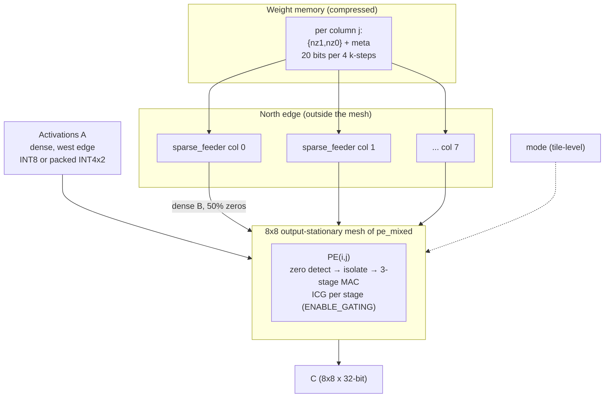
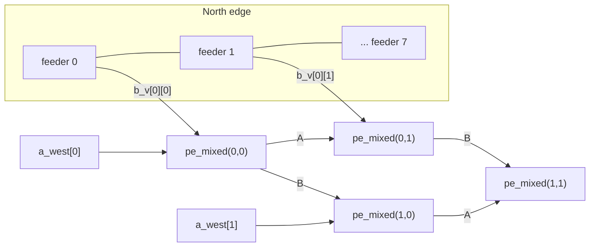

# Module 8 — `systolic_array_sparse`: The Full Design (Mixed Precision + 2:4 Sparsity + Clock Gating)

| Item | Value |
|---|---|
| RTL file | [src/systolic_array_sparse.sv](../src/systolic_array_sparse.sv) |
| Contains | 8 × `sparse_feeder` (each with a `sparsity_decoder`) + 64 × `pe_mixed` (each with 3 × `icg_cell` when gated) |
| Golden model | `prune_matrix_2of4()`, `gemm_golden()`, `gemm_golden_int4x2()`, `make_sparse_matrix()` in [golden/golden_model.py](../golden/golden_model.py) |
| Testbench | [tb/test_array_sparse.py](../tb/test_array_sparse.py) |
| Power flow | [synth/fpga/power_sweep.sh](../synth/fpga/power_sweep.sh), [tb/power.do](../tb/power.do) |
| Synthesis configs | `sparse_nogate` (`ENABLE_GATING=0`) and `full` (`ENABLE_GATING=1`) |
| Role in the project | **The complete accelerator.** All three contributions working together, and the design point that every final result is measured on. |

---

## 1. What this module is

This is the top level of my accelerator. It combines everything from the previous
seven modules:

| Contribution | Module(s) | What it adds here |
|---|---|---|
| 1. Precision-adaptive PE | `pe_mixed` (Module 3) | INT8 or INT4×2 on every PE, selected by `mode` |
| 2. 2:4 structured sparsity | `sparsity_decoder`, `sparse_feeder` (Modules 5, 6) | Weights arrive **compressed** at the north edge |
| 3. Zero-aware clock gating | `pe_mixed` gating logic + `icg_cell` (Modules 3, 7) | Zero weights (and zero activations) switch off the MAC pipeline |

The mesh is still the same output-stationary 8×8 grid from Module 2. The only
structural change is **at the north edge**: instead of dense weights going
straight into each column, each column now has a feeder that expands compressed
2:4 groups into a dense stream with explicit zeros.

---

## 2. Theory: how the three contributions work together

### 2.1 The full data path



### 2.2 Where each saving comes from

| Saving | Mechanism | Where | Depends on |
|---|---|---|---|
| **Throughput ×2** (up to) | Two INT4 MACs per byte | Every PE | `mode = 1` |
| **Weight bandwidth −37.5 %** | 2:4 compressed storage, expanded at the edge | Feeders | 2:4-pruned weights |
| **MAC switching power** | Zero operand → inputs isolated → no toggling in multipliers or adders | Every PE | Zero weights (≥ 50 % by 2:4) **and** zero activations (ReLU) |
| **Clock power** (ASIC only) | Zero operand → ICG stops the clock to the MAC registers | Every PE | Same as above |

The contributions **multiply** rather than compete. INT4×2 doubles the useful
work per cycle, and in the remaining cycles, every zero (from 2:4 weights or from
sparse activations) costs almost no dynamic power.

### 2.3 Why sparsity does not speed up this array

The feeder does **not** compress the schedule. A group of 4 k-steps still takes 4
cycles, and 2 of them carry zero weights. Those cycles are **gated**, not
**skipped**. This keeps the 1-byte-per-hop systolic mesh unchanged, but it means
2:4 sparsity gives **bandwidth and power** benefits, not speed. All the throughput
gain in my design comes from INT4×2 packing. Skipping zero cycles (as GPU sparse
tensor cores do) would need a scheduler that collapses the zero steps differently
in every column. That is outside my scope (Module 5, Section 2.6).

### 2.4 Weight sparsity and activation sparsity

The PE's zero detector looks at **both** operands: `(a_in == 0) || (b_in == 0)`.
So two independent kinds of zeros are exploited:

- **Weight zeros:** guaranteed **≥ 50 %** by the 2:4 structure, and inserted by the
  feeders.
- **Activation zeros:** produced naturally by ReLU layers (often 40–70 % in CNNs),
  and arriving on the west edge.

A MAC is skipped if **either** operand is zero. With independent sparsities $s_w$
and $s_a$, the expected fraction of gated MAC cycles is:

$$
P(\text{gated}) = 1 - (1 - s_w)(1 - s_a)
$$

| Activation sparsity $s_a$ | Weight sparsity $s_w$ (2:4) | Expected gated MACs |
|---|---|---|
| 0 % | 50 % | 50 % |
| 25 % | 50 % | 62.5 % |
| 50 % | 50 % | 75 % |
| 75 % | 50 % | 87.5 % |

This is exactly the sweep I run for power characterization (Section 9.2).

---

## 3. Interface

### 3.1 Parameters

| Parameter | Default | Meaning |
|---|---|---|
| `N` | 8 | Array size. |
| `DATA_WIDTH` | 8 | Operand width. |
| `ACC_WIDTH` | 32 | Accumulator width. |
| `ENABLE_GATING` | 1 | Passed to every `pe_mixed`. 0 = `sparse_nogate` config, 1 = `full` config. |

### 3.2 Ports

| Port | Dir | Width (N = 8) | Description |
|---|---|---|---|
| `clk`, `rst` | in | 1 | Clock, synchronous reset. |
| `mode` | in | 1 | 0 = INT8, 1 = INT4×2 (per tile). |
| `acc_clear` | in | 1 | Start a new tile. |
| `a_west` | in | 64 | Dense activations, one byte per row (row-skewed by the driver). |
| `valid_west` | in | 8 | Activation valid per row. |
| `grp_nz` | in | 8 × 16 = 128 | Compressed survivors per column: column $j$ = `grp_nz[j*16 +: 16]`. |
| `grp_meta` | in | 8 × 4 = 32 | Metadata per column: column $j$ = `grp_meta[j*4 +: 4]`. |
| `feed_en` | in | 8 | Per-column feeder enable (column-skewed by the driver). |
| `grp_advance` | out | 8 | Per-column "group consumed" strobe. |
| `meta_legal` | out | 8 | Per-column metadata check. |
| `c_out` | out | 2,048 | Results, same layout as every other array. |
| `valid_east` | out | 8 | As before. |

Compared with the mixed array, `b_north` (64 dense bits) is replaced by
`grp_nz` + `grp_meta` + `feed_en` (128 + 32 + 8 bits). The **port** is wider
because it holds a whole group, but each group stays on the port for 4 cycles. So
the **average data rate** is 20 bits per 4 cycles per column, against 8 bits per
cycle for dense.

---

## 4. Microarchitecture

### 4.1 Block structure



### 4.2 The four synthesis configurations

I designed the RTL so that **all four** configurations of my evaluation can be
built without editing any file. Each one adds exactly **one** feature to the one
before it, so every difference between neighbouring rows is a single-variable
comparison:

| Config | Top module | Parameters | Adds |
|---|---|---|---|
| `baseline` | `systolic_array` | — | Dense INT8 reference (DSP-based) |
| `mixed` | `systolic_array_mixed` | — | INT8 / INT4×2 PE |
| `sparse_nogate` | `systolic_array_sparse` | `ENABLE_GATING=0` | 2:4 feeders (bandwidth) |
| `full` | `systolic_array_sparse` | `ENABLE_GATING=1` | Zero detection, isolation, clock gating |

| Comparison | Isolates the effect of |
|---|---|
| `mixed` − `baseline` | Precision adaptivity (area: use ASIC; see Module 3) |
| `sparse_nogate` − `mixed` | The 8 feeders |
| `full` − `sparse_nogate` | Zero-aware gating, **at matched stimulus** |

---

## 5. RTL implementation walkthrough

### 5.1 Expanded-weight wires — [systolic_array_sparse.sv L79](../src/systolic_array_sparse.sv#L79)

```systemverilog
logic [DATA_WIDTH-1:0] b_dense [N];
```

One dense weight per column per cycle, coming out of the feeders. The mesh link
arrays (`a_h`, `b_v`, `v_h`) below this line are identical to Module 2.

### 5.2 One feeder per column — [systolic_array_sparse.sv L91-L110](../src/systolic_array_sparse.sv#L91-L110)

```systemverilog
for (j = 0; j < N; j++) begin : g_feed
    logic unused_nonzero;

    sparse_feeder #(.DATA_WIDTH(DATA_WIDTH)) u_feeder (
        .clk         (clk),
        .rst         (rst),
        .en          (feed_en[j]),
        .grp_nz      (grp_nz[j*2*DATA_WIDTH +: 2*DATA_WIDTH]),
        .grp_meta    (grp_meta[j*4 +: 4]),
        .k_data      (b_dense[j]),
        .k_nonzero   (unused_nonzero),
        .grp_advance (grp_advance[j]),
        .meta_legal  (meta_legal[j])
    );

    assign b_v[0][j] = b_dense[j];
end
```

- Each column slices its own 16-bit survivor pair and 4-bit metadata out of the
  flat input buses, using the same `[j*W +: W]` pattern as everywhere else.
- `assign b_v[0][j] = b_dense[j]` is the **only** place where this array differs
  from the mixed array inside the mesh: the top of column $j$ is driven by a
  feeder instead of directly by `b_north`.
- `k_nonzero` is connected to a local dummy wire. The PE does its own zero
  detection on the byte value, so this signal is not needed, and synthesis removes
  its register.

### 5.3 The mesh with the gating parameter — [systolic_array_sparse.sv L115-L139](../src/systolic_array_sparse.sv#L115-L139)

```systemverilog
pe_mixed #(
    .DATA_WIDTH    (DATA_WIDTH),
    .ACC_WIDTH     (ACC_WIDTH),
    .ENABLE_GATING (ENABLE_GATING)
) u_pe ( ... same connections as systolic_array_mixed ... );
```

The only difference from Module 4 is that `ENABLE_GATING` is passed down. This one
parameter switches all 64 PEs between the `sparse_nogate` and `full` configurations.

---

## 6. Timing behaviour

### 6.1 The full skew contract

From Module 6, the feeder output register delays weights by one cycle, so the
driver delays activations by one cycle too:

| Signal | Injected at cycle | Reaches PE$(i,j)$ at cycle |
|---|---|---|
| $A[i][k]$ on `a_west[i]` | $i + k + 1$ | $i + j + k + 1$ |
| Group $\lfloor k/4 \rfloor$ of column $j$ on `grp_nz/meta`, `feed_en[j] = 1` | $j + k$ | — |
| Dense $B[k][j]$ out of feeder $j$ | — (visible $j + k + 1$) | $i + j + k + 1$ |

Both operands meet at **$i + j + k + 1$**: the original contract, shifted by one
cycle everywhere.

### 6.2 Latency and stream length

| Quantity | Baseline | Mixed | **Sparse / full** |
|---|---|---|---|
| Stream cycles (inputs busy) | $N + K - 1$ | $N + K - 1$ | $N + K$ |
| Tile latency (last result final) | $2N + K - 1$ | $2N + K$ | $2N + K + 1$ |
| N = K = 8 | 23 | 24 | **25** |

Each extra cycle comes from a pipeline register added for timing closure: +1 for
the 3-stage PE, +1 for the feeder output. Both are paid once per tile, not once
per MAC.

### 6.3 What the driver does (from `stream_sparse()`)

For each cycle $t$:

- **Rows:** if $0 \le t - i - 1 < K$, drive $A[i][t-i-1]$ on row $i$ and set
  `valid_west[i]`.
- **Columns:** if $0 \le t - j < K$, drive group `compressed[(t-j)//4][j]` and set
  `feed_en[j]`. The same group stays on the port for 4 consecutive cycles
  automatically, because $(t-j)//4$ only changes every 4 cycles.
- After each clock edge, check that `meta_legal` is 1 on every **active** column.

---

## 7. Design decisions and trade-offs

| Decision | Alternative I rejected | Reason |
|---|---|---|
| Feeders at the boundary, mesh unchanged | Sparse decode inside each PE | 8 decoders instead of 64; mesh and skew contract stay the same. |
| Gate, not skip, the zero steps | Compress the schedule (2× faster) | Skipping would need different per-column schedules and a load-balancing controller; out of scope. |
| `ENABLE_GATING` as one top-level parameter | Separate RTL files for gated and ungated | Guarantees `sparse_nogate` and `full` differ **only** in gating. |
| Separate tops for `baseline` and `mixed` | One top with many parameters | The reference designs can never be changed by accident. |
| Zero detection in the PE (byte value) | Use the feeder's `k_nonzero` flag | Also catches **activation** zeros from the west edge, at no extra cost. |
| Delay A by 1 to match the feeder register | Advance `feed_en` | Causal driver; no data needed before cycle 0. |

### 7.1 Known issues and limitations

1. **Stale header comment.** The RTL header says the driver should assert
   `feed_en[j]` from cycle $j-1$. The tested driver instead keeps `feed_en[j]` at
   cycle $j$ and delays activations by one cycle (6.1). Both are valid, but the
   comment should be updated to describe what is actually verified.
2. **`meta_legal` on idle columns.** An idle column shows `meta = 0`, which is
   flagged as illegal. The testbench masks this with `feed_en`. In a real system,
   the hardware should report `meta_legal | ~en`, so that only active columns can
   raise an error.
3. **`grp_advance` timing** is one cycle late as a source request (Module 6,
   Section 7.3).
4. **No tile overlap.** It inherits the global `acc_clear` limitation of Module 2.
5. **FPGA gating is operand isolation + CE, not ICG** (Module 7, Section 7.2).

---

## 8. Verification

### 8.1 Reference model

The array computes $A \times B_{pruned}$, **not** $A \times B$. Pruning is a property
of the weights, so the testbench:

1. generates random dense $B$,
2. calls `prune_matrix_2of4(B)` to get both $B_{pruned}$ (the dense matrix with
   2:4 zeros) and the compressed `(nz_word, meta)` stream,
3. drives the compressed stream into the hardware, and
4. compares $C$ with `gemm_golden(A, B_pruned)` (or `gemm_golden_int4x2`).

If any group were decoded wrongly, placed in the wrong slot, or paired with the
wrong activation, $C$ would differ from the reference.

### 8.2 Tests

| Test | What it checks |
|---|---|
| `test_sparse_int8_random` | 20 random INT8 problems, compressed weights vs `gemm_golden(A, B_pruned)` |
| `test_sparse_int4x2_random` | 20 random packed INT4×2 problems: sparsity + mixed precision together |
| `test_pruned_weights_are_half_zero` | Sanity check of the test data itself: every group of 4 has ≤ 2 non-zeros |
| `test_zero_weight_group_gates_cleanly` | All-zero weights → every MAC gated → C must be exactly 0 (no stale or X values) |
| `test_back_to_back_sparse_tiles` | 6 tiles in a row: feeder `phase` and accumulators re-align every time |
| `test_power_stimulus` | Long run (16 tiles) at a set activation sparsity (`TB_SPARSITY`), every tile checked; used to produce SAIF activity |
| Live `meta_legal` check | Every cycle, every active column carries legal metadata |

### 8.3 Gating equivalence

The most important property of Contribution 3 is that **gating never changes a
result**. I run the **same** test file twice:

```
make TEST=array_sparse GATING=0
make TEST=array_sparse GATING=1
```

Both must pass against the **same** golden values. In RTL simulation, `GATING=1`
uses the real latch-based ICG (Module 7), so this proves functional transparency
with genuinely stopped clocks.

---

## 9. Implementation results

### 9.1 FPGA: all four configurations (Kintex-7 `xc7k70tfbv676-1`, OOC, uniform 50 % toggle)

| Config | LUTs | FFs | DSPs | Clock | WNS | Fmax | Dynamic power* |
|---|---|---|---|---|---|---|---|
| `baseline` | 2 | 344 | 64 | 4.00 ns | +2.024 ns | ≈ 506 MHz | 0.139 W |
| `mixed` | 9,549 | 6,716 | 0 | 4.00 ns | +0.064 ns | ≈ 254 MHz | 0.520 W |
| `sparse_nogate` | 9,910 | 6,812 | 0 | 4.00 ns | +0.120 ns | ≈ 258 MHz | 0.575 W |
| `full` | 11,311 | 6,932 | 0 | 4.05 ns | +0.040 ns | ≈ 249 MHz | 0.546 W |

\* Vectorless placeholder (uniform 50 % toggle). Use it for structure only; the
real power numbers are in 9.2.

All four configurations meet (or, for `full`, essentially meet) the 250 MHz
target. Fmax ≈ 1 / (T − WNS).

### 9.2 FPGA power vs. sparsity — SAIF-annotated (`power_sweep.sh`)

These numbers use **real switching activity** from `test_power_stimulus`, with
2:4 sparse weights in every run and activation sparsity swept from 0 to 75 %.
Report files are in [synth/fpga/reports/power_sweep/](../synth/fpga/reports/power_sweep).

| Activation sparsity | Expected gated MACs | `sparse_nogate` dynamic | `full` dynamic | Reduction |
|---|---|---|---|---|
| 0 % | 50 % | 0.193 W | 0.150 W | **−22.3 %** |
| 25 % | 62.5 % | 0.182 W | 0.145 W | **−20.3 %** |
| 50 % | 75 % | 0.168 W | 0.136 W | **−19.0 %** |
| 75 % | 87.5 % | 0.151 W | 0.120 W | **−20.5 %** |

Breakdown of the dynamic power (W):

| Sparsity | Config | Clocks | Slice logic | Signals | Logic + signals |
|---|---|---|---|---|---|
| 0 % | `sparse_nogate` | 0.086 | 0.056 | 0.051 | 0.107 |
| 0 % | `full` | 0.085 | 0.037 | 0.029 | 0.066 (**−38 %**) |
| 75 % | `sparse_nogate` | 0.086 | 0.035 | 0.029 | 0.064 |
| 75 % | `full` | 0.085 | 0.020 | 0.015 | 0.035 (**−45 %**) |

**How I read these results:**

1. **Gating saves about 20 % of total dynamic power at every sparsity point**,
   and **38–45 % of the datapath (logic + signal) power**. That is the effect of
   operand isolation: zero operands stop the multiplier trees from toggling.
2. **Clock power does not change** (0.085–0.086 W in every run). This is exactly
   what I expect on the FPGA: with `ICG_NO_GATING`, no clock is actually stopped
   (Module 7). The clock component is the part that **true ICG on the ASIC** would
   additionally reduce, so the FPGA number is a **lower bound** on the benefit of
   Contribution 3.
3. **Both configurations use less power as activation sparsity rises**, because
   zeros toggle fewer wires even without gating. The **percentage** reduction
   stays at about 20 % because both the reference and the gated design benefit
   from the extra zeros.
4. **Even at 0 % activation sparsity, gating saves 22 %**: this comes entirely
   from the 2:4 weight zeros inserted by the feeders. It is the direct evidence
   that Contributions 2 and 3 work together.

**Important caveats** (to state in the report):

- **Low SAIF match rate.** Vivado matched only **11–12 %** of design nets to the
  SAIF file ("Design Nets Matched 3284/29032"), and the confidence level is
  *Medium*. The rest is estimated by vectorless propagation from the matched nets.
  The likely cause is that RTL signal names do not survive OOC synthesis with
  register retiming. A post-synthesis functional simulation (generating the SAIF
  on the netlist) would raise the match rate and the confidence. Until then, I
  treat the **trend and the relative reduction** as the result, not the exact
  wattage.
- The `full` configuration was closed at 4.05 ns in the vectorless sweep. The
  clock period used in the SAIF sweep should be stated explicitly when quoting
  these numbers (`CLK_NS` in `power_sweep.sh`, default 4.0 ns).

### 9.3 ASIC

At PE level (FreePDK45): gating adds **+8.3 %** area (latches excluded). The true
clock-gating power from the ASIC flow is still pending (Module 7, Section 9.2).

---

## 10. Report-ready summary

> The full accelerator integrates all three contributions into one 8×8
> output-stationary systolic array. The 64 PEs are precision-adaptive
> `pe_mixed` instances, selectable per tile between INT8 and packed INT4×2.
> Weights enter the north edge in 2:4-compressed form and are expanded by eight
> per-column sparse feeders into dense streams with explicit zeros, which cuts
> average weight bandwidth by 37.5 % while leaving the systolic mesh unchanged. A
> single `ENABLE_GATING` parameter enables per-PE zero detection, operand
> isolation and per-stage clock gating. Every zero operand, whether a pruned
> weight or a zero activation, therefore suppresses the MAC datapath's switching
> activity. The design exposes four synthesis configurations (baseline, mixed,
> sparse without gating, full), each adding exactly one feature, so every
> reported delta is a single-variable comparison. To compensate the feeder output
> register, activations are injected one cycle later, so operands meet at
> PE(i,j) in cycle i + j + k + 1, and an 8×8×8 tile completes in 25 cycles. I
> verified the design against $A \times B_{pruned}$ in both precision modes, with
> identical results for gating on and off. With SAIF-annotated activity on a
> Kintex-7, enabling the zero-aware gating reduced total dynamic power by
> 19–22 % and datapath power by 38–45 % across activation sparsities of 0–75 %,
> with 2:4 weight sparsity throughout. Clock-network power is unchanged on the
> FPGA, where per-PE gated clocks cannot be implemented, so this is a lower bound
> on the saving that true ICG gating provides in the ASIC flow.

---

## 11. References

1. A. Mishra et al., "Accelerating Sparse Deep Neural Networks," arXiv:2104.08378, 2021.
2. Y.-H. Chen, T. Krishna, J. Emer and V. Sze, "Eyeriss: An Energy-Efficient Reconfigurable Accelerator for Deep Convolutional Neural Networks," *IEEE JSSC*, 2017 (zero gating on sparse activations).
3. N. P. Jouppi et al., "In-Datacenter Performance Analysis of a Tensor Processing Unit," *Proc. ISCA*, 2017.
4. H. Sharma et al., "Bit Fusion," *Proc. ISCA*, 2018.
5. AMD/Xilinx, *Vivado Design Suite User Guide: Power Analysis and Optimization*, UG907 (SAIF annotation, confidence levels).

---

### Figures to export for the Word report

| Figure | Source | Suggested caption |
|---|---|---|
| Fig. 8.1 | Section 2.1 Mermaid block | Complete data path of the mixed-precision, sparsity-aware systolic array |
| Fig. 8.2 | Section 4.1 Mermaid block | North-edge feeders attached to the mesh |
| Fig. 8.3 | Section 9.2 table: plot dynamic power vs activation sparsity, two lines (`sparse_nogate`, `full`) | Dynamic power vs. activation sparsity with and without zero-aware gating |
| Fig. 8.4 | Section 9.2 breakdown: stacked bars (clocks / logic / signals) per config at 0 % and 75 % | Dynamic power breakdown: gating removes datapath power, not clock power, on FPGA |
| Table 8.x | Section 4.2 tables | The four evaluation configurations and the comparison each one isolates |
| Table 8.y | Section 9.1 table | FPGA implementation results of all four configurations |

**Tip:** Fig. 8.3 is your headline result figure. Make it a native Excel line
chart or a matplotlib SVG, with clear axis labels ("Activation sparsity (%)",
"Dynamic power (W)") and the percentage reduction written above each pair of
points.
