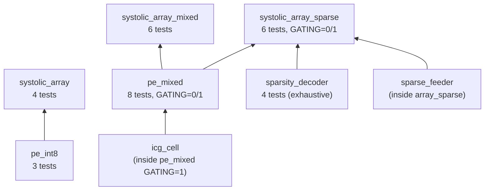
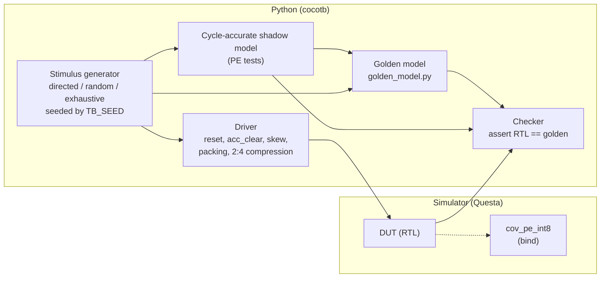
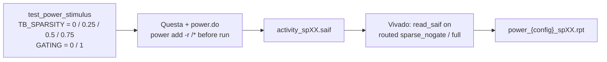

# Verification — Strategy, Environment and Results

| Item | Value |
|---|---|
| Testbenches | [tb/](../tb) (cocotb, Python) |
| Golden model | [golden/golden_model.py](../golden/golden_model.py) (pure Python, bit-accurate) |
| Simulator | Siemens Questa 2021.2 (Makefile also supports ModelSim, Icarus, Verilator, VCS, Xcelium) |
| Build / run | [tb/Makefile](../tb/Makefile): `make TEST=<name> [GATING=0/1] [WAVES=1] [COVERAGE=1] [POWER=1]` |
| Functional coverage | [tb/cov_pe_int8.sv](../tb/cov_pe_int8.sv) (SystemVerilog covergroup, bound to `pe_int8`) |
| Waveform / power scripts | [tb/wave.do](../tb/wave.do), [tb/power.do](../tb/power.do) |
| Status | **All 31 tests pass**, in both `GATING=0` and `GATING=1` where applicable |

---

## 1. What I needed to prove

My design makes three claims. Each one needs a different kind of evidence:

| Claim | What verification must show |
|---|---|
| The arithmetic is correct | Every PE computes the exact signed INT8 / INT4×2 dot product, for **every** possible operand. |
| The systolic timing is correct | Every operand pair meets at the right PE in the right cycle, so the whole matrix product is exact. |
| The power features are **transparent** | Sparsity expansion and clock gating change **only** switching activity, never a single result bit. |

The third claim is the subtle one. A power-saving feature that silently changes a
result is worse than useless. So my strategy is built around **one rule**: the
same tests, with the same expected values, must pass with every feature on and
off.

---

## 2. Verification strategy

### 2.1 Layered, bottom-up

I verified each block on its own before integrating it. When an array-level test
fails, I then already know that the PE inside it is correct, and the bug must be
in the wiring or the timing.



| Level | DUT | Focus |
|---|---|---|
| Unit | `pe_int8`, `pe_mixed`, `sparsity_decoder` | Arithmetic, pipeline timing, corner values, exhaustive spaces |
| Integration | `systolic_array`, `systolic_array_mixed` | Skew contract, data movement, tile isolation |
| System | `systolic_array_sparse` | All three contributions together, gating equivalence, power stimulus |

`icg_cell` and `sparse_feeder` are verified **in context**. The ICG's job is to
be invisible inside the PE, and the feeder's job is to pair weights with
activations in the array. Neither can be judged meaningfully on its own.

### 2.2 Why cocotb (Python) instead of a SystemVerilog/UVM testbench

| Reason | Benefit for this project |
|---|---|
| The golden model is in Python | The testbench calls the **same** functions I use to explain the maths (no second reference to keep in sync). |
| Matrix work is natural in Python | Building, pruning, packing and skewing matrices takes a few lines instead of pages of SV. |
| Simulator-independent | The same tests run on Questa, Icarus, Verilator, etc. via one Makefile. |
| Reproducible randomness | Every random test is seeded from `TB_SEED`, so a failing case can be replayed exactly. |

UVM would add a lot of structure (agents, sequences, scoreboards) that a
datapath of this size does not need. Where SystemVerilog is clearly better, for
**functional coverage** with covergroups, I use SystemVerilog, **bound** into the
design (Section 6).

### 2.3 The verification architecture



Every test is **self-checking**. There is no "look at the waveform and decide"
step. A test passes only if every compared value matches.

---

## 3. The golden model

[golden/golden_model.py](../golden/golden_model.py) is a pure-Python,
bit-accurate description of what the hardware **should** compute. It is written
in the most obvious way possible (plain loops and plain multiplication), so that
it is easy to trust. It is **not** a copy of the RTL's structure. For example,
it does not use the 4-sub-product decomposition of `pe_mixed`, so it can catch
mistakes in that decomposition.

| Function | Models | Used by |
|---|---|---|
| `to_signed(v, w)` | Two's-complement interpretation + wrap-around | Everything |
| `pe_golden_int8(a, b, acc)` | One INT8 MAC step | `test_pe_int8`, `test_pe_mixed` |
| `pe_golden_int4x2(a, b, acc)` | One INT4×2 step (two lanes) | `test_pe_mixed` |
| `pack_int4x2`, `unpack_int4x2` | Lane packing contract | Mixed tests |
| `gemm_golden(A, B)` | Signed INT8 GEMM with 32-bit wrap | All array tests |
| `gemm_golden_int4x2(A, B)` | GEMM on packed INT4×2 bytes | Mixed and sparse array tests |
| `prune_group_2of4`, `prune_matrix_2of4` | 2:4 magnitude pruning + compression | Sparse tests |
| `expand_group_2of4(nz0, nz1, meta)` | Decoder behaviour, including illegal metadata | `test_sparsity_decoder` |
| `make_sparse_matrix(rng, r, c, s)` | Random matrix with sparsity `s` | Power stimulus |

**Wrap-around everywhere.** Every addition is wrapped to 32 bits with
`to_signed()`, exactly like the hardware accumulator. So even an overflow would be
modelled correctly (overflow cannot actually happen for my test sizes; see
Module 1, Section 2.4).

---

## 4. Techniques I used

### 4.1 Cycle-accurate shadow models (PE level)

A golden **function** knows what the answer is, but not **when** the hardware
should show it. For the PEs, the testbench contains a small Python class
(`PEModel`, `PEMixedModel`) that copies the RTL's pipeline registers. It advances
one step per clock edge and calls the golden functions for the arithmetic. After
**every** clock edge, the testbench compares the RTL with the model on **all**
outputs (`acc_result`, `a_out`, `b_out`, `valid_out`). So a pipeline-timing bug is
caught on the exact cycle it happens, not only at the end of a long sequence.

### 4.2 End-of-tile checking (array level)

At array level the important thing is the final matrix. The testbench streams a
whole tile with the skew, drains the pipeline (with more margin than the
$2N + K + 1$ cycles the maths requires), and then compares **all 64** results
with the golden matrix. On a mismatch it reports the first 5 wrong elements with
their $(i, j)$. A timing bug produces a recognisable **pattern** (a wrong row, a
wrong column, or a diagonal shift), which makes debugging fast.

### 4.3 Directed, random and exhaustive stimulus

| Type | Purpose | Example |
|---|---|---|
| Directed corners | Hit the values most likely to break signed arithmetic | {0, ±1, +127, −128} in every combination |
| Directed structural | Expose dataflow bugs with an obvious expected result | $A \times I = A$ (identity) |
| Constrained random | Broad coverage of normal operation | 50 random 8×8 matrix pairs per mode |
| Exhaustive | **Prove** correctness over a whole input space | All 65,536 operand pairs per mode; all 16 metadata codes |
| Random control | Stress control logic | Random `valid`, `acc_clear` and `mode` every cycle |

Where the input space is small enough, I test it **exhaustively**. That turns
"no bug found" into "no bug possible" for that space:

| Space | Size | Covered by |
|---|---|---|
| INT8 operand pairs | 256 × 256 = 65,536 | `test_int8_exhaustive` |
| INT4×2 lane combinations | 16⁴ = 65,536 | `test_int4x2_exhaustive` |
| 2:4 metadata encodings | 16 (12 legal + 4 illegal) | `test_metadata_exhaustive` |

### 4.4 Feature-transparency testing (on/off equivalence)

| Feature | How I prove it changes nothing functionally |
|---|---|
| Clock gating | Same tests with `GATING=0` and `GATING=1`; same expected values. RTL simulation uses the **real** latch ICG. |
| INT4×2 | Same logical problem in INT8 and INT4×2 modes; **identical** result matrix (`test_throughput_int4x2_vs_int8`). |
| 2:4 compression | Compressed stream into hardware vs. dense pruned matrix into the golden model; identical result. |
| INT8 mode of `pe_mixed` | Must reproduce `pe_int8` / `gemm_golden` exactly (same tests as the baseline). |

### 4.5 Reproducibility

| Variable | Meaning | Default |
|---|---|---|
| `TB_SEED` | Random seed | 1 |
| `TB_N` | Array size | 8 |
| `TB_K` | Dot-product depth (sparse array, multiple of 4) | 8 |
| `TB_MATRICES` | Random matrices per test | 50 (20 for sparse) |
| `TB_EXHAUSTIVE` | Run the 65,536-pair sweeps | 1 |
| `TB_SPARSITY`, `TB_POWER_TILES` | Power stimulus settings | 0.5, 16 |

Any failure can be reproduced exactly by rerunning with the same variables.

---

## 5. Test inventory and results

### 5.1 `pe_int8` — `make TEST=pe`

| Test | Checks | Result |
|---|---|---|
| `test_pe_directed_corners` | 25 corner pairs × 4 accumulations | PASS |
| `test_pe_random_mac` | 100 random MACs | PASS |
| `test_pe_valid_gating_and_clear` | 200 cycles, random valid (60 %) / clear (5 %) | PASS |

### 5.2 `systolic_array` — `make TEST=array`

| Test | Checks | Result |
|---|---|---|
| `test_gemm_identity` | $A \times I = A$ | PASS |
| `test_gemm_corners` | All +127, all −128, zeros, checkerboard | PASS |
| `test_gemm_random` | 50 random matrix pairs (3,200 results) | PASS |
| `test_back_to_back_tiles` | 5 tiles, `acc_clear` isolation | PASS |

### 5.3 `pe_mixed` — `make TEST=pe_mixed GATING=0` and `GATING=1`

| Test | Checks | Result (×2) |
|---|---|---|
| `test_int8_corners` | 25 corner pairs | PASS |
| `test_int8_exhaustive` | 65,536 pairs | PASS |
| `test_int8_random_accumulate` | 500 random MACs | PASS |
| `test_int4x2_corners` | 625 lane combinations | PASS |
| `test_int4x2_exhaustive` | 65,536 lane combinations | PASS |
| `test_int4x2_lane_independence` | 200 single-lane cases (no bleed) | PASS |
| `test_mode_transition_with_clear` | 40 alternating-precision tiles | PASS |
| `test_mode_change_does_not_corrupt_inflight` | 300 cycles of random mode/valid/clear | PASS |

### 5.4 `systolic_array_mixed` — `make TEST=array_mixed`

| Test | Checks | Result |
|---|---|---|
| `test_int8_identity` | $A \times I = A$ in INT8 mode | PASS |
| `test_int8_random` | 50 random INT8 pairs | PASS |
| `test_int4x2_corners` | 4 extreme lane patterns | PASS |
| `test_int4x2_random` | 50 random packed pairs | PASS |
| `test_alternating_mode_tiles` | 10 tiles alternating INT8/INT4×2 | PASS |
| `test_throughput_int4x2_vs_int8` | Same logical problem, identical C, speed-up 1.53× (> 1.5) | PASS |

### 5.5 `sparsity_decoder` — `make TEST=decoder`

| Test | Checks | Result |
|---|---|---|
| `test_metadata_exhaustive` | 16 encodings × 49 value pairs = 784 vectors | PASS |
| `test_legal_2of4_placement` | 12 legal index pairs × 20 | PASS |
| `test_illegal_metadata_flagged` | 4 colliding encodings | PASS |
| `test_sparsity_rate_is_exactly_two_of_four` | 500 random legal groups | PASS |

### 5.6 `systolic_array_sparse` — `make TEST=array_sparse GATING=0` and `GATING=1`

| Test | Checks | Result (×2) |
|---|---|---|
| `test_sparse_int8_random` | 20 compressed INT8 problems vs $A \times B_{pruned}$ | PASS |
| `test_sparse_int4x2_random` | 20 compressed INT4×2 problems | PASS |
| `test_pruned_weights_are_half_zero` | Test-data sanity: ≤ 2 non-zeros per group | PASS |
| `test_zero_weight_group_gates_cleanly` | All-zero weights → C = 0 exactly | PASS |
| `test_back_to_back_sparse_tiles` | 6 tiles, feeder phase re-alignment | PASS |
| `test_power_stimulus` | 16 tiles at `TB_SPARSITY`, every tile checked | PASS |

### 5.7 Summary

| DUT | Tests | Runs (incl. GATING 0/1) | Status |
|---|---|---|---|
| `pe_int8` | 3 | 3 | PASS |
| `systolic_array` | 4 | 4 | PASS |
| `pe_mixed` | 8 | 16 | PASS |
| `systolic_array_mixed` | 6 | 6 | PASS |
| `sparsity_decoder` | 4 | 4 | PASS |
| `systolic_array_sparse` | 6 | 12 | PASS |
| **Total** | **31** | **45** | **All PASS** |

---

## 6. Functional coverage

### 6.1 Approach

Passing tests only tell me that the cases I tried work. Coverage tells me
**which cases I actually tried**. I wrote a SystemVerilog covergroup,
[tb/cov_pe_int8.sv](../tb/cov_pe_int8.sv), and attached it to the PE with
`bind`:

```systemverilog
bind pe_int8 cov_pe_int8 #(.DATA_WIDTH(DATA_WIDTH), .ACC_WIDTH(ACC_WIDTH)) u_cov (.*);
```

`bind` inserts the coverage module into **every** `pe_int8` instance (including
all 64 inside the array) **without editing the RTL**. The design files stay
synthesis-clean.

### 6.2 Coverage model

| Coverpoint | Bins | Why it matters |
|---|---|---|
| `cp_a`, `cp_b` | 0, +1, −1, +127, −128, 3 positive ranges, 3 negative ranges | Sign handling and INT8 extremes |
| `x_operands` | `cp_a` × `cp_b` cross (121 bins) | Every sign/extreme combination, e.g. −128 × −128 |
| `cp_zero_operand` | busy / gated | Zero operands are the **clock-gating trigger**; covered from Month 1 to de-risk Contribution 3 |
| `cp_valid`, `cp_valid_tr` | idle/active; start, stop, hold | Valid-pipeline behaviour |
| `cp_clear`, `cp_clear_tr` | run/clear; 0→1→0 pulse | Tile boundaries |
| `x_valid_clear` | valid × clear | `acc_clear` while streaming |
| `cp_acc` | negative, zero, positive, ≥ 100,000, ≤ −100,000 | Accumulator range and polarity |

Run with: `make SIM=questa TEST=pe COVERAGE=1` (or `TEST=array`). The result is
printed at the end of simulation as `[COVERAGE] ... cg_pe_int8 = xx.xx %`. The
plan target is **> 90 %**.

> *Fill in the measured coverage percentage here from your latest coverage run,
> together with the Questa code-coverage summary (`+cover=bcesxf`: branch,
> condition, expression, statement, FSM, toggle).*

### 6.3 Coverage gaps (honest note)

The covergroup is bound to `pe_int8` only. For `pe_mixed`, the exhaustive tests
cover the whole operand space in both modes by construction, so value coverage is
100 % by definition. The control-path behaviour (mode changes, gated cycles) is
covered by the directed and random control tests. A dedicated `cov_pe_mixed`
covergroup (mode × zero-operand × valid, mode transitions) would make this
measurable. I list it as future work.

---

## 7. Issues found by verification

Verification found real problems. Each one was fixed, and the fix was confirmed
by the same tests:

| # | Symptom | Root cause | Fix |
|---|---|---|---|
| 1 | Sparse array results wrong by a one-cycle shift between weights and activations | `sparse_feeder` output register (added for timing) delays the B path by 1 cycle, but A was injected without matching delay | Driver injects $A[i][k]$ at $i + k + 1$ (Module 6, Section 6.2) |
| 2 | Lane-independence and mode-transition tests read the result too early | `pe_mixed` gained a third pipeline stage for FPGA timing; tests still assumed the 2-stage latency | Added a second drain cycle; shadow model updated to 3 stages |
| 3 | `meta_legal` errors reported on columns that were not being fed | Idle columns present `meta = 0` (`idx0 = idx1 = 0`), which is correctly flagged illegal | Check masked with `feed_en`; hardware fix (`meta_legal \| ~en`) proposed (Module 8, Section 7.1) |
| 4 | Yosys `check -assert` reported `a_out`, `b_out`, `valid_out`, `acc_q` as "used but has no driver" in the `pe_mixed` netlist | Synthesis-tool artifact in the default ABC recipe on the larger netlist. The RTL was proven correctly driven by the cocotb tests | Stripped ABC recipe (`abcfix`); gate-level simulation target added to confirm the netlist |
| 5 | Power-tracking data missing from SAIF | `power add` issued after the run, on a reopened `.wlf` file | Separate `power.do` that enables tracking **before** `run -all` in the live session |

Issue 1 is a good example of why I document **both** "is there a one-cycle
offset?" questions separately (Module 6, Section 6.3). An earlier version of the
driver got this wrong in both directions at different times, and only the
end-to-end matrix check caught it.

---

## 8. Power-characterization stimulus

The same verification environment produces the **switching activity** for power
analysis. `test_power_stimulus` streams 16 sparse tiles at a chosen activation
sparsity and checks every tile against the golden model, so the activity comes
from a run that is **known to be functionally correct**.



The whole pipeline is automated by
[synth/fpga/power_sweep.sh](../synth/fpga/power_sweep.sh). The results are in
Module 8, Section 9.2.

---

## 9. Gate-level simulation

The Makefile has a gate-level target that runs the **same** `test_pe_mixed`
tests on the Yosys netlist:

```
make TEST=pe_mixed_gl GL_NETLIST=../synth/asic/reports/pe_mixed_gated_abcfix.v \
                      GL_LIB_V=<standard-cell Verilog models>
```

This confirms that synthesis (including the abcfix workaround and the ICG
latches) preserved the function. It is also the correct source of SAIF activity
for ASIC power with OpenSTA.

> *Add the gate-level result here once it has been run (it is listed as
> outstanding in the mid-term report).*

---

## 10. Report-ready summary

> I verified the design bottom-up with self-checking cocotb testbenches running
> on Questa, against an independent, bit-accurate Python golden model that
> computes each result directly rather than reproducing the RTL's structure. At
> PE level, cycle-accurate shadow models check every output after every clock
> edge. At array level, complete result matrices are compared against a
> reference GEMM, and mismatches are reported by position to expose skew
> errors. The stimulus combines directed corner cases, seeded constrained-random
> matrices, randomized control (valid, clear, mode), and exhaustive sweeps of
> every INT8 operand pair, every INT4×2 lane combination and every 2:4 metadata
> encoding. The power features are verified for functional transparency: the
> identical regression passes with clock gating disabled and with real
> latch-based clock gating enabled, the INT4×2 stream reproduces the INT8 result
> of the same logical problem bit for bit, and compressed 2:4 weights reproduce
> the dense pruned product exactly. All 31 tests (45 runs including both gating
> configurations) pass. A SystemVerilog covergroup, bound non-intrusively into
> every PE, measures operand, control and accumulator coverage. The same
> environment generates SAIF switching activity, from functionally checked runs,
> for the power-versus-sparsity characterization.

---

## 11. References

1. cocotb project, *cocotb Documentation*, https://docs.cocotb.org.
2. IEEE Std 1800-2017, *IEEE Standard for SystemVerilog* (covergroups, `bind`, `always_latch`).
3. J. Bergeron, *Writing Testbenches Using SystemVerilog*, Springer, 2006 (self-checking testbenches, layered verification).
4. C. Spear and G. Tumbush, *SystemVerilog for Verification*, 3rd ed., Springer, 2012 (functional coverage).
5. Siemens EDA, *Questa SIM User's Manual* (coverage, power-aware toggle/SAIF output).

---

### Figures to export for the Word report

| Figure | Source | Suggested caption |
|---|---|---|
| Fig. 9.1 | Section 2.1 Mermaid block | Bottom-up verification hierarchy |
| Fig. 9.2 | Section 2.3 Mermaid block | Verification architecture: cocotb driver, golden model and checker |
| Fig. 9.3 | Section 8 Mermaid block | Power-characterization flow from verified stimulus to annotated power |
| Table 9.x | Section 5.7 table | Regression summary |
| Table 9.y | Section 4.3 exhaustive table | Input spaces verified exhaustively |
| Table 9.z | Section 7 table | Issues found during verification |
